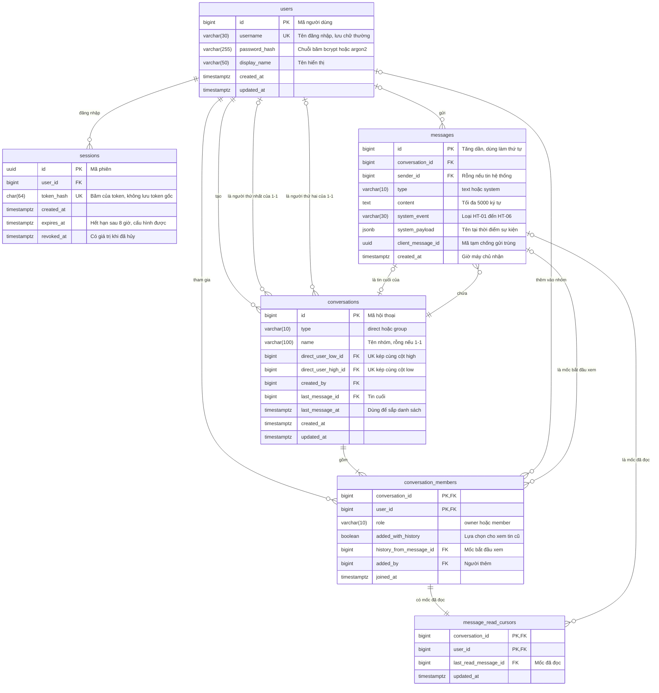

# 06 - Mô hình dữ liệu (ERD)

| Mục | Nội dung |
|---|---|
| Dự án | Ứng dụng chat nội bộ (MVP) – Nhóm: *[chưa xác định]* |
| Tệp | `docs/06-erd.md` |
| Phiên bản | 1.0 – Draft |
| Ngày | 2026-11-14 |
| Người soạn | Nhóm BA / Architect / QA (bản nháp có trợ lý AI hỗ trợ soạn thảo) |
| Trạng thái | Draft – chờ Product Owner và Architect xác nhận mục 9 (giả định) và mục 10 (câu hỏi mở) |
| Căn cứ | (1) PDF "Xây dựng ứng dụng chat nội bộ (MVP)", ngày 13~14/11/2026 – **nguồn duy nhất của yêu cầu nghiệp vụ**; (2) `docs/01-brd.md` v1.1, `docs/02-srs.md` v1.1, `docs/03-frs.md` v1.0, `docs/04-use-cases.md` v1.1, `docs/05-user-stories.md` v1.0 – **tất cả đang ở trạng thái Draft**; (3) `docs/08-high-level-design.md` **chưa có trên repository**, nên lựa chọn hệ quản trị CSDL ở tài liệu này là giả định (GE-01, OQ-23) |

**Quy ước ký hiệu**

| Ký hiệu | Ý nghĩa |
|---|---|
| `[PDF]` | Do đề bài quy định. Không được tự thay đổi. |
| `[QĐ-xx]` | Quyết định của Product Owner (QĐ-01…05 ở BRD, QĐ-06…10 ở SRS). |
| `[GĐ-xx]` / `[GS-xx]` / `[GF-xx]` / `[GU-xx]` | Giả định đã ghi ở BRD / SRS / FRS / Use case. |
| `[GE-xx]` | Giả định mới của tài liệu này (mục 9). |
| `[ĐX]` | Lựa chọn thiết kế do nhóm đề xuất, không phải yêu cầu đề bài. |
| `[OQ-xx]` | Câu hỏi mở. OQ-01…OQ-22 đã có ở các tài liệu trước; OQ-23 trở đi phát sinh ở tài liệu này (mục 10). |

> Tài liệu này **không chứa kết quả chạy thử hay số đo nào**. Các chỉ mục (index) được đề xuất để phục vụ ngưỡng "mở hội thoại 50 tin < 1,5 giây" của PDF §4; việc đạt ngưỡng hay không phải được đo thực tế và ghi ở `docs/12-test-reports.md`.

---

## 1. Giải thích nhanh cho người không làm IT

| Thuật ngữ | Giải thích dễ hiểu |
|---|---|
| Cơ sở dữ liệu (CSDL) | Nơi máy chủ lưu lâu dài tài khoản, hội thoại, tin nhắn. Dữ liệu ở đây **không mất** khi khởi động lại dịch vụ `[PDF §4]`. |
| Bảng | Giống một trang tính Excel: mỗi **dòng** là một bản ghi (một người dùng, một tin nhắn…), mỗi **cột** là một thông tin. |
| ERD | Sơ đồ cho biết có những bảng nào và chúng nối với nhau thế nào. |
| Khóa chính (PK) | Cột (hoặc cặp cột) giúp nhận ra **duy nhất** một dòng, như số CCCD của một người. |
| Khóa ngoại (FK) | Cột trỏ sang một dòng ở bảng khác, ví dụ tin nhắn trỏ tới hội thoại chứa nó. CSDL không cho trỏ tới dòng không tồn tại. |
| Ràng buộc duy nhất (UK) | Quy tắc "không được trùng", ví dụ hai người không thể có cùng tên đăng nhập. |
| Chỉ mục (index) | Giống mục lục cuối sách: giúp tìm nhanh mà không phải lật từng trang. |
| Giao dịch | Một nhóm thao tác ghi **cùng thành công hoặc cùng thất bại**, không có trạng thái "làm dở". |
| Quan hệ 1-1 / 1-n / n-n | Một-một / một-nhiều / nhiều-nhiều. Ví dụ: một hội thoại có nhiều tin (1-n); một người ở nhiều hội thoại và một hội thoại có nhiều người (n-n). |

## 2. Danh sách thực thể

| # | Bảng | Ý nghĩa bằng lời | Mã yêu cầu chính |
|---|---|---|---|
| 1 | `users` | Mỗi dòng là một tài khoản nhân viên: tên đăng nhập, mật khẩu đã băm, tên hiển thị. | TK-01, TK-02, TK-04, TK-05, TK-06 |
| 2 | `sessions` | Mỗi dòng là một lần đăng nhập trên một trình duyệt; có hạn dùng và bị hủy khi đăng xuất. | TK-03, TK-04 |
| 3 | `conversations` | Mỗi dòng là một hội thoại, loại 1-1 hoặc nhóm; lưu sẵn tin cuối để hiện danh sách nhanh. | CH-01, CH-06, NH-01, NH-03 |
| 4 | `conversation_members` | Ai **đang** ở trong hội thoại nào, với vai trò gì (trưởng nhóm / thành viên) và được xem tin từ mốc nào. | CH-01, NH-01, NH-03, QT-CHUNG-2 |
| 5 | `messages` | Mọi tin trong hội thoại: tin văn bản do người gửi và **tin hệ thống** (thêm, xóa, rời, đổi tên…). | CH-02, CH-03, NH-02, NH-04 |
| 6 | `message_read_cursors` | "Mốc đã đọc" của từng thành viên trong từng hội thoại; dùng để tính số chưa đọc. | TB-01, CH-06 |

**Không có bảng `system_events` riêng.** Tin hệ thống được lưu ngay trong `messages` với `type = 'system'` `[ĐX]`, vì PDF NH-04 yêu cầu sự kiện "hiển thị thành dòng tin hệ thống **trong hội thoại**": để chung một bảng thì lịch sử phân trang 50 tin (CH-03) và "trích tin cuối" (CH-06) chỉ cần đọc một nơi, đúng thứ tự (GE-06).

**Không lưu trong CSDL:** mã đăng ký tổ chức (QĐ-06) nằm ở cấu hình triển khai (GE-04); avatar không có cột riêng vì được suy ra từ chữ cái của tên hiển thị `[PDF TK-05]`, `[GS-11]`.

## 3. Sơ đồ ERD



**Cách đọc ký hiệu nối:** `||` = đúng một; `|o` = không hoặc một; `|{` = một hoặc nhiều; `o{` = không hoặc nhiều.

## 4. Quan hệ giữa các bảng

| Quan hệ | Loại | Giải thích |
|---|---|---|
| `users` – `conversations` (qua `conversation_members`) | **n-n** | Một người ở nhiều hội thoại; một hội thoại có nhiều người. Bảng `conversation_members` là bảng trung gian. |
| `users` – `sessions` | 1-n | Một tài khoản có thể đăng nhập đồng thời trên nhiều trình duyệt, mỗi nơi một phiên `[GF-04]`, `[GU-03]`. |
| `conversations` – `conversation_members` | 1-n | Hội thoại 1-1 luôn có đúng 2 dòng; nhóm có từ 3 dòng lúc tạo `[PDF NH-01]`, `[GĐ-05]`, sau đó có thể ít hơn `[GS-31]`. |
| `conversation_members` – `message_read_cursors` | **1-1** | Mỗi thành viên hiện tại có đúng một mốc đã đọc trong hội thoại đó. Hai dòng được tạo và xóa cùng nhau. |
| `conversations` – `messages` | 1-n | Một hội thoại chứa nhiều tin; mỗi tin thuộc đúng một hội thoại. |
| `users` – `messages` | 1-n (tùy chọn) | Tin văn bản có đúng một người gửi; tin hệ thống không có người gửi (`sender_id` rỗng). |
| `conversations` – `messages` (tin cuối) | 1-1 (tùy chọn) | `conversations.last_message_id` trỏ tới tin mới nhất để hiện danh sách nhanh (CH-06). |
| `users` – `conversations` (cặp 1-1) | 1-n | Hai cột `direct_user_low_id`, `direct_user_high_id` ghi cặp người của hội thoại 1-1, dùng để chống trùng (mục 6.1). |

## 5. Từ điển dữ liệu

Hệ quản trị CSDL giả định là **PostgreSQL**, mã hóa **UTF-8** (GE-01). Kiểu dữ liệu ghi theo PostgreSQL. Mọi mốc thời gian là `timestamptz` (có múi giờ), do máy chủ gán.

### 5.1 `users`

| Cột | Kiểu | Bắt buộc | Ràng buộc | Mô tả |
|---|---|---|---|---|
| `id` | `bigint` (tự tăng) | Có | PK | Mã người dùng. |
| `username` | `varchar(30)` | Có | UK; CHECK chỉ gồm `a–z`, `0–9`, `.`, `_`, dài 3–30 | Tên đăng nhập. Được đổi về **chữ thường** trước khi lưu, nên `NhanVien01` trùng `nhanvien01` `[PDF TK-01]`, `[QĐ-07]`, `[GF-01]`. Không đổi được sau khi tạo `[GS-10]`. |
| `password_hash` | `varchar(255)` | Có | – | **Chỉ** lưu chuỗi băm bcrypt hoặc argon2 `[PDF TK-02]`. Không có cột nào chứa mật khẩu gốc. |
| `display_name` | `varchar(50)` | Có | CHECK 1–50 ký tự sau khi bỏ khoảng trắng đầu/cuối; CHECK đã chuẩn hóa NFC | Tên hiển thị, cho phép tiếng Việt có dấu và được trùng `[GS-02]`. |
| `created_at` | `timestamptz` | Có | Mặc định giờ máy chủ | Thời điểm đăng ký. |
| `updated_at` | `timestamptz` | Có | – | Lần sửa gần nhất (đổi tên hiển thị, đổi mật khẩu). |

### 5.2 `sessions`

| Cột | Kiểu | Bắt buộc | Ràng buộc | Mô tả |
|---|---|---|---|---|
| `id` | `uuid` | Có | PK | Mã phiên. |
| `user_id` | `bigint` | Có | FK → `users.id`; có index | Chủ phiên. |
| `token_hash` | `char(64)` | Có | UK | Giá trị băm (ví dụ SHA-256) của token cấp cho trình duyệt. Không lưu token gốc, để lộ CSDL cũng không dùng lại được phiên `[ĐX]`. |
| `created_at` | `timestamptz` | Có | – | Thời điểm đăng nhập. |
| `expires_at` | `timestamptz` | Có | CHECK `expires_at > created_at` | Hạn phiên: mặc định 8 giờ sau khi đăng nhập, cấu hình được `[PDF TK-03]`, `[QĐ-09]`. |
| `revoked_at` | `timestamptz` | Không | – | Có giá trị khi phiên bị hủy do **đăng xuất** `[PDF TK-03]` hoặc do **đổi mật khẩu** (các phiên khác) `[QĐ-09]`. |

**Phiên hợp lệ** = có dòng khớp `token_hash` **và** `revoked_at` rỗng **và** `expires_at` còn ở tương lai. Máy chủ kiểm tra điều này cho mọi yêu cầu API và khi mở kết nối realtime (NFR-03).

### 5.3 `conversations`

| Cột | Kiểu | Bắt buộc | Ràng buộc | Mô tả |
|---|---|---|---|---|
| `id` | `bigint` (tự tăng) | Có | PK | Mã hội thoại. |
| `type` | `varchar(10)` | Có | CHECK ∈ {`direct`, `group`} | `direct` = 1-1, `group` = nhóm. |
| `name` | `varchar(100)` | Chỉ với nhóm | CHECK: nhóm thì 1–100 ký tự, đã chuẩn hóa NFC; 1-1 thì rỗng | Tên nhóm `[GS-28]`. Được trùng tên nhóm khác. |
| `direct_user_low_id` | `bigint` | Chỉ với 1-1 | FK → `users.id`; UK kép với `direct_user_high_id` | Mã người dùng **nhỏ hơn** trong cặp 1-1. |
| `direct_user_high_id` | `bigint` | Chỉ với 1-1 | FK → `users.id`; CHECK `low < high` | Mã người dùng **lớn hơn** trong cặp 1-1. |
| `created_by` | `bigint` | Có | FK → `users.id` | Người tạo nhóm, hoặc người mở hội thoại 1-1 đầu tiên. |
| `last_message_id` | `bigint` | Không | FK → `messages.id` | Tin mới nhất. Rỗng khi hội thoại 1-1 chưa có tin nào. |
| `last_message_at` | `timestamptz` | Không | Có index (mục 7) | Thời điểm tin mới nhất; dùng để sắp danh sách "tin mới nhất trước" `[PDF CH-06]`. |
| `created_at` | `timestamptz` | Có | – | Thời điểm tạo. |
| `updated_at` | `timestamptz` | Có | – | Lần đổi tên nhóm hoặc có tin mới gần nhất. |

**Ràng buộc kiểm tra theo loại hội thoại (CHECK):**
- `type = 'direct'` ⇒ `name` rỗng, hai cột `direct_user_*` đều có giá trị và `low < high`.
- `type = 'group'` ⇒ `name` có giá trị, hai cột `direct_user_*` đều rỗng.

### 5.4 `conversation_members`

| Cột | Kiểu | Bắt buộc | Ràng buộc | Mô tả |
|---|---|---|---|---|
| `conversation_id` | `bigint` | Có | PK (phần 1), FK → `conversations.id` | Hội thoại. |
| `user_id` | `bigint` | Có | PK (phần 2), FK → `users.id`; có index riêng | Thành viên. |
| `role` | `varchar(10)` | Có | CHECK ∈ {`owner`, `member`}; mỗi nhóm **tối đa một** `owner` (index duy nhất có điều kiện, mục 7) | Trưởng nhóm / thành viên `[PDF NH-01, NH-03]`. Hội thoại 1-1: cả hai là `member`. |
| `added_with_history` | `boolean` | Có | Mặc định `false` | Lựa chọn "Cho xem tin nhắn trước đó" của **lần thêm này** `[QĐ-08]`, `[GS-35]`. Thành viên lúc tạo nhóm và hội thoại 1-1: `true`. |
| `history_from_message_id` | `bigint` | Không | FK → `messages.id` | **Mốc bắt đầu xem** (FRS mục 6.2). Rỗng = xem từ đầu hội thoại. Có giá trị = chỉ xem tin có `id` ≥ giá trị này (GE-07). |
| `added_by` | `bigint` | Không | FK → `users.id` | Trưởng nhóm đã thêm người này. Rỗng với người tạo nhóm và hội thoại 1-1. |
| `joined_at` | `timestamptz` | Có | – | Thời điểm vào hội thoại (lần gần nhất). |

**Dòng tồn tại = đang là thành viên hiện tại.** Khi một người **rời nhóm hoặc bị xóa**, dòng của họ (và dòng `message_read_cursors` đi kèm) bị **xóa hẳn** trong cùng giao dịch sinh tin hệ thống (GE-05). Nhờ vậy mọi kiểm tra quyền chỉ cần hỏi "có dòng hay không", không thể quên lọc người đã rời `[QĐ-04]`. Khi được thêm lại, một dòng mới được tạo theo lựa chọn của lần thêm mới nhất `[GS-35]`.

**Cách đặt mốc bắt đầu xem:**

| Trường hợp | `added_with_history` | `history_from_message_id` | Nguồn |
|---|---|---|---|
| Hai người của hội thoại 1-1 | `true` | rỗng (từ đầu) | `[PDF]` |
| Thành viên lúc tạo nhóm (gồm trưởng nhóm) | `true` | rỗng (từ tin "đã tạo nhóm") | NH-01, `[GS-30]` |
| Được thêm, **có** cho xem tin cũ | `true` | rỗng (từ lúc tạo nhóm) | `[QĐ-08]`, `[GS-36]` |
| Được thêm, **không** cho xem tin cũ (mặc định) | `false` | mã của tin hệ thống "A đã thêm D vào nhóm" sinh cho chính người này | `[QĐ-08]`, `[GS-35]`, GE-07 |
| Đã rời / bị xóa | – | – (không còn dòng) | `[QĐ-04]` |

### 5.5 `messages`

| Cột | Kiểu | Bắt buộc | Ràng buộc | Mô tả |
|---|---|---|---|---|
| `id` | `bigint` (tự tăng) | Có | PK | Mã tin. Tăng dần trong từng hội thoại theo thứ tự máy chủ nhận `[GS-20]` (mục 6.2, bước 1). Dùng làm mốc phân trang `[GS-22]` và mốc đã đọc. |
| `conversation_id` | `bigint` | Có | FK → `conversations.id`; index kép với `id` | Hội thoại chứa tin. |
| `sender_id` | `bigint` | Chỉ với tin văn bản | FK → `users.id` | Người gửi. Rỗng với tin hệ thống `[PDF NH-04]`. |
| `type` | `varchar(10)` | Có | CHECK ∈ {`text`, `system`} | Tin văn bản / tin hệ thống. |
| `content` | `text` | Có | CHECK với `text`: 1–5.000 ký tự (GE-12); CHECK đã chuẩn hóa NFC | Nội dung, giữ nguyên xuống dòng và tiếng Việt có dấu `[PDF CH-02]`. Với tin hệ thống: câu hiển thị đã ghép sẵn (ví dụ "A đã thêm D vào nhóm"). |
| `system_event` | `varchar(30)` | Chỉ với tin hệ thống | CHECK ∈ {`group_created`, `member_added`, `member_removed`, `member_left`, `group_renamed`, `owner_transferred`} | Loại sự kiện, tương ứng HT-01…HT-06 trong FRS-14. |
| `system_payload` | `jsonb` | Không | – | Dữ liệu sự kiện: mã và **tên hiển thị tại thời điểm sự kiện** của người thực hiện và người bị tác động, tên nhóm mới `[GS-32]`. |
| `client_message_id` | `uuid` | Không | UK kép (`sender_id`, `client_message_id`) | Mã tạm do trình duyệt tạo; gửi lại cùng mã thì máy chủ trả tin cũ, không lưu thêm `[GF-12]`. Rỗng với tin hệ thống. |
| `created_at` | `timestamptz` | Có | Mặc định giờ máy chủ | Thời điểm máy chủ nhận và lưu tin. |

**Ràng buộc kiểm tra theo loại tin (CHECK):**
- `type = 'text'` ⇒ `sender_id` có giá trị, `system_event` rỗng, `content` 1–5.000 ký tự.
- `type = 'system'` ⇒ `sender_id` rỗng, `system_event` có giá trị.

Tin văn bản chỉ được báo "đã gửi" **sau khi** đã ghi xong vào bảng này `[PDF §4]`, `[SRS CH-02 R5]`.

### 5.6 `message_read_cursors`

| Cột | Kiểu | Bắt buộc | Ràng buộc | Mô tả |
|---|---|---|---|---|
| `conversation_id` | `bigint` | Có | PK (phần 1); FK kép (`conversation_id`, `user_id`) → `conversation_members`, xóa theo khi thành viên bị xóa | Hội thoại. |
| `user_id` | `bigint` | Có | PK (phần 2) | Thành viên. |
| `last_read_message_id` | `bigint` | Không | FK → `messages.id` | **Mốc đã đọc**: mã tin mới nhất người này đã xem trong hội thoại `[GS-34]`. Rỗng = chưa đọc tin nào. |
| `updated_at` | `timestamptz` | Có | – | Lần cập nhật mốc gần nhất. |

**Vì sao tách khỏi `conversation_members`** `[ĐX]`: mốc đã đọc được ghi rất thường xuyên (mỗi lần mở hội thoại, mỗi tin đến khi đang xem), còn dòng thành viên là dữ liệu dùng để **kiểm tra quyền**. Tách riêng giúp thao tác ghi thường xuyên không đụng vào dữ liệu quyền. Gộp làm một cột trong `conversation_members` cũng đúng nghiệp vụ; nếu HLD muốn gộp thì đổi tên bảng/cột ở cả `06` và `07` cho trùng nhau.

**Giá trị ban đầu** (tạo cùng giao dịch với dòng thành viên):
- Hội thoại 1-1: rỗng.
- Thành viên lúc tạo nhóm: mã tin "đã tạo nhóm".
- Thành viên được thêm (dù có hay không cho xem tin cũ): mã **tin mới nhất tại thời điểm được thêm**, nên các tin cũ **không** tính vào số chưa đọc `[GF-22]`, `[GU-10]`.

## 6. Ràng buộc nghiệp vụ quan trọng

### 6.1 Hội thoại 1-1 không trùng theo cặp người dùng (CH-01)

| Lớp bảo vệ | Cách làm | Nguồn |
|---|---|---|
| Chuẩn hóa cặp | Máy chủ luôn ghi người có mã **nhỏ hơn** vào `direct_user_low_id`, mã **lớn hơn** vào `direct_user_high_id`. A mở với B hay B mở với A đều ra cùng một cặp. | `[PDF CH-01]` "không tạo trùng", không phụ thuộc ai mở trước |
| Ràng buộc duy nhất ở CSDL | UK kép (`direct_user_low_id`, `direct_user_high_id`). CSDL **từ chối** dòng thứ hai cho cùng một cặp, kể cả khi hai yêu cầu đến cùng lúc. | `[GS-17]` |
| Không chat với chính mình | CHECK `direct_user_low_id < direct_user_high_id` (dấu "nhỏ hơn" thật sự nên hai mã không thể bằng nhau). | `[GĐ-14]`, E-CH01-1 |
| Cách tạo an toàn | Trong một giao dịch: thử thêm hội thoại; nếu vi phạm UK kép thì đọc lại hội thoại đã có và trả về hội thoại đó. Hai dòng `conversation_members` và hai dòng `message_read_cursors` được tạo cùng giao dịch. | `[GS-17]` `[ĐX]` |
| Không có người thứ ba | Máy chủ không cho thêm thành viên vào hội thoại `direct`; chức năng thêm chỉ áp dụng cho `group`. | `[GU-07]` |

Các nhóm (`group`) có hai cột `direct_user_*` rỗng nên không bị ràng buộc UK kép chặn (PostgreSQL coi các giá trị rỗng là khác nhau).

### 6.2 Người gửi phải là thành viên hiện tại – kiểm tra ở máy chủ (CH-02, NH-02, AT-06)

**Vì sao không dùng khóa ngoại để ép buộc:** tin nhắn phải được **giữ lại** sau khi người gửi rời nhóm (người khác vẫn đọc được lịch sử), trong khi dòng thành viên của người đó bị xóa (GE-05). Nếu đặt khóa ngoại từ `messages` sang `conversation_members`, CSDL sẽ hoặc chặn việc xóa thành viên, hoặc xóa luôn tin của họ – cả hai đều sai nghiệp vụ. Vì vậy ràng buộc "người gửi thuộc hội thoại" được **máy chủ kiểm tra bên trong giao dịch ghi tin** `[PDF §4]`, `[FRS mục 6.1]`.

**Trình tự ghi một tin văn bản** (một giao dịch) `[ĐX]`:
1. **Khóa dòng hội thoại** trong `conversations` (khóa ghi). Mọi thao tác ghi tin, thêm/xóa/rời nhóm của **cùng hội thoại** phải xếp hàng lần lượt.
2. Kiểm tra có dòng `conversation_members` (`conversation_id`, `user_id` = người gửi). Không có → hủy giao dịch, trả lỗi "không tìm thấy" (M-30, E-CH02-3); **không lưu, không phát tới ai**.
3. Nếu `client_message_id` đã tồn tại cho người gửi này → trả lại tin cũ, không lưu thêm `[GF-12]`.
4. Thêm dòng `messages` (`type = 'text'`).
5. Cập nhật `conversations.last_message_id`, `last_message_at`, `updated_at`.
6. Kết thúc giao dịch → mới xác nhận "đã gửi" cho người gửi và phát realtime tới **thành viên hiện tại**.

Bước 1 bảo đảm hai điều: (a) mã tin trong một hội thoại tăng đúng theo thứ tự lưu, nên phân trang và mốc đã đọc không bị sót tin; (b) không có trường hợp người **vừa bị xóa** vẫn lọt được một tin vào nhóm, vì thao tác xóa thành viên cũng phải chờ khóa này.

**Các thao tác khác dùng cùng quy tắc kiểm tra** (FRS mục 6.3): xem lịch sử, đánh dấu đã đọc, nhận tin realtime – đều đòi có dòng `conversation_members`. Thêm/xóa thành viên, đổi tên nhóm còn đòi `role = 'owner'`.

### 6.3 Sự kiện nhóm và tin hệ thống luôn đi cùng nhau (NH-03, NH-04)

Mỗi sự kiện nhóm được ghi trong **một giao dịch** gồm cả thay đổi dữ liệu và tin hệ thống tương ứng `[GF-21]`, `[GU-11]`:

| Sự kiện | Thay đổi dữ liệu | Tin hệ thống (`messages.system_event`) |
|---|---|---|
| Tạo nhóm | Thêm `conversations` (`group`), các dòng `conversation_members` (người tạo `owner`), các dòng `message_read_cursors` | `group_created` – HT-01 `[GS-30]` |
| Thêm thành viên | Thêm dòng `conversation_members` + `message_read_cursors` cho mỗi người | `member_added` – HT-02, **mỗi người một tin** `[PDF NH-04]` |
| Xóa thành viên | Xóa dòng `conversation_members` (kéo theo `message_read_cursors`) | `member_removed` – HT-03 `[PDF NH-04]` |
| Thành viên rời nhóm | Như xóa thành viên | `member_left` – HT-04 `[PDF NH-04]` |
| Đổi tên nhóm | Cập nhật `conversations.name` | `group_renamed` – HT-05 `[PDF NH-04]` |
| Trưởng nhóm rời nhóm | Đổi `role` của người nhận thành `owner`, rồi xóa dòng của trưởng nhóm cũ | `owner_transferred` – HT-06 rồi `member_left` – HT-04 `[QĐ-03]`, `[GĐ-19]` |

Mỗi nhóm có **tối đa một** trưởng nhóm nhờ index duy nhất có điều kiện (mục 7). Việc nhóm luôn **còn** một trưởng nhóm được máy chủ bảo đảm: chuyển quyền và rời nằm trong cùng giao dịch; trưởng nhóm là người cuối cùng thì không được rời `[GĐ-18]`, `[OQ-11]`.

### 6.4 Phạm vi được xem khi đọc lịch sử (CH-03, QĐ-04, QĐ-08)

Máy chủ chỉ trả tin thỏa **cả hai** điều kiện: người yêu cầu có dòng `conversation_members` trong hội thoại, **và** `messages.id` ≥ `history_from_message_id` (nếu cột này có giá trị). Điều kiện này nằm **trong câu truy vấn**, không lọc sau ở trình duyệt, nên gọi thẳng API cũng không lấy được tin trước mốc (NH-03-AC1).

**Tin cuối luôn nằm trong phạm vi của mọi thành viên hiện tại**, vì mốc bắt đầu xem của người được thêm sau chính là tin "đã thêm" của họ – luôn cũ hơn hoặc bằng tin cuối. Do đó `conversations.last_message_id` dùng chung cho mọi thành viên khi hiện "trích tin cuối" (CH-06) mà không lộ tin ngoài phạm vi.

## 7. Chỉ mục (index) đề xuất

| # | Bảng | Chỉ mục | Loại | Phục vụ | Lý do |
|---|---|---|---|---|---|
| I-01 | `users` | `username` | Duy nhất | TK-01, TK-03 | Chặn trùng tên đăng nhập; tìm nhanh khi đăng nhập. |
| I-02 | `users` | Trigram trên `lower(username)` và `lower(display_name)` (tiện ích `pg_trgm`) | Thường, **tùy chọn** | TK-06 | Tìm "chứa từ khóa", không phân biệt hoa thường `[PDF §4]`, `[GS-13]`. Với số người dùng nhỏ của MVP có thể chưa cần; quyết định ở `09` (GE-15). |
| I-03 | `sessions` | `token_hash` | Duy nhất | TK-03, NFR-03 | Kiểm tra phiên ở **mọi** yêu cầu nên phải nhanh. |
| I-04 | `sessions` | `user_id` | Thường | TK-04 | Hủy các phiên khác khi đổi mật khẩu `[QĐ-09]`. |
| I-05 | `conversations` | (`direct_user_low_id`, `direct_user_high_id`) | Duy nhất | CH-01 | Chống trùng hội thoại 1-1 (mục 6.1). |
| I-06 | `conversation_members` | (`conversation_id`, `user_id`) | Khóa chính | QT-CHUNG-2, NFR-04 | Kiểm tra "có phải thành viên" ở mọi thao tác. |
| I-07 | `conversation_members` | (`user_id`, `conversation_id`) | Thường | CH-06, TB-01 | Lấy nhanh các hội thoại của **một** người khi mở danh sách. |
| I-08 | `conversation_members` | (`conversation_id`) với điều kiện `role = 'owner'` | Duy nhất có điều kiện | NH-01, NH-03 | Mỗi nhóm tối đa một trưởng nhóm. |
| I-09 | `messages` | (`conversation_id`, `id`) | Thường | **CH-03, NFR-06**, TB-01 | Lấy 50 tin gần nhất hoặc 50 tin cũ hơn một mốc chỉ cần đọc đúng 50 mục liền nhau trong chỉ mục, **không quét toàn bộ bảng tin** – phục vụ ngưỡng "< 1,5 giây" `[PDF §4]`. Cũng dùng để đếm chưa đọc (mục 8). |
| I-10 | `messages` | (`sender_id`, `client_message_id`) | Duy nhất | CH-02 | Gửi lại không sinh tin trùng `[GF-12]`. |
| I-11 | `conversations` | `last_message_at` | Thường, **tùy chọn** | CH-06 | Sắp danh sách theo tin mới nhất. Số hội thoại của một người nhỏ nên có thể chỉ cần I-07. |

**Truy vấn lịch sử minh họa** (một trang 50 tin, cuộn ngược theo mốc `[GS-22]`):

```sql
SELECT m.*
FROM messages m
WHERE m.conversation_id = :conversation_id
  AND m.id < :id_tin_cu_nhat_dang_hien          -- bỏ điều kiện này ở lần mở đầu tiên
  AND m.id >= COALESCE(:history_from_message_id, 0)
ORDER BY m.id DESC
LIMIT 50;
```

Máy chủ chạy câu này **sau khi** đã xác nhận người yêu cầu có dòng `conversation_members` (mục 6.2). Trả ít hơn 50 tin nghĩa là đã hết lịch sử (FRS-09).

## 8. Cách tính số chưa đọc hiệu quả (TB-01, CH-06)

### 8.1 Quy tắc nghiệp vụ (đã chốt ở SRS/FRS)
Số chưa đọc của một hội thoại = số **tin văn bản do người khác gửi**, có mã **lớn hơn mốc đã đọc** và nằm trong phạm vi được xem. Không tính tin của mình, không tính tin hệ thống `[QĐ-10]`, không tính tin trước lúc được thêm `[GF-22]`.

### 8.2 Cách làm `[ĐX]`, `[GE-08]`
Không đếm lại toàn bộ tin của hội thoại. Với mỗi hội thoại, máy chủ chỉ đếm **các tin đứng sau mốc đã đọc**, đi theo chỉ mục I-09, và **dừng ở 100 tin**:

```sql
SELECT c.conversation_id,
       LEAST(u.so_chua_doc, 100) AS so_chua_doc
FROM message_read_cursors c
CROSS JOIN LATERAL (
    SELECT COUNT(*) AS so_chua_doc
    FROM (
        SELECT 1
        FROM messages m
        WHERE m.conversation_id = c.conversation_id
          AND m.id > COALESCE(c.last_read_message_id, 0)
          AND m.type = 'text'
          AND m.sender_id <> c.user_id
        LIMIT 100
    ) t
) u
WHERE c.user_id = :user_id;
```

| Câu hỏi | Trả lời dễ hiểu |
|---|---|
| Vì sao nhanh? | Mỗi hội thoại chỉ "lật" các tin **sau** chỗ đã đọc, như đánh dấu trang sách: không đọc lại cả cuốn. Chỉ mục I-09 giúp nhảy thẳng tới chỗ đánh dấu. |
| Vì sao dừng ở 100? | Giao diện chỉ hiện tối đa "99+" `[SRS TB-01 R6]`. Đếm quá 100 không làm thay đổi gì trên màn hình. Tổng số trên tab (R5) vẫn đúng: nếu có hội thoại nào chạm 100 thì tổng đã ≥ 100 và cũng hiện "99+". |
| Vì sao không lưu sẵn một con số đếm? | Con số lưu sẵn phải tăng/giảm ở nhiều chỗ (gửi tin, đọc, thêm, xóa thành viên) và dễ lệch nếu một bước lỗi. Cách tính từ mốc đã đọc luôn khớp với dữ liệu thật. Nếu sau này đo thấy chậm, có thể bổ sung bộ đếm lưu sẵn – đó là thay đổi thiết kế cần ghi ở `09` (OQ-27). |
| Tin hệ thống có làm tăng số không? | Không – điều kiện `m.type = 'text'` loại tin hệ thống `[QĐ-10]`. |

### 8.3 Đánh dấu đã đọc
- Khi người dùng mở hội thoại (hoặc đang xem hội thoại và tab đang hiện mà có tin mới `[GS-33]`), máy chủ đặt `last_read_message_id` = mã tin mới nhất trong phạm vi được xem → số của hội thoại **về 0** `[PDF §5 bước 4]`.
- Mốc **chỉ tăng, không lùi** (GE-09): cập nhật bằng "giá trị lớn hơn giữa mốc cũ và mốc mới". Hai tab gửi yêu cầu lệch thứ tự cũng không làm số chưa đọc nhảy ngược.
- Mốc lưu ở máy chủ nên đồng bộ mọi tab, trình duyệt và còn nguyên sau đăng xuất hoặc khởi động lại dịch vụ `[GS-34]`, `[SRS TB-01 R7]`.

## 9. ASSUMPTIONS – Giả định của tài liệu này

Các QĐ, GĐ, GS, GF, GU trong các tài liệu trước vẫn giữ hiệu lực. Bảng dưới chỉ gồm giả định mới. **Không giả định nào trong bảng là yêu cầu của PDF.**

| Mã | Giả định | Áp dụng | Câu hỏi |
|---|---|---|---|
| GE-01 | Hệ quản trị CSDL là **PostgreSQL** (bản 13 trở lên, vì dùng kiểm tra `IS NFC NORMALIZED`), mã hóa UTF-8. Theo gợi ý PDF §7; `08-high-level-design.md` chưa có nên chưa được chốt. Nếu HLD chọn CSDL khác, phải rà lại kiểu dữ liệu, CHECK, index có điều kiện và truy vấn ở mục 7, 8. | Toàn tài liệu | OQ-23 |
| GE-02 | Khóa chính dạng số nguyên tự tăng (`bigint`) cho `users`, `conversations`, `messages`; `sessions` dùng `uuid`. Việc đoán mã hội thoại không giúp được người ngoài vì mọi truy cập đều kiểm tra thành viên (mục 6.2). | Mục 5 | – |
| GE-03 | Phiên được lưu ở máy chủ trong bảng `sessions`, chỉ lưu giá trị băm của token. Nếu HLD chọn JWT, JWT phải mang mã phiên và máy chủ vẫn kiểm tra bảng `sessions` ở mỗi yêu cầu, để đáp ứng "đăng xuất hủy token" `[PDF TK-03]` và hủy phiên khi đổi mật khẩu `[QĐ-09]`. | TK-03, TK-04 | OQ-25 |
| GE-04 | Mã đăng ký tổ chức (QĐ-06) lưu ở cấu hình triển khai (biến môi trường), không lưu trong CSDL và không ghi vào mã nguồn công khai. | TK-01 | – |
| GE-05 | Khi rời nhóm hoặc bị xóa, dòng `conversation_members` và `message_read_cursors` của người đó bị **xóa hẳn**. Dấu vết "ai đã rời/bị xóa, lúc nào" vẫn còn trong tin hệ thống. Đây là cách thể hiện "thành viên hiện tại", **không** phải chính sách xóa mềm hay lưu trữ. | NH-03, QĐ-04 | OQ-24 |
| GE-06 | Tin hệ thống lưu trong `messages` với `type = 'system'`, không tách bảng `system_events`. | NH-04 | – |
| GE-07 | Mốc bắt đầu xem lưu bằng **mã tin**, không bằng giờ. Với lựa chọn "Không", mốc là tin hệ thống "A đã thêm D vào nhóm" của chính người đó, nên người mới thấy dòng thông báo mình được thêm và mọi tin sau đó. | NH-03, CH-03 | OQ-17 |
| GE-08 | Số chưa đọc được tính từ mốc đã đọc, mỗi hội thoại đếm tối đa 100 tin; không lưu bộ đếm sẵn trong MVP. | TB-01, CH-06 | OQ-27 |
| GE-09 | Mốc đã đọc chỉ tăng, không giảm. | TB-01 | – |
| GE-10 | **Không xóa mềm, không tự xóa theo thời hạn trong MVP:** không bảng nào có cột kiểu `deleted_at`; tin nhắn được giữ toàn bộ `[PDF CH-03]`, `[GS-21]`. MVP không có chức năng xóa tài khoản, xóa tin hay giải tán nhóm (xóa/thu hồi tin là TN-10…TN-14, NOT MVP), nên các khóa ngoại tới `users` và `conversations` đặt chế độ **chặn xóa** (RESTRICT). Mọi chính sách xóa mềm / thời hạn lưu trữ là việc của phiên bản sau và phải được Product Owner quyết định. | Toàn tài liệu | OQ-28 |
| GE-11 | Các dòng `sessions` đã hết hạn hoặc đã hủy được giữ lại; việc dọn định kỳ chưa quyết định và không ảnh hưởng tính đúng (phiên hết hạn vẫn bị từ chối). | TK-03 | OQ-28 |
| GE-12 | CHECK độ dài 5.000 ở CSDL đếm theo **điểm mã Unicode** sau chuẩn hóa NFC. Với chữ tiếng Việt, mỗi chữ có dấu sau NFC là 1 điểm mã nên kết quả trùng cách đếm "ký tự người đọc nhìn thấy" của GS-18. Riêng một số biểu tượng cảm xúc ghép nhiều điểm mã có thể bị đếm nhiều hơn. Kiểm tra chính vẫn ở máy chủ theo GS-18. | CH-02 | OQ-26 |
| GE-13 | Văn bản (tên hiển thị, tên nhóm, nội dung tin) được máy chủ chuẩn hóa NFC trước khi lưu `[GS-18]`; CSDL có CHECK `IS NFC NORMALIZED` làm lớp chặn cuối. | NFR-08 | – |
| GE-14 | Hàm chuyển chữ thường của CSDL xử lý đúng chữ tiếng Việt (ví dụ "Đ" → "đ") với mã hóa UTF-8; cần kiểm chứng bằng TK-06-AC3 trên môi trường thật. Tìm kiếm **có phân biệt dấu** `[GĐ-10]`. | TK-06 | OQ-08 |
| GE-15 | Chỉ mục I-02 (tìm kiếm) và I-11 (sắp danh sách) là tùy chọn; quyết định dùng hay không ở `09-detailed-design.md`. | TK-06, CH-06 | – |

## 10. OPEN QUESTIONS – Câu hỏi mở

| Mã | Câu hỏi | Giả định tạm | Ảnh hưởng | Người quyết định đề xuất |
|---|---|---|---|---|
| OQ-08 | Tìm người dùng có bỏ qua dấu tiếng Việt không? (kế thừa) | Không (GĐ-10) | I-02, TK-06 | Product Owner |
| OQ-11 | Trưởng nhóm là người cuối cùng thì xử lý thế nào? (kế thừa) | Không cho rời (GĐ-18) | Mục 6.3 | Product Owner |
| OQ-17 | Chi tiết tùy chọn "Cho xem tin nhắn trước đó". (kế thừa; SRS ghi ảnh hưởng tới `06-erd.md`) | GS-35, GS-36, GE-07 | `conversation_members.added_with_history`, `history_from_message_id` | Product Owner |
| OQ-23 | HLD sẽ chọn hệ quản trị CSDL nào? | PostgreSQL (GE-01) | Toàn tài liệu | Architect |
| OQ-24 | Khi rời / bị xóa: xóa hẳn dòng thành viên (đề xuất) hay giữ dòng kèm thời điểm rời để tra cứu về sau? | Xóa hẳn (GE-05) | `conversation_members`, mọi câu kiểm tra quyền | Product Owner, Architect |
| OQ-25 | Phiên lưu ở máy chủ (bảng `sessions`) có được chấp nhận dù HLD chọn JWT hay session? | Có (GE-03) | `sessions`, TK-03, TK-04 | Architect |
| OQ-26 | Giới hạn 5.000 ký tự ở CSDL đếm theo điểm mã hay theo ký tự hiển thị? | Điểm mã ở CSDL, ký tự hiển thị ở máy chủ (GE-12) | CHECK của `messages.content` | Architect, QA |
| OQ-27 | Có cần bộ đếm chưa đọc lưu sẵn không, hay chỉ bổ sung khi đo thấy chậm? | Không lưu sẵn (GE-08) | `message_read_cursors`, mục 8 | Architect |
| OQ-28 | Chính sách lưu trữ sau MVP: thời hạn giữ tin, xóa mềm tài khoản/tin, dọn phiên hết hạn? | Không áp dụng trong MVP (GE-10, GE-11) | Mọi bảng | Product Owner |

## 11. Truy vết mã yêu cầu → bảng / cột

| Mã | Yêu cầu (tóm tắt) | Bảng / cột / ràng buộc đáp ứng | Nguồn quy định |
|---|---|---|---|
| TK-01 | Đăng ký; tên đăng nhập duy nhất | `users.username` (UK, chữ thường, CHECK định dạng); `users.display_name` | `[PDF]`, `[QĐ-07]` |
| TK-02 | Mật khẩu băm bcrypt/argon2 | `users.password_hash` – không có cột mật khẩu gốc | `[PDF]` |
| TK-03 | Phiên có thời hạn; đăng xuất hủy token | `sessions.expires_at`, `sessions.revoked_at`, `sessions.token_hash` (I-03) | `[PDF]`, `[QĐ-09]`, GE-03 |
| TK-04 | Đổi mật khẩu | `users.password_hash`, `users.updated_at`; hủy phiên khác qua `sessions.revoked_at` (I-04) | `[PDF]`, `[QĐ-09]` |
| TK-05 | Xem/sửa tên hiển thị; avatar chữ cái | `users.display_name`; avatar suy ra, không có cột | `[PDF]`, `[GS-11]` |
| TK-06 | Tìm theo tên đăng nhập / tên hiển thị | `users.username`, `users.display_name`; I-02 (tùy chọn) | `[PDF]`, GE-14 |
| CH-01 | Mở lại hội thoại cũ, không tạo trùng | `conversations.direct_user_low_id`, `direct_user_high_id` + UK kép I-05 + CHECK `low < high` | `[PDF]`, mục 6.1 |
| CH-02 | Gửi/nhận realtime; tiếng Việt; ≤ 5.000 ký tự | `messages.content` (CHECK độ dài, NFC), `messages.created_at`, `client_message_id` (I-10); kiểm tra thành viên mục 6.2 | `[PDF]`, GE-12 |
| CH-03 | Lưu toàn bộ lịch sử; 50 tin/lần | `messages` + I-09; `conversation_members.history_from_message_id` (mục 6.4) | `[PDF]`, `[QĐ-08]` |
| CH-06 | Danh sách theo tin mới nhất; trích tin cuối; thời gian; số chưa đọc | `conversations.last_message_id`, `last_message_at`; I-07; mục 8 | `[PDF]` |
| NH-01 | Tạo nhóm ≥ 2 thành viên; người tạo là trưởng nhóm | `conversations` (`type = 'group'`, `name`), `conversation_members.role = 'owner'`, I-08 | `[PDF]`, `[GĐ-05]` |
| NH-02 | Hiện tên + avatar người gửi cạnh mỗi tin | `messages.sender_id` → `users.display_name` (tên hiện tại `[GS-12]`) | `[PDF]` |
| NH-03 | Trưởng nhóm thêm/xóa/đổi tên; thành viên tự rời | `conversation_members` (thêm/xóa dòng, `role`, `added_with_history`, `added_by`), `conversations.name`; mục 6.3 | `[PDF]`, `[QĐ-03]`, `[QĐ-04]`, `[QĐ-08]` |
| NH-04 | Tin hệ thống cho thêm/xóa/rời/đổi tên | `messages.type = 'system'`, `system_event`, `system_payload`; mục 6.3 | `[PDF]`, `[GS-30]`, `[GĐ-19]` |
| TB-01 | Số chưa đọc từng hội thoại và tổng | `message_read_cursors.last_read_message_id` + I-09; mục 8 | `[PDF]`, `[QĐ-10]` |
| NFR-03 | Phiên hết hạn / đã hủy bị từ chối | `sessions` | `[PDF §4]` |
| NFR-04 | Người ngoài không đọc được tin | Khóa chính `conversation_members` (I-06); mục 6.2, 6.4 | `[PDF §4, §5]` |
| NFR-06 | Mở 50 tin gần nhất < 1,5 giây | I-09 (cần đo thực tế, ghi ở `12-test-reports.md`) | `[PDF §4]` |
| NFR-07 | Không mất dữ liệu khi khởi động lại | Mọi dữ liệu nằm trong CSDL; tin chỉ báo "đã gửi" sau khi ghi xong | `[PDF §4]` |
| NFR-08 | Unicode tiếng Việt | Mã hóa UTF-8; CHECK `IS NFC NORMALIZED` (GE-13) | `[PDF §4]` |

**Kiểm tra độ phủ:** 15/15 mã MVP (TK-01…TK-06, CH-01, CH-02, CH-03, CH-06, NH-01…NH-04, TB-01) có bảng/cột đáp ứng. Bước nghiệm thu AT-05 (lịch sử còn nguyên sau đăng nhập lại) và AT-06 (người ngoài không đọc được) được hỗ trợ bởi NFR-07 và NFR-04 ở trên.

## 12. Ngoài phạm vi – NOT MVP

Theo QĐ-01, mô hình **không** có bảng hay cột nào cho các mã ở PDF §6. Cụ thể:

| Không có trong mô hình | Thuộc mã |
|---|---|
| Trạng thái từng tin "đã gửi / đã nhận / đã xem" | CH-04 |
| Trạng thái online, thời điểm hoạt động gần nhất | CH-05 |
| Danh sách "ai đã xem" trong nhóm (`message_read_cursors` chỉ dùng để đếm số chưa đọc của **chính mình**, không hiển thị cho người khác) | NH-05 |
| Khóa / mở khóa tài khoản, vai trò quản trị, thống kê | QT-01, QT-02 |
| Reaction, tệp đính kèm, ảnh, trả lời trích dẫn | TN-01…TN-07 |
| Email, mã đặt lại mật khẩu | TK-07…11 |
| Sửa tin, thu hồi tin, gỡ tin, bản ghi kiểm toán | TN-10…TN-14 |

Lưu ý: cột `messages.client_message_id` chỉ phục vụ **gửi lại không trùng** khi mất mạng (NFR-13, mức khuyến khích), **không** phải trạng thái tin của CH-04.
