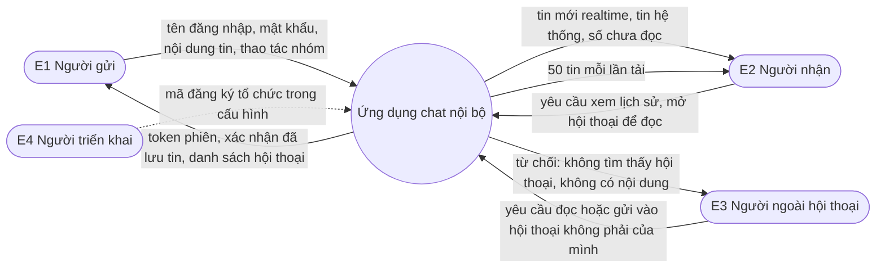
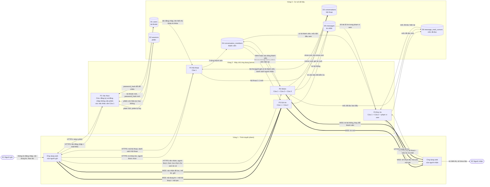
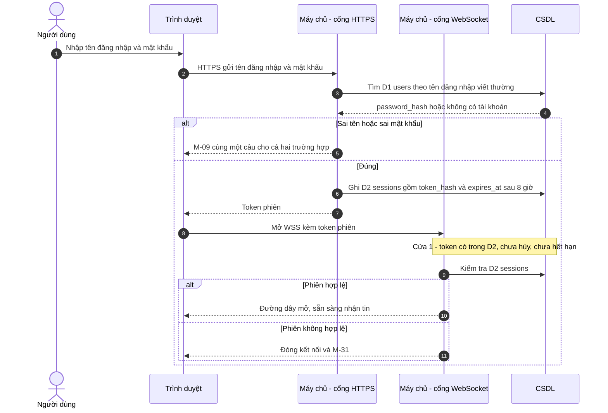
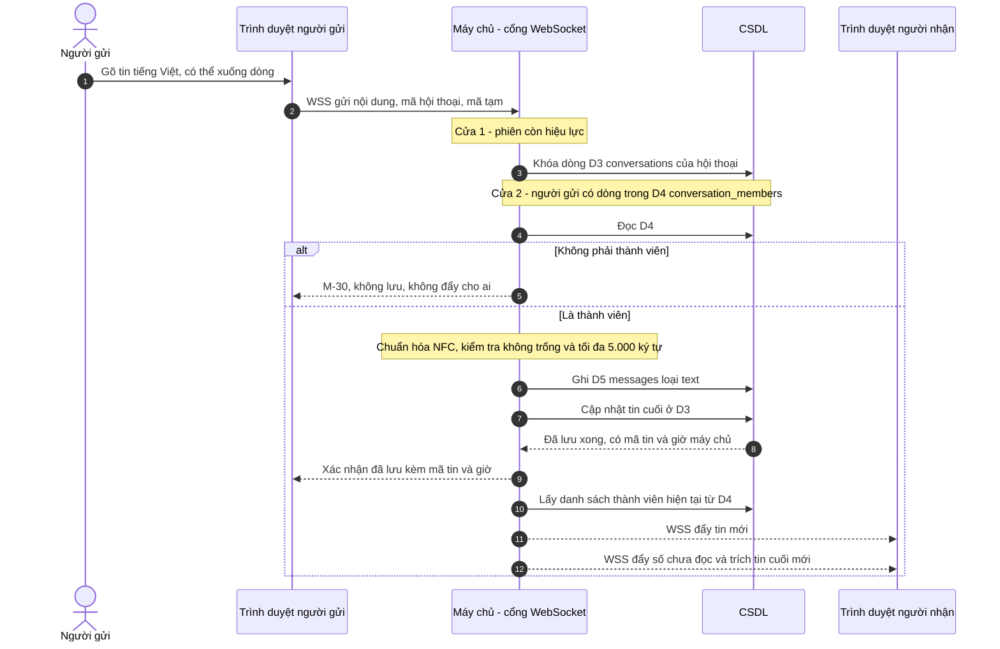
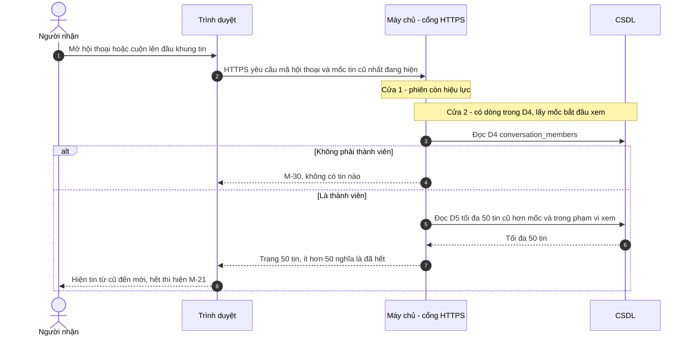
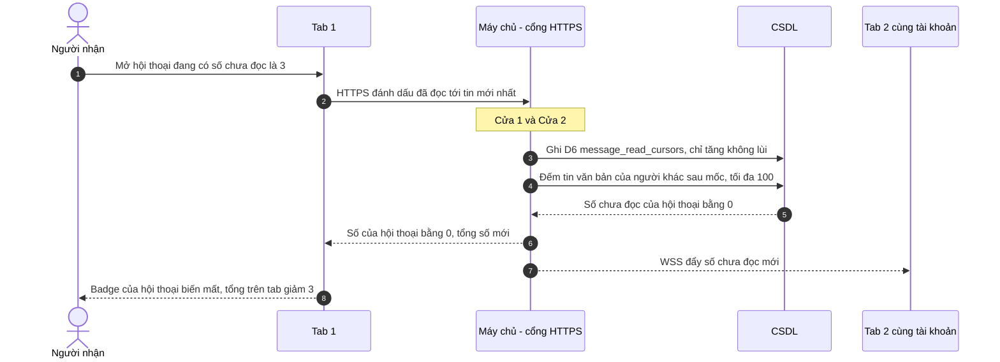
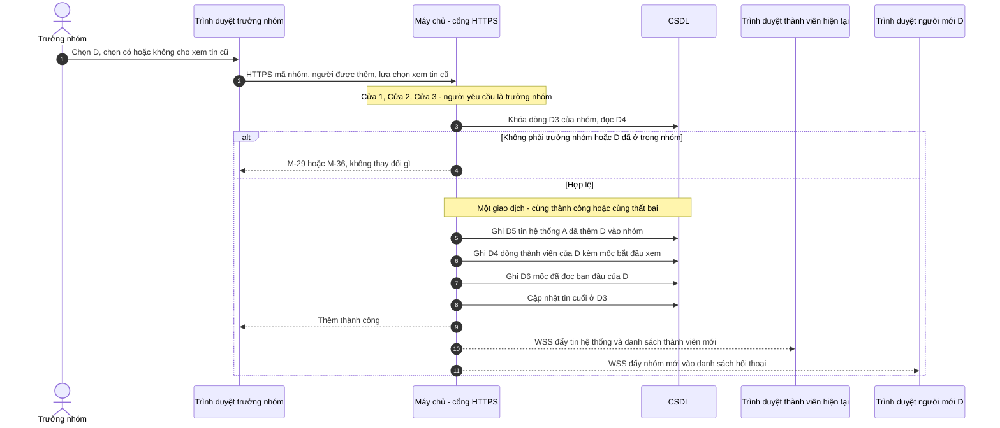
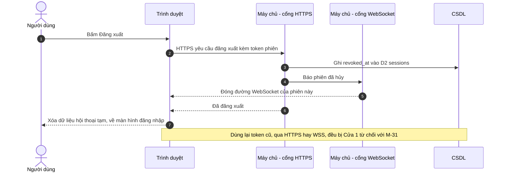
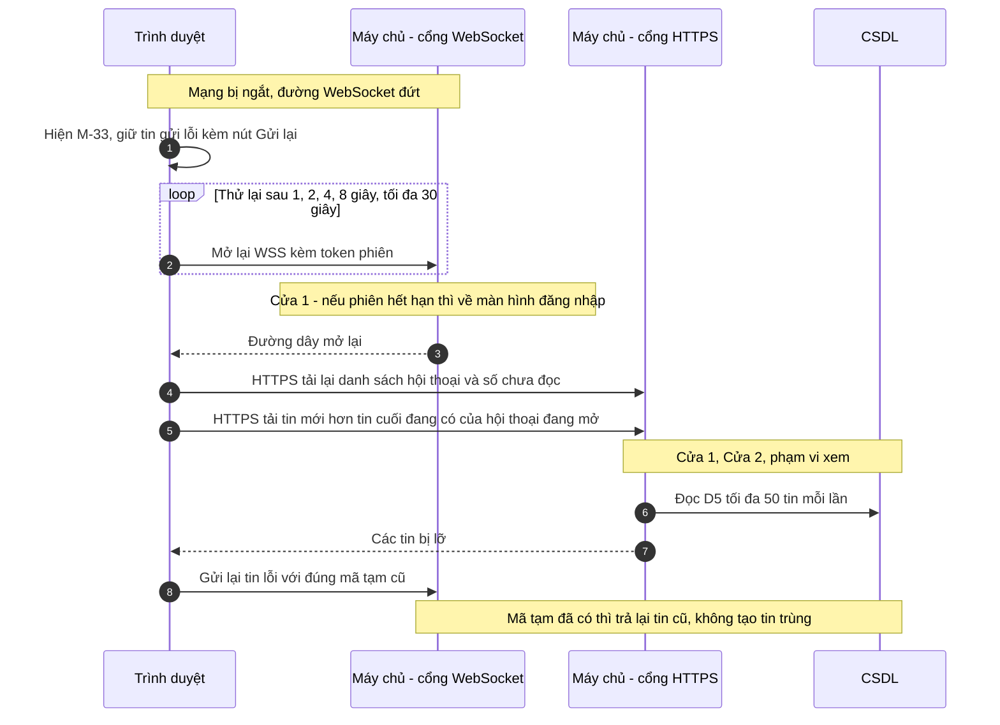
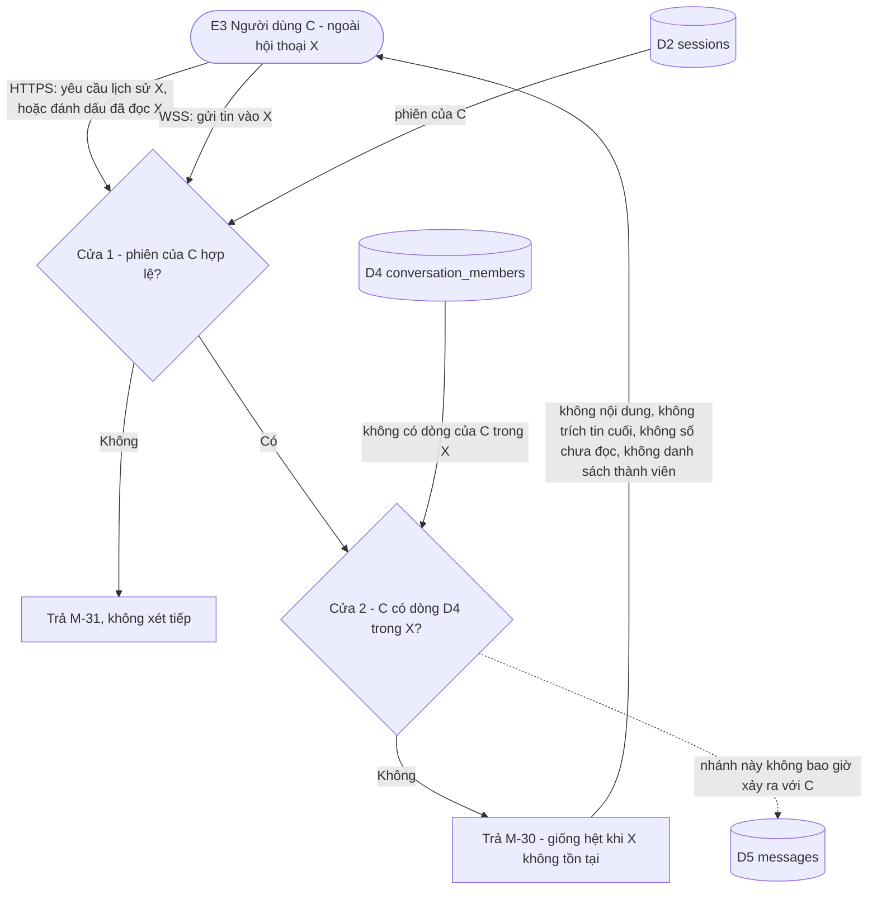

# 07 - Luồng dữ liệu (Data Flow)

| Mục | Nội dung |
|---|---|
| Dự án | Ứng dụng chat nội bộ (MVP) – Nhóm: *[chưa xác định]* |
| Tệp | `docs/07-data-flow.md` |
| Phiên bản | 1.0 – Draft |
| Ngày | 2026-11-14 |
| Người soạn | Nhóm BA / Architect / QA (bản nháp có trợ lý AI hỗ trợ soạn thảo) |
| Trạng thái | Draft – chờ Product Owner và Architect xác nhận mục 9 (giả định) và mục 10 (câu hỏi mở) |
| Căn cứ | (1) PDF "Xây dựng ứng dụng chat nội bộ (MVP)", ngày 13~14/11/2026 – **nguồn duy nhất của yêu cầu nghiệp vụ**; (2) `docs/01-brd.md` v1.1, `docs/02-srs.md` v1.1, `docs/03-frs.md` v1.0, `docs/04-use-cases.md` v1.1, `docs/05-user-stories.md` v1.0, `docs/06-erd.md` v1.0 – **tất cả đang ở trạng thái Draft**; (3) `docs/08-high-level-design.md` **chưa có trên repository**, nên cách chia kênh HTTPS / WebSocket và cách triển khai máy chủ ở tài liệu này là giả định (mục 9) |

**Quy ước ký hiệu**

| Ký hiệu | Ý nghĩa |
|---|---|
| `[PDF]` | Do đề bài quy định. Không được tự thay đổi. |
| `[QĐ-xx]` | Quyết định của Product Owner (QĐ-01…05 ở BRD, QĐ-06…10 ở SRS). |
| `[GĐ-xx]` / `[GS-xx]` / `[GF-xx]` / `[GU-xx]` / `[GE-xx]` | Giả định đã ghi ở BRD / SRS / FRS / Use case / ERD. |
| `[GL-xx]` | Giả định mới của tài liệu này (mục 9). |
| `[ĐX]` | Lựa chọn thiết kế do nhóm đề xuất, không phải yêu cầu đề bài. |
| `[OQ-xx]` | Câu hỏi mở. OQ-01…OQ-28 đã có ở các tài liệu trước; OQ-29 trở đi phát sinh ở tài liệu này (mục 10). |
| `M-xx` | Thông báo hiển thị cho người dùng, theo danh mục ở `03-frs.md` mục 5. |

> Tài liệu này mô tả **dữ liệu đi đâu**, không mô tả giao diện và không chứa kết quả chạy thử hay số đo nào. Tên đường dẫn API, tên sự kiện WebSocket và định dạng dữ liệu chi tiết thuộc `08-high-level-design.md` và `09-detailed-design.md` (GL-08).

---

## 1. Giải thích nhanh cho người không làm IT

| Thuật ngữ | Giải thích dễ hiểu |
|---|---|
| Sơ đồ luồng dữ liệu (DFD) | Hình vẽ cho biết **thông tin gì** đi từ **đâu** tới **đâu**. Mỗi mũi tên ghi tên dữ liệu đi qua nó. |
| Tác nhân ngoài | Người đứng ngoài hệ thống và trao đổi thông tin với nó. Ở đây là **người gửi** và **người nhận**: cùng một nhân viên, tùy lúc là người gửi hay người nhận. |
| Tiến trình (P) | Một phần việc máy chủ làm, ví dụ "P3 Gửi tin". |
| Kho dữ liệu (D) | Nơi cất dữ liệu lâu dài. Mỗi kho ở đây **trùng tên** một bảng trong `06-erd.md`. |
| Trình duyệt (client) | Ứng dụng chạy trên Chrome, Edge, Firefox, Safari của nhân viên `[PDF §1]`. |
| Máy chủ (server) | Máy tính chạy ứng dụng, nơi **quyết định cuối cùng** về quyền truy cập `[FRS NT-01]`. |
| HTTPS | Kiểu "hỏi – đáp": trình duyệt hỏi, máy chủ trả lời một lần, rồi xong. Dùng cho đăng nhập, tải lịch sử… `[PDF §4]`. |
| WebSocket (WSS) | Kiểu "đường dây luôn mở": máy chủ **chủ động đẩy** tin mới tới trình duyệt mà không cần trình duyệt hỏi lại. Dùng cho chat realtime `[PDF §2]`. Chữ "S" cuối nghĩa là có mã hóa `[PDF §4]`. |
| Token phiên | Một "vé vào cửa" máy chủ cấp sau khi đăng nhập đúng. Mỗi lần hỏi, trình duyệt trình vé này. Vé có hạn và bị hủy khi đăng xuất `[PDF TK-03]`. |
| Cửa kiểm tra | Bước máy chủ kiểm tra trước khi cho dữ liệu đi tiếp (mục 5). |

## 2. Danh mục thành phần

### 2.1 Tác nhân ngoài

| Mã | Tác nhân | Vai trò trong luồng |
|---|---|---|
| E1 | Người gửi | Nhân viên đã đăng nhập, gửi tin hoặc thực hiện thao tác (tạo nhóm, thêm người…). |
| E2 | Người nhận | Thành viên **hiện tại** của hội thoại, nhận tin realtime, xem lịch sử, xem số chưa đọc. |
| E3 | Người ngoài hội thoại | Nhân viên hợp lệ nhưng **không** thuộc hội thoại (tình huống bước nghiệm thu 6 `[PDF §5]`). Chỉ xuất hiện trong luồng bị từ chối (mục 7). |
| E4 | Người triển khai | Cấu hình mã đăng ký tổ chức `[QĐ-06]`, `[GE-04]`. Không có giao diện quản trị. |

### 2.2 Tiến trình

| Mã | Tiến trình | Việc làm | Kênh chính |
|---|---|---|---|
| P1 | Xác thực | Đăng ký, đăng nhập, đăng xuất, đổi mật khẩu, xem/sửa hồ sơ; **kiểm tra phiên** cho mọi tiến trình khác. | HTTPS |
| P2 | Hội thoại | Tìm người dùng, mở hội thoại 1-1, lấy danh sách hội thoại kèm trích tin cuối. | HTTPS |
| P3 | Gửi tin | Nhận tin từ người gửi, kiểm tra, **lưu vào CSDL**, xác nhận cho người gửi, đẩy realtime tới người nhận. | WSS |
| P4 | Đọc tin | Tải lịch sử 50 tin/lần, tải tin bị lỡ, đánh dấu đã đọc, tính số chưa đọc. | HTTPS (đẩy số chưa đọc qua WSS) |
| P5 | Nhóm | Tạo nhóm, thêm/xóa thành viên, đổi tên, rời nhóm; sinh tin hệ thống. | HTTPS (đẩy thay đổi qua WSS) |

### 2.3 Kho dữ liệu (trùng tên bảng ở `06-erd.md`)

| Mã | Kho | Bảng ở `06-erd.md` | Chứa gì |
|---|---|---|---|
| D1 | Tài khoản (accounts) | `users` | Tên đăng nhập, `password_hash`, tên hiển thị. **Không có mật khẩu gốc** `[PDF TK-02]`. |
| D2 | Phiên | `sessions` | `token_hash`, `expires_at`, `revoked_at`. |
| D3 | Hội thoại | `conversations` | Loại 1-1/nhóm, tên nhóm, cặp người 1-1, tin cuối. |
| D4 | Thành viên (membership) | `conversation_members` | Ai **đang** ở hội thoại nào, vai trò, mốc bắt đầu xem (`history_from_message_id`). |
| D5 | Tin nhắn (messages) | `messages` | Tin văn bản và tin hệ thống. |
| D6 | Mốc đã đọc (read cursor) | `message_read_cursors` | `last_read_message_id` của từng người trong từng hội thoại. |

## 3. DFD mức ngữ cảnh (mức 0)

Toàn bộ hệ thống được vẽ như **một hộp**. Hình này chỉ trả lời: ai đưa gì vào, ai nhận gì ra.

## 4. DFD mức 1

### 4.1 Cách đọc

- Ba vùng tương ứng ba **ranh giới**: trình duyệt (client), máy chủ ứng dụng (server), cơ sở dữ liệu.
- **Mũi tên mảnh** = đi qua **HTTPS** (hỏi – đáp). **Mũi tên đậm** = đi qua **WebSocket WSS** (đường dây luôn mở). **Mũi tên giữa máy chủ và CSDL** = đọc/ghi trong mạng nội bộ của máy chủ, người dùng không chạm tới được.
- Dòng chữ "Cửa" trong mỗi tiến trình cho biết máy chủ kiểm tra gì trước khi xử lý (chi tiết ở mục 5).
- Để hình dễ đọc, mũi tên "kiểm tra phiên" từ P2…P5 sang D2 không vẽ lặp lại: **mọi** yêu cầu tới P2…P5 đều đi qua Cửa 1, do P1 kiểm tra trên D2.

### 4.2 Sơ đồ

### 4.3 Dữ liệu **không bao giờ** rời máy chủ

| Dữ liệu | Lý do | Nguồn |
|---|---|---|
| Mật khẩu gốc | Chỉ đi từ trình duyệt tới P1 qua HTTPS để đối chiếu, **không lưu, không ghi log, không trả về** | `[PDF TK-02]` |
| `password_hash`, `token_hash` | Chỉ dùng bên trong máy chủ | `[GE-03]` |
| Mã đăng ký tổ chức đúng | Chỉ nằm trong cấu hình máy chủ; khi sai chỉ báo M-05, không tiết lộ mã đúng | `[QĐ-06]`, `[GE-04]` |
| Tin trước mốc bắt đầu xem của một thành viên | Lọc ngay trong câu đọc D5, không gửi xuống trình duyệt rồi mới ẩn | `[QĐ-08]`, `06-erd.md` mục 6.4 |

## 5. Ranh giới và cửa kiểm tra

### 5.1 Bốn ranh giới

| Ranh giới | Bên trong là gì | Dữ liệu đi qua ranh giới bằng gì | Quy tắc |
|---|---|---|---|
| Trình duyệt ↔ máy chủ, kênh **HTTPS** | Các câu "hỏi – đáp" | Yêu cầu có kèm token phiên (trừ đăng ký, đăng nhập) | Bắt buộc mã hóa `[PDF §4]` |
| Trình duyệt ↔ máy chủ, kênh **WebSocket WSS** | Đường dây luôn mở, mỗi trình duyệt (tab) một đường | Mở đường dây phải trình token phiên; sau đó tin đi hai chiều | Bắt buộc mã hóa `[PDF §4]`; dùng cho realtime `[PDF §2]` |
| Máy chủ ↔ CSDL | Mạng nội bộ của máy chủ | Câu lệnh đọc/ghi | Trình duyệt **không bao giờ** nói chuyện trực tiếp với CSDL `[ĐX]` |
| Trong máy chủ: **cửa kiểm tra** | Cửa 1, 2, 3 và phạm vi xem | – | Mọi kiểm tra quyền làm ở máy chủ; giao diện ẩn nút không được coi là kiểm soát quyền `[PDF §4]`, `[FRS 6.1]` |

### 5.2 Ba cửa kiểm tra (theo đúng thứ tự)

| Cửa | Câu hỏi máy chủ đặt ra | Dữ liệu đọc | Không qua thì sao |
|---|---|---|---|
| **Cửa 1 – Phiên** | Token phiên có dòng trong D2, chưa hủy (`revoked_at` rỗng) và chưa hết hạn (`expires_at`)? | D2 `sessions` | Từ chối, M-31, trình duyệt về màn hình đăng nhập. Đường WebSocket bị đóng `[PDF TK-03]`, `[GS-07]` |
| **Cửa 2 – Thành viên** | Người yêu cầu có dòng trong D4 cho đúng hội thoại này? | D4 `conversation_members` | Từ chối, M-30 "Không tìm thấy hội thoại hoặc bạn không có quyền truy cập". **Không đọc D5**, không ghi gì, không đẩy gì `[PDF §4]`, `[QĐ-04]` |
| **Cửa 3 – Trưởng nhóm** | Dòng D4 đó có `role = 'owner'`? | D4 | Từ chối, M-29 `[PDF NH-03]` |
| *Phạm vi xem* | Tin có nằm từ `history_from_message_id` trở đi? | D4, D5 | Tin ngoài phạm vi **không được trả**, kể cả khi gọi thẳng máy chủ `[QĐ-08]` |

Sau ba cửa mới tới bước kiểm tra dữ liệu (độ dài tin, tên nhóm…) `[FRS 6.1]`.

### 5.3 Bảng tuyến – kênh – cửa

"Tuyến" là một loại yêu cầu. Tên đường dẫn cụ thể do `08`/`09` đặt (GL-08). Cột "Kênh" theo `02-srs.md` mục 6.2–6.3 và giả định GL-01.

| # | Tuyến | Kênh | Cửa 1 | Cửa 2 | Cửa 3 | Kho đọc → ghi | Khi bị từ chối | Mã SRS |
|---|---|---|---|---|---|---|---|---|
| T-01 | Đăng ký | HTTPS | – | – | – | D1 → D1 | M-01…M-08, M-05 | TK-01, TK-02 |
| T-02 | Đăng nhập | HTTPS | – | – | – | D1 → D2 | M-09 | TK-03 |
| T-03 | Đăng xuất | HTTPS | ✓ | – | – | D2 → D2 | M-31 | TK-03 |
| T-04 | Đổi mật khẩu | HTTPS | ✓ | – | – | D1 → D1, D2 | M-10, M-11 | TK-04, TK-02 |
| T-05 | Xem / sửa hồ sơ | HTTPS | ✓ | – | – | D1 → D1 | M-03 | TK-05 |
| T-06 | Tìm người dùng | HTTPS | ✓ | – | – | D1 | M-14 (không có kết quả) | TK-06 |
| T-07 | Mở hội thoại 1-1 | HTTPS | ✓ | – (tự tạo thành viên) | – | D1, D3 → D3, D4, D6 | M-15, M-16 | CH-01 |
| T-08 | Danh sách hội thoại + số chưa đọc | HTTPS | ✓ | Chỉ lấy hội thoại có dòng D4 của mình | – | D3, D4, D5, D6 | M-24 | CH-06, TB-01 |
| T-09 | Tải lịch sử 50 tin | HTTPS | ✓ | ✓ + phạm vi xem | – | D4, D5 | M-30 | CH-03, NH-02 |
| T-10 | Tải tin bị lỡ sau khi kết nối lại | HTTPS | ✓ | ✓ + phạm vi xem | – | D4, D5 | M-30 | CH-03, NFR-13 |
| T-11 | Đánh dấu đã đọc | HTTPS | ✓ | ✓ | – | D4, D5 → D6 | M-30 | TB-01 |
| T-12 | Mở đường WebSocket | WSS | ✓ | – | – | D2 | Đóng kết nối, M-31 | CH-02, TK-03 |
| T-13 | Gửi tin | WSS | ✓ | ✓ | – | D4 → D5, D3 | M-30, M-17 | CH-02, NH-02 |
| T-14 | Nhận tin realtime (máy chủ đẩy xuống) | WSS | Kết nối đã qua T-12 | Người nhận lấy từ D4 tại lúc lưu tin | – | D4 | Không đẩy | CH-02, NH-02, NH-04 |
| T-15 | Tạo nhóm | HTTPS | ✓ | – (người tạo thành trưởng nhóm) | – | D1 → D3, D4, D5, D6 | M-25…M-27 | NH-01, NH-04 |
| T-16 | Thêm thành viên | HTTPS | ✓ | ✓ | ✓ | D1, D4 → D4, D5, D6 | M-30, M-29, M-36 | NH-03, NH-04 |
| T-17 | Xóa thành viên | HTTPS | ✓ | ✓ | ✓ | D4 → D4, D5 | M-30, M-29 | NH-03, NH-04 |
| T-18 | Đổi tên nhóm | HTTPS | ✓ | ✓ | ✓ | D3 → D3, D5 | M-30, M-29, M-25 | NH-03, NH-04 |
| T-19 | Rời nhóm (trưởng nhóm phải chọn người nhận quyền) | HTTPS | ✓ | ✓ | – | D4 → D4, D5 | M-30, M-37, M-28 | NH-03, NH-04 |

## 6. Các luồng chính theo thứ tự thời gian

Các sơ đồ dưới đây đọc từ trên xuống. Mũi tên liền là gửi đi, mũi tên đứt là trả lời. Khung "Cửa" đánh dấu chỗ máy chủ kiểm tra quyền.

### 6.1 Đăng nhập và mở đường WebSocket (TK-03)

Nguồn: đăng nhập bằng tên + mật khẩu, phiên có thời hạn `[PDF TK-03]`; một câu báo lỗi chung `[SRS TK-03 R5, ĐX]`; 8 giờ `[QĐ-09]`; chỉ lưu `token_hash` `[GE-03]`.

### 6.2 Gửi tin 1-1 realtime (CH-02)

Điểm then chốt:
- Tin chỉ được báo "đã gửi" **sau khi** đã ghi xong vào D5 `[PDF §4]`, `[SRS CH-02 R5]`.
- Người nhận được lấy từ D4 **ngay lúc lưu tin**, không lấy từ một danh sách giữ sẵn trong bộ nhớ, nên người vừa bị xóa không nhận được tin (GL-03).
- Gửi lại cùng mã tạm thì máy chủ trả lại tin cũ, không lưu thêm `[GF-12]`.
- Mục tiêu "< 2 giây" `[PDF §4]` được **đo thực tế** ở `12-test-reports.md`; tài liệu này không khẳng định đã đạt.
- Tin nhóm (NH-02) đi đúng luồng này; khác ở chỗ danh sách người nhận có nhiều người.

### 6.3 Xem lịch sử, 50 tin mỗi lần (CH-03)

Nguồn: lưu toàn bộ lịch sử ở máy chủ, 50 tin/lần `[PDF CH-03]`; phân trang theo mốc tin để không trùng, không sót `[GS-22]`; phạm vi xem `[QĐ-04]`, `[QĐ-08]`.

### 6.4 Mở hội thoại và đưa số chưa đọc về 0 (TB-01)

Nguồn: mở hội thoại thì số về 0 `[PDF §5 bước 4]`; tin hệ thống và tin của mình không tính `[QĐ-10]`; mốc lưu ở máy chủ nên đồng bộ mọi tab `[GS-34]`; cách đếm không quét toàn bộ `[GE-08]`, `06-erd.md` mục 8. Khi đang mở hội thoại và tab đang được xem mà có tin mới, trình duyệt gửi yêu cầu đánh dấu đã đọc tự động `[GS-33]`.

### 6.5 Thêm thành viên nhóm và sinh tin hệ thống (NH-03, NH-04)

Nguồn: chỉ trưởng nhóm được thêm `[PDF NH-03]`; tin hệ thống `[PDF NH-04]`; tùy chọn xem tin cũ `[QĐ-08]`, mặc định "Không" `[GS-35]`; một giao dịch `[GF-21]`; mốc bắt đầu xem `[GE-07]`. Tin hệ thống **không** làm tăng số chưa đọc `[QĐ-10]`.

Xóa thành viên và rời nhóm đi cùng khuôn: qua Cửa 1–3 (rời nhóm không cần Cửa 3), **xóa dòng D4 trước** `[GE-05]`, ghi tin hệ thống vào D5, rồi mới đẩy tin hệ thống cho những người còn lại. Người bị xóa chỉ nhận thông báo "bị xóa khỏi nhóm" (M-32), **không** nhận tin hệ thống về chính mình `[QĐ-04]`, `[FRS 6.1 mục 5]`.

### 6.6 Đăng xuất (TK-03)

Nguồn: đăng xuất hủy token `[PDF TK-03]`; đóng kết nối realtime `[GS-07]`; TK-03-AC2. Đổi mật khẩu (TK-04) đi cùng khuôn nhưng hủy **các phiên khác** của tài khoản `[QĐ-09]`. Phiên hết hạn (`expires_at`) bị Cửa 1 từ chối ở yêu cầu kế tiếp.

### 6.7 Mất mạng, tự kết nối lại và tải tin bị lỡ (NFR-13 – mức khuyến khích)

PDF §4 ghi mục này là **khuyến khích**, không phải mã bắt buộc.

Nguồn: tự kết nối lại, gửi lại tin lỗi `[PDF §4]` (khuyến khích); nhịp thử lại `[GF-23]`; mã tạm `[GF-12]`; tải tin bị lỡ theo mốc, 50 tin mỗi lần, lặp tới khi hết `[GL-05]`.

## 7. Luồng dữ liệu bị từ chối với người ngoài hội thoại (bước nghiệm thu 6)

Tình huống theo PDF §5 bước 6: A và B có hội thoại 1-1 mã X. C là tài khoản thứ ba, đã đăng nhập hợp lệ.

| Biến thể | C làm gì | Dữ liệu C nhận | Dữ liệu bị ghi | Nguồn |
|---|---|---|---|---|
| V1 | Tự điền mã X để đọc lịch sử | M-30, **không có tin nào** | Không có | `[PDF §4, §5]`, NFR-04 |
| V2 | Gửi tin vào X qua WebSocket | M-30 | **Không** ghi D5; A và B không nhận gì | E-CH02-3 |
| V3 | Đánh dấu đã đọc trong X | M-30 | **Không** ghi D6; số chưa đọc của A, B không đổi | UC-17 |
| V4 | Chờ nhận tin realtime của X | Không có gì | – | GL-03: người nhận lấy từ D4, C không có dòng D4 |
| V5 | Người vừa bị xóa hoặc vừa rời nhóm đọc tin cũ | M-30, kể cả tin trước khi rời | Không có | `[QĐ-04]`, `[GE-05]` |
| V6 | Người được thêm **không** kèm xem tin cũ đọc tin trước mốc | Chỉ tin từ mốc bắt đầu xem trở đi | Không có | `[QĐ-08]` |
| V7 | Dùng token đã đăng xuất hoặc hết hạn | M-31 | Không có | `[PDF TK-03]` |

**Ba nguyên tắc** của luồng từ chối:
1. Máy chủ **không đọc D5** khi chưa qua Cửa 2. Nội dung tin không bao giờ rời CSDL tới người ngoài `[ĐX]`.
2. Câu trả lời cho người ngoài **giống hệt** câu trả lời khi hội thoại không tồn tại, để không lộ "X có tồn tại" `[FRS 6.1]`, NFR-04.
3. Danh sách hội thoại của C (T-08) chỉ lấy từ các dòng D4 **của C**, nên X không bao giờ xuất hiện ở đó `[SRS CH-06 R5]`.

## 8. Bảng ánh xạ tiến trình → mã SRS

| Tiến trình | Tuyến (mục 5.3) | Mã MVP `[PDF §3]` | NFR / quy tắc chung | Bước nghiệm thu `[PDF §5]` |
|---|---|---|---|---|
| P1 Xác thực | T-01…T-05, T-12; Cửa 1 cho mọi tuyến | TK-01, TK-02, TK-03, TK-04, TK-05 | NFR-01, NFR-02, NFR-03, QT-CHUNG-1 | AT-01, AT-05 |
| P2 Hội thoại | T-06, T-07, T-08 | TK-06, CH-01, CH-06 | NFR-09, NFR-04 | AT-02, AT-04 |
| P3 Gửi tin | T-13, T-14 | CH-02, NH-02 | NFR-05, NFR-07, NFR-08, NFR-04, QT-CHUNG-2 | AT-02, AT-03, AT-06 |
| P4 Đọc tin | T-08, T-09, T-10, T-11 | CH-03, CH-06, TB-01 | NFR-06, NFR-07, NFR-04, NFR-13 (khuyến khích) | AT-04, AT-05, AT-06 |
| P5 Nhóm | T-15…T-19 | NH-01, NH-03, NH-04 (và NH-02 qua P3) | NFR-04 | AT-03 |
| Luồng từ chối (mục 7) | Cửa 1, Cửa 2 trên T-08…T-11, T-13, T-14, T-16…T-19 | QT-CHUNG-2 cho CH-02, CH-03, NH-03 | NFR-04 | **AT-06** |

**Kiểm tra độ phủ:** 15/15 mã MVP (TK-01…TK-06, CH-01, CH-02, CH-03, CH-06, NH-01…NH-04, TB-01) thuộc ít nhất một tiến trình; 6/6 bước nghiệm thu có luồng tương ứng.

**Không có luồng nào cho các mã NOT MVP** ở PDF §6 `[QĐ-01]`: không có luồng trạng thái "đã nhận / đã xem" (CH-04), trạng thái online (CH-05), "ai đã xem" trong nhóm (NH-05), thông báo bật lên của trình duyệt (TB-03), quản trị (QT-01, QT-02), tệp/ảnh/reaction/"đang nhập" (TN-01…TN-07), email (TK-07…11), sửa/thu hồi tin (TN-10…TN-14). Xác nhận "đã lưu" ở mục 6.2 chỉ để người gửi biết tin đã vào CSDL và để gửi lại khi lỗi (NFR-13), **không** phải CH-04.

## 9. ASSUMPTIONS – Giả định của tài liệu này

Các QĐ, GĐ, GS, GF, GU, GE trong các tài liệu trước vẫn giữ hiệu lực; riêng GE-01 (PostgreSQL), GE-03 (bảng phiên), GE-05 (xóa hẳn dòng thành viên), GE-07 (mốc bắt đầu xem), GE-08 (cách đếm chưa đọc) của `06-erd.md` là nền của các luồng trên. Bảng dưới chỉ gồm giả định mới. **Không giả định nào là yêu cầu của PDF.**

| Mã | Giả định | Áp dụng | Câu hỏi |
|---|---|---|---|
| GL-01 | **Chia kênh:** gửi tin (trình duyệt → máy chủ) và mọi thông báo đẩy (máy chủ → trình duyệt) đi qua WSS; mọi việc còn lại (đăng ký, đăng nhập, đăng xuất, đổi mật khẩu, hồ sơ, tìm người, mở 1-1, danh sách, lịch sử, tin bị lỡ, đánh dấu đã đọc, thao tác nhóm) đi qua HTTPS. Bám theo `02-srs.md` mục 6.2–6.3. | Mục 5.3 | OQ-29 |
| GL-02 | Đường WebSocket xác thực bằng token phiên lúc mở. Mỗi tin gửi lên qua đường này vẫn được kiểm tra lại Cửa 1 và Cửa 2, không chỉ tin vào lần kiểm tra lúc mở. | T-12, T-13 | – |
| GL-03 | **Đẩy tin theo người nhận:** khi lưu tin, máy chủ đọc danh sách thành viên hiện tại từ D4 rồi đẩy tới mọi đường WebSocket đang mở của từng người. Không dựa vào danh sách "phòng hội thoại" giữ trong bộ nhớ, để người vừa bị xóa không thể nhận tin. | T-14, mục 7 | – |
| GL-04 | MVP chạy **một** máy chủ ứng dụng, nên máy chủ biết mọi đường WebSocket đang mở. Nếu chạy nhiều máy chủ, cần thêm kênh trung chuyển giữa các máy chủ (PDF §7 gợi ý Redis, tùy chọn) và phải cập nhật tài liệu này. | Mục 4, 6 | OQ-30 |
| GL-05 | Sau khi kết nối lại, trình duyệt tải tin **mới hơn** tin cuối đang có, 50 tin mỗi lần, lặp tới khi hết; danh sách hội thoại và số chưa đọc được tải lại toàn bộ. | T-10, mục 6.7 | OQ-31 |
| GL-06 | Đánh dấu đã đọc đi qua HTTPS; máy chủ đẩy số chưa đọc mới qua WSS tới **các tab khác** của cùng tài khoản. | T-11, mục 6.4 | – |
| GL-07 | Máy chủ trả lời người ngoài hội thoại bằng cùng một thông báo M-30, và không đọc D5 trước khi qua Cửa 2. | Mục 7 | – |
| GL-08 | Sơ đồ mô tả luồng ở mức nghiệp vụ. Tên đường dẫn API, tên sự kiện WebSocket, cách trình duyệt mang token phiên và định dạng dữ liệu thuộc `08`/`09`. | Toàn tài liệu | OQ-32 |
| GL-09 | Khi xóa thành viên hoặc thành viên rời nhóm, máy chủ ngừng đẩy tin cho người đó **trước khi** đẩy tin hệ thống cho những người còn lại (cùng thứ tự `03-frs.md` mục 6.1). | Mục 6.5 | – |
| GL-10 | Một phiên hết hạn trong lúc đường WebSocket đang mở thì bị đóng khi đến hạn hoặc ở sự kiện kế tiếp, tùy cách cài đặt ở `09`; trong cả hai trường hợp, mọi tin gửi lên sau hạn đều bị Cửa 1 từ chối. | T-12, T-13 | – |

## 10. OPEN QUESTIONS – Câu hỏi mở

| Mã | Câu hỏi | Giả định tạm | Ảnh hưởng | Người quyết định đề xuất |
|---|---|---|---|---|
| OQ-23 | HLD chọn hệ quản trị CSDL nào? (kế thừa từ `06`) | PostgreSQL (GE-01) | Vùng 3 | Architect |
| OQ-24 | Rời / bị xóa: xóa hẳn dòng thành viên hay giữ dòng? (kế thừa từ `06`) | Xóa hẳn (GE-05) | Cửa 2, mục 7 | Product Owner, Architect |
| OQ-25 | Phiên lưu ở máy chủ (D2) dù dùng JWT? (kế thừa từ `06`) | Có (GE-03) | Cửa 1, mục 6.1, 6.6 | Architect |
| OQ-29 | Gửi tin đi qua WebSocket (theo SRS mục 6.3) hay qua HTTPS rồi mới đẩy bằng WebSocket? | Qua WebSocket (GL-01) | Mục 4.2, 6.2, T-13 | Architect |
| OQ-30 | Bản demo trực tuyến chạy một hay nhiều máy chủ ứng dụng? | Một máy chủ (GL-04) | Cách đẩy tin realtime | Architect |
| OQ-31 | Khi kết nối lại mà bị lỡ rất nhiều tin, tải hết hay chỉ tải 50 tin mới nhất rồi để người dùng cuộn? | Tải hết, 50 tin mỗi lần (GL-05) | Mục 6.7 | Product Owner, Architect |
| OQ-32 | Trình duyệt mang token phiên bằng cookie hay bằng phần đầu yêu cầu? Cách này ảnh hưởng tới việc mở đường WebSocket và chống giả mạo yêu cầu. | Do `08` chốt (GL-08) | Cửa 1, T-12 | Architect |

## 11. Ghi chú chuyển giao

- Tên kho D1…D6 trùng tuyệt đối tên bảng ở `06-erd.md`. Nếu `06` đổi tên bảng hoặc cột, phải sửa tài liệu này cùng lúc.
- `08-high-level-design.md` cần chốt OQ-23, OQ-25, OQ-29, OQ-30, OQ-32, rồi cập nhật mục 9 ở đây.
- `09-detailed-design.md` đặt tên cụ thể cho từng tuyến T-01…T-19 và từng sự kiện WebSocket; nên giữ mã T-xx để truy vết.
- `11-test-cases.md` dùng mục 7 (V1…V7) làm danh sách phép thử cho bước nghiệm thu 6 và dùng bảng 5.3 để thử "thiếu phiên" và "không phải thành viên" trên **mọi** tuyến.
