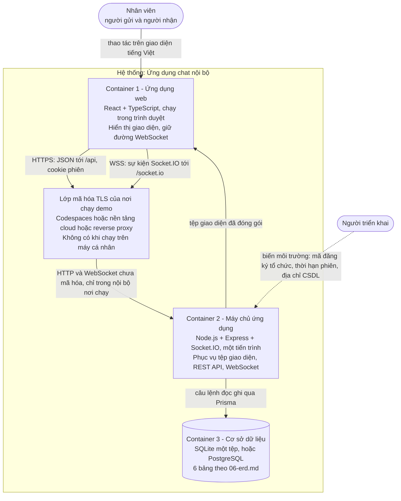
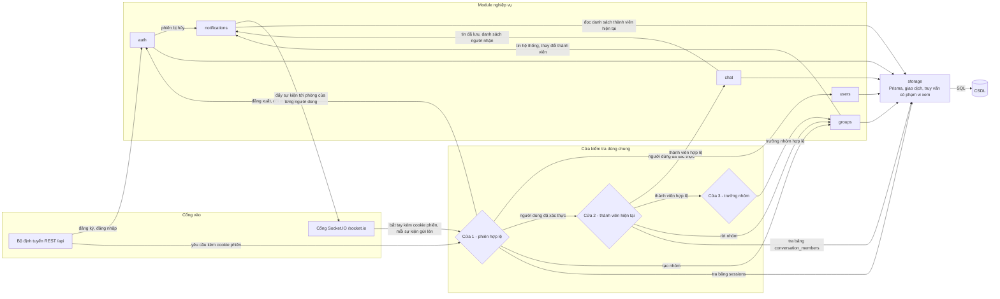

# 08 - Thiết kế tổng thể (High-Level Design)

| Mục | Nội dung |
|---|---|
| Dự án | Ứng dụng chat nội bộ (MVP) – Nhóm: *[chưa xác định]* |
| Tệp | `docs/08-high-level-design.md` |
| Phiên bản | 1.0 – Draft |
| Ngày | 2026-11-14 |
| Người soạn | Nhóm Architect / BA / QA (bản nháp có trợ lý AI hỗ trợ soạn thảo) |
| Trạng thái | Draft – các ADR ở mục 15 đang ở trạng thái **Đề xuất**, chờ nhóm và Product Owner xác nhận (mục 18) |
| Căn cứ | (1) PDF "Xây dựng ứng dụng chat nội bộ (MVP)", ngày 13~14/11/2026 – **nguồn duy nhất của yêu cầu nghiệp vụ**; (2) `docs/01-brd.md` v1.1, `docs/02-srs.md` v1.1, `docs/03-frs.md` v1.0, `docs/04-use-cases.md` v1.1, `docs/05-user-stories.md` v1.0, `docs/06-erd.md` v1.0, `docs/07-data-flow.md` v1.0 – **tất cả đang ở trạng thái Draft** |

**Quy ước ký hiệu**

| Ký hiệu | Ý nghĩa |
|---|---|
| `[PDF]` | Do đề bài quy định. Không được tự thay đổi. |
| `[PDF §7 gợi ý]` | Đề bài **gợi ý**, không bắt buộc; được chọn khác nhưng phải giải thích `[PDF §7]`. |
| `[QĐ-xx]` | Quyết định của Product Owner (QĐ-01…05 ở BRD, QĐ-06…10 ở SRS). |
| `[GĐ]` / `[GS]` / `[GF]` / `[GU]` / `[GE]` / `[GL]` | Giả định đã ghi ở BRD / SRS / FRS / Use case / ERD / Data flow. |
| `[GH-xx]` | Giả định mới của tài liệu này (mục 17). |
| `[ADR-xx]` | Quyết định kiến trúc (mục 15). |
| `[ĐX]` | Lựa chọn thiết kế do nhóm đề xuất, không phải yêu cầu đề bài. |
| `[OQ-xx]` | Câu hỏi mở. OQ-01…OQ-32 đã có ở các tài liệu trước; OQ-33 trở đi phát sinh ở tài liệu này (mục 18). |
| `T-xx`, `P1…P5`, `D1…D6` | Tuyến, tiến trình, kho dữ liệu theo `07-data-flow.md`. |

> Tài liệu này **không chứa kết quả chạy thử hay số đo nào**. Mọi đánh giá "dễ / khó / nhanh / chậm" trong các bảng so sánh là **nhận định định tính của nhóm** `[ĐX]`, không phải số liệu đo. Kết quả đo hiệu năng và kiểm thử chỉ được ghi ở `docs/12-test-reports.md`.

---

## 1. Giải thích nhanh cho người không làm IT

| Thuật ngữ | Giải thích dễ hiểu |
|---|---|
| Kiến trúc | "Bản vẽ mặt bằng" của phần mềm: gồm những khối nào, khối nào nói chuyện với khối nào, bằng đường nào. |
| C4 – mức Container | Một kiểu vẽ kiến trúc. Mức "Container" cho thấy các **khối chạy được độc lập** (ứng dụng web, máy chủ, cơ sở dữ liệu), chưa đi vào chi tiết mã nguồn. |
| Stack công nghệ | Bộ công cụ dùng để làm phần mềm, ví dụ React cho giao diện, Node.js cho máy chủ. |
| Module | Một "phòng ban" bên trong máy chủ, chỉ lo một việc (xác thực, nhóm…). |
| ADR | Biên bản quyết định kiến trúc: bối cảnh, các phương án, phương án được chọn và hệ quả. |
| SQLite / PostgreSQL | Hai loại cơ sở dữ liệu. SQLite là **một tệp** trên ổ đĩa, không phải cài máy chủ CSDL riêng. PostgreSQL là **một dịch vụ CSDL** chạy riêng, gần với môi trường doanh nghiệp hơn. |
| TLS | Lớp mã hóa đường truyền. Có TLS thì địa chỉ là `https://` và `wss://`; không có thì là `http://` và `ws://` (không mã hóa). |
| Cookie HttpOnly | Nơi trình duyệt cất "vé vào cửa" (token phiên) mà mã JavaScript trên trang **không đọc được**, giảm rủi ro bị đánh cắp vé. |

## 2. Mục tiêu kiến trúc

| # | Mục tiêu | Gắn với |
|---|---|---|
| MT-01 | **Không lọt tin cho người ngoài:** mọi đường đọc/ghi tin (HTTPS và WebSocket) đi qua cùng một bộ cửa kiểm tra phiên và thành viên ở máy chủ. | NFR-04, AT-06 `[PDF §4, §5]` |
| MT-02 | **Không mất tin:** tin chỉ được báo "đã gửi" sau khi đã ghi vào CSDL; CSDL nằm trên ổ đĩa, không nằm trong bộ nhớ. | NFR-07 `[PDF §4]` |
| MT-03 | **Realtime đơn giản, chắc chắn:** một đường WebSocket cho mỗi tab, máy chủ chủ động đẩy tin; người nhận được tính lại từ CSDL mỗi lần đẩy. | CH-02, NFR-05 `[PDF §2, §4]` |
| MT-04 | **Ít thành phần, dễ chạy:** một tiến trình máy chủ phục vụ cả giao diện, API và WebSocket; một CSDL. Người mới có thể chạy trên máy cá nhân bằng vài lệnh. | Khung thời gian 13~14/11/2026, R-06 (BRD) |
| MT-05 | **Cấu trúc rõ, khó làm sai:** chia module và quy tắc bất biến (mục 11) để người viết mã – kể cả trợ lý AI – không đặt truy vấn tin nhắn ngoài cửa kiểm tra. | NFR-04, PDF §9 "chất lượng kỹ thuật" |

## 3. Ràng buộc đầu vào

| Ràng buộc | Nguồn | Hệ quả cho kiến trúc |
|---|---|---|
| Chạy trên trình duyệt web, responsive; không có ứng dụng mobile | `[PDF §1, §2]` | Một ứng dụng web (SPA) duy nhất |
| Chat realtime qua **WebSocket** | `[PDF §2]` | Có kênh WSS; loại các phương án chỉ dùng hỏi – đáp định kỳ |
| Backend API và realtime **dùng chung** | `[PDF §2]` | API và WebSocket trong cùng một máy chủ ứng dụng (ADR-04) |
| HTTPS/WSS; mật khẩu băm bcrypt/argon2; token có thời hạn; API kiểm soát quyền | `[PDF §4]` | Mục 8, 10, 12 |
| Tin lưu ở CSDL, không chỉ trong bộ nhớ | `[PDF §4]` | ADR-01 |
| Phiên dùng token (JWT hoặc session) có thời hạn; đăng xuất hủy token | `[PDF TK-03]` | ADR-02 |
| Công nghệ được tự chọn nhưng phải giải thích | `[PDF §7]` | Mục 4 và ADR |
| Chỉ MVP, không làm phần mở rộng | `[QĐ-01]` | Không có module file, quản trị, thông báo trình duyệt (mục 20) |
| Demo chính thức chạy **trực tuyến** | `[QĐ-02]` | Mục 12.2 |
| Phiên 8 giờ, cấu hình được; đổi mật khẩu hủy phiên khác | `[QĐ-09]` | ADR-02 |
| Mô hình dữ liệu 6 bảng, cửa kiểm tra, luồng dữ liệu | `06-erd.md`, `07-data-flow.md` | Mục 9; một số điều chỉnh cho SQLite ở mục 16 |

## 4. Lựa chọn công nghệ

Tiêu chí so sánh: **độ khó cho người mới**, **tốc độ làm MVP**, **hỗ trợ realtime**, **chi phí**, **mức trợ lý AI viết mã tốt** (độ phổ biến của tài liệu và ví dụ). Đánh giá là định tính `[ĐX]`. Phương án tham chiếu theo `[PDF §7 gợi ý]` và khuyến nghị của lớp học.

### 4.1 Giao diện (Frontend)

| Phương án | Người mới | Tốc độ MVP | Realtime | Chi phí | AI viết mã | Nhận xét |
|---|---|---|---|---|---|---|
| **React + TypeScript + Vite** | Trung bình | Nhanh | Dùng thư viện client Socket.IO | Miễn phí, mã nguồn mở | Rất tốt | Đúng gợi ý PDF §7 (React + TypeScript); Vite khởi tạo và chạy thử nhanh |
| Vue + TypeScript + Vite | Dễ | Nhanh | Như trên | Miễn phí | Tốt | Không phải gợi ý của PDF |
| Next.js (React có máy chủ riêng) | Khó hơn | Trung bình | Phải tách WebSocket ra máy chủ khác hoặc tùy biến | Miễn phí | Tốt | Thêm một lớp máy chủ không cần thiết cho MVP |

**Chọn: React + TypeScript + Vite.** React tự chống chèn mã khi hiển thị chữ, phù hợp yêu cầu hiện nội dung tin dạng chữ thuần `[SRS CH-02 R6]`.

### 4.2 Máy chủ (Backend)

| Phương án | Người mới | Tốc độ MVP | Realtime | Chi phí | AI viết mã | Nhận xét |
|---|---|---|---|---|---|---|
| **Node.js + Express** | Dễ | Nhanh | Gắn Socket.IO trực tiếp vào cùng máy chủ HTTP | Miễn phí | Rất tốt | Đúng gợi ý PDF §7; cùng ngôn ngữ TypeScript với giao diện |
| Node.js + NestJS | Khó hơn | Trung bình | Có sẵn gateway WebSocket | Miễn phí | Tốt | Cấu trúc chặt nhưng nhiều khái niệm mới |
| Python + FastAPI | Trung bình | Nhanh | Có WebSocket | Miễn phí | Tốt | Hai ngôn ngữ cho hai phía, khó dùng chung kiểu dữ liệu |

**Chọn: Node.js (bản LTS hiện hành) + Express + TypeScript** `[GH-01]`.

### 4.3 Realtime

| Phương án | Người mới | Tốc độ MVP | Realtime | Chi phí | AI viết mã | Nhận xét |
|---|---|---|---|---|---|---|
| **Socket.IO** | Dễ | Nhanh | Có sẵn: phòng, xác nhận (ack), tự kết nối lại | Miễn phí | Rất tốt | Đúng gợi ý PDF §7. Dùng WebSocket làm đường truyền chính |
| Thư viện `ws` thuần | Trung bình | Chậm hơn | Phải tự viết ack, phòng, kết nối lại | Miễn phí | Tốt | Nhiều việc tự làm |
| Server-Sent Events + HTTP | Dễ | Nhanh | Một chiều | Miễn phí | Tốt | **Loại**: không phải WebSocket `[PDF §2]` |

**Chọn: Socket.IO.** Cấu hình **chỉ dùng WebSocket** (`transports: ['websocket']`), không lùi về kiểu hỏi định kỳ, để đúng yêu cầu `[PDF §2]` `[GH-07]`.

### 4.4 Cơ sở dữ liệu

| Phương án | Người mới | Tốc độ MVP | Phù hợp `06-erd.md` | Chi phí | AI viết mã | Nhận xét |
|---|---|---|---|---|---|---|
| **SQLite (một tệp)** | Rất dễ – không cài dịch vụ | Rất nhanh | Phần lớn; cần điều chỉnh vài điểm (mục 16.1) | Miễn phí | Tốt | Một người ghi tại một thời điểm, đủ cho MVP một máy chủ. **Không** tự đổi chữ hoa/thường với chữ có dấu |
| PostgreSQL | Trung bình – cần cài dịch vụ hoặc dùng dịch vụ có sẵn | Nhanh | Khớp hoàn toàn (06 thiết kế cho PostgreSQL – GE-01) | Miễn phí khi tự chạy; dịch vụ cloud tùy nhà cung cấp | Rất tốt | Gợi ý PDF §7; gần thực tế doanh nghiệp |
| MongoDB | Trung bình | Nhanh | Thấp – dữ liệu có quan hệ chặt | Miễn phí khi tự chạy | Tốt | **Loại**: mô hình 06 là quan hệ |

**Chọn: SQLite là mặc định** cho chạy trên máy cá nhân và cho bản demo nếu nơi chạy giữ được ổ đĩa; **PostgreSQL là đích chuyển đổi** khi nơi chạy demo không giữ được tệp hoặc khi nhóm muốn khớp hoàn toàn 06 (ADR-01, mục 16).

### 4.5 Lớp truy cập CSDL (ORM)

| Phương án | Người mới | Tốc độ MVP | Đổi SQLite ↔ PostgreSQL | Chi phí | AI viết mã | Nhận xét |
|---|---|---|---|---|---|---|
| **Prisma** | Dễ | Nhanh | Đổi `provider` và tạo lại migration | Miễn phí | Rất tốt | Một tệp mô tả bảng; ràng buộc CHECK, index có điều kiện bổ sung bằng SQL trong migration nếu tệp mô tả chưa biểu diễn được |
| Drizzle ORM | Trung bình | Nhanh | Có, nhưng mã khác nhau theo loại CSDL | Miễn phí | Tốt | Ít tài liệu cho người mới hơn |
| SQL thuần | Khó | Chậm | Phải viết lại câu lệnh | Miễn phí | Tốt | Dễ sai, khó bảo trì |

**Chọn: Prisma.** Các truy vấn đặc thù (đếm chưa đọc, khóa ghi) được gom trong module `storage` (mục 6).

### 4.6 Xác thực

| Phương án | Hủy được khi đăng xuất? | Người mới | AI viết mã | Nhận xét |
|---|---|---|---|---|
| **Token phiên ngẫu nhiên lưu ở máy chủ (bảng `sessions`), gửi bằng cookie HttpOnly** | **Có**, ngay lập tức | Dễ | Rất tốt | Khớp `06-erd.md` (GE-03), `07` Cửa 1. "Session token" là một trong hai cách PDF cho phép `[PDF TK-03]` |
| JWT không lưu trạng thái | **Không** – token còn hạn vẫn dùng được | Dễ | Rất tốt | **Loại**: trái "đăng xuất hủy token" `[PDF TK-03]` |
| JWT + danh sách token bị thu hồi | Có | Trung bình | Tốt | Vẫn phải tra CSDL mỗi lần, phức tạp hơn mà không thêm lợi ích cho MVP |

| Băm mật khẩu | Nhận xét |
|---|---|
| **argon2id** | Được PDF cho phép. Không giới hạn độ dài đầu vào ở mức gây ảnh hưởng tới quy tắc mật khẩu tối đa 64 ký tự `[GS-04]` |
| bcrypt | Được PDF cho phép. **Chỉ dùng 72 byte đầu** của mật khẩu; 64 ký tự tiếng Việt có dấu có thể vượt 72 byte (một chữ có dấu chiếm 2–3 byte) nên phần cuối bị bỏ qua |

**Chọn: token phiên lưu ở máy chủ + cookie HttpOnly; băm mật khẩu bằng argon2id** (ADR-02). Nếu thư viện argon2 không cài được trên máy của nhóm thì dùng bcrypt và **giới hạn mật khẩu theo 72 byte** – thay đổi đó phải được ghi vào `02-srs.md` (OQ-35).

### 4.7 Nơi chạy demo

| Phương án | HTTPS/WSS | Giữ tệp SQLite | Người mới | Chi phí | Rủi ro chính |
|---|---|---|---|---|---|
| **GitHub Codespaces, cổng công khai** | Có – nền tảng cấp địa chỉ `https://…app.github.dev` | Có, trong suốt thời gian codespace còn tồn tại | Dễ | Theo hạn mức tài khoản GitHub – cần kiểm tra | Codespace **tự dừng khi để không** (thời gian chờ đặt được); từng có báo cáo đường WebSocket bị ngắt định kỳ qua lớp chuyển tiếp – phải diễn tập |
| Nền tảng cloud chạy ứng dụng Node.js + PostgreSQL dịch vụ | Có – nền tảng cấp | Thường **không** giữ tệp khi khởi động lại → **phải dùng PostgreSQL** | Trung bình | Tùy nhà cung cấp – cần kiểm tra | Cấu hình biến môi trường, chuyển CSDL |
| Máy ảo riêng + reverse proxy có TLS | Có – sau khi cấu hình chứng chỉ | Có | Khó | Tùy nhà cung cấp | Cần tên miền và kỹ năng quản trị máy chủ |
| Video quay màn hình 3–5 phút | Không áp dụng | Không áp dụng | Dễ | Không | PDF §8 cho phép, nhưng Product Owner đã chọn demo trực tuyến `[QĐ-02]` → chỉ là **dự phòng** |

**Chọn: GitHub Codespaces làm mặc định** cho bản demo trực tuyến, kèm điều kiện diễn tập; nếu diễn tập thấy kết nối realtime không ổn định thì chuyển sang phương án nền tảng cloud + PostgreSQL (ADR-05, OQ-34).

### 4.8 Tổng hợp stack

| Lớp | Lựa chọn | Nguồn |
|---|---|---|
| Giao diện | React + TypeScript + Vite; thư viện `socket.io-client` | `[PDF §7 gợi ý]`, `[ĐX]` |
| Máy chủ | Node.js LTS + Express + TypeScript | `[PDF §7 gợi ý]`, `[GH-01]` |
| Realtime | Socket.IO, chỉ dùng đường WebSocket | `[PDF §2]`, `[PDF §7 gợi ý]` |
| CSDL | SQLite (mặc định); PostgreSQL (đích chuyển đổi) | ADR-01 |
| ORM | Prisma | `[ĐX]` |
| Xác thực | Token phiên trong `sessions` + cookie HttpOnly; argon2id | `[PDF TK-02, TK-03]`, ADR-02 |
| Kiểm thử | Vitest, Supertest, `socket.io-client`, Playwright | `[ĐX]`, mục 14 |
| Demo | GitHub Codespaces cổng công khai; dự phòng nền tảng cloud + PostgreSQL; video dự phòng | `[QĐ-02]`, ADR-05 |
| Redis | **Không dùng** trong MVP (PDF §7 ghi "tùy chọn") | ADR-04 |

## 5. Sơ đồ kiến trúc – mức C4 Container

| Container | Trách nhiệm | Công nghệ | Mã yêu cầu chính |
|---|---|---|---|
| 1 – Ứng dụng web | Màn hình SCR-01…SCR-08 (`03-frs.md`); kiểm tra dữ liệu sớm để báo lỗi nhanh; mở đường WebSocket; tự kết nối lại; gửi lại tin lỗi | React, TypeScript, Vite, `socket.io-client` | Toàn bộ giao diện của 15 mã; NFR-10…NFR-13 |
| TLS | Mã hóa đường truyền giữa trình duyệt và nơi chạy | Do nơi chạy demo cung cấp | NFR-01 `[PDF §4]` |
| 2 – Máy chủ ứng dụng | Cửa kiểm tra phiên/thành viên/trưởng nhóm; mọi quy tắc nghiệp vụ; lưu tin rồi mới xác nhận; đẩy realtime | Node.js, Express, Socket.IO, Prisma, argon2 | Toàn bộ 15 mã; NFR-02…NFR-09 |
| 3 – CSDL | Lưu lâu dài tài khoản, phiên, hội thoại, thành viên, tin, mốc đã đọc | SQLite hoặc PostgreSQL | NFR-07 `[PDF §4]` |

**Một địa chỉ duy nhất:** khi chạy demo, máy chủ ứng dụng phục vụ luôn tệp giao diện đã đóng gói, nên giao diện, API và WebSocket **cùng một địa chỉ gốc**. Nhờ vậy cookie phiên tự đi kèm và không cần cấu hình chia sẻ giữa các địa chỉ khác nhau `[ĐX]`. Khi phát triển trên máy cá nhân, máy chủ thử nghiệm của Vite chuyển tiếp `/api` và `/socket.io` sang máy chủ ứng dụng để giữ cùng địa chỉ.

## 6. Module bên trong máy chủ ứng dụng

### 6.1 Sơ đồ thành phần

### 6.2 Bảng module

| Module | Trách nhiệm | Bảng chính (06) | Tiến trình (07) | Mã yêu cầu |
|---|---|---|---|---|
| `auth` | Đăng ký (kiểm tra mã đăng ký tổ chức), đăng nhập, đăng xuất, đổi mật khẩu, tạo/hủy phiên, **Cửa 1** dùng chung cho HTTP và WebSocket | `users`, `sessions` | P1 | TK-01, TK-02, TK-03, TK-04 |
| `users` | Xem/sửa hồ sơ (tên hiển thị), tìm người dùng không phân biệt hoa thường | `users` | P1, P2 | TK-05, TK-06 |
| `chat` | Mở hội thoại 1-1 không trùng; danh sách hội thoại; gửi tin; tải lịch sử 50 tin; tải tin bị lỡ; đánh dấu đã đọc; **Cửa 2** | `conversations`, `conversation_members`, `messages`, `message_read_cursors` | P2, P3, P4 | CH-01, CH-02, CH-03, CH-06, NH-02, TB-01 |
| `groups` | Tạo nhóm; thêm/xóa thành viên (kèm lựa chọn cho xem tin cũ); đổi tên; rời nhóm có chuyển quyền; sinh tin hệ thống trong cùng giao dịch; **Cửa 3** | `conversations`, `conversation_members`, `messages`, `message_read_cursors` | P5 | NH-01, NH-03, NH-04 |
| `notifications` | Tính số chưa đọc (cách của `06` mục 8); **đẩy** sự kiện realtime tới các phòng theo người dùng; đóng kết nối khi phiên bị hủy. **Không** phải thông báo bật lên của trình duyệt (TB-03, NOT MVP) | `message_read_cursors`, `conversation_members`, `messages` | P3, P4 (phần đẩy) | TB-01, CH-06, CH-02 |
| `storage` | Lớp truy cập CSDL duy nhất: Prisma client, migration, giao dịch, **hàng đợi ghi** khi dùng SQLite, các truy vấn đặc thù. **Không** phải lưu trữ tệp đính kèm (TN-03, NOT MVP) | Cả 6 bảng | D1…D6 | NFR-07; hỗ trợ mọi mã |

### 6.3 Quy tắc phụ thuộc giữa module

- Cổng vào (route REST, xử lý sự kiện Socket.IO) **chỉ** gọi module nghiệp vụ; **không** gọi thẳng Prisma.
- Module nghiệp vụ gọi `storage` để đọc/ghi; gọi `notifications` để đẩy realtime. Module nghiệp vụ không tự gọi `io.emit`.
- `notifications` không chứa quy tắc nghiệp vụ; chỉ nhận "ai cần biết gì" rồi đẩy đi.
- Không module nào phụ thuộc vào giao diện. Kiểu dữ liệu dùng chung (tên trường API) đặt ở một chỗ chung cho cả web và server (chi tiết ở `09`).

## 7. Kênh giao tiếp: HTTPS API và WebSocket WSS

### 7.1 Phân kênh (chốt GL-01 của `07`)

| Kênh | Dùng cho | Tuyến (07) |
|---|---|---|
| **HTTPS – REST JSON** dưới `/api` | Đăng ký, đăng nhập, đăng xuất, đổi mật khẩu, hồ sơ, tìm người, mở 1-1, danh sách hội thoại + số chưa đọc, tải lịch sử 50 tin, tải tin bị lỡ, đánh dấu đã đọc, mọi thao tác nhóm | T-01…T-11, T-15…T-19 |
| **WSS – Socket.IO** tại `/socket.io` | Mở đường dây; **gửi tin** (trình duyệt → máy chủ, có xác nhận); **mọi thông báo đẩy** (máy chủ → trình duyệt) | T-12, T-13, T-14 |

Quy ước tên trường: **camelCase** ở API và sự kiện, **snake_case** ở CSDL; Prisma ánh xạ giữa hai kiểu `[ĐX]`. Đường dẫn và định dạng chi tiết do `09-detailed-design.md` chốt.

### 7.2 Thiết kế realtime

| Chủ đề | Thiết kế | Nguồn |
|---|---|---|
| Phòng (room) | Mỗi đường dây sau khi xác thực được đưa vào **phòng của chính người dùng** `user:{userId}`. **Không** dùng phòng theo hội thoại | ADR-03, `[GL-03]` |
| Đẩy tin | Sau khi lưu tin, `notifications` đọc danh sách **thành viên hiện tại** từ `conversation_members`, rồi đẩy tới phòng `user:{id}` của từng người. Người vừa bị xóa không có dòng thành viên nên không nhận | ADR-03, `[QĐ-04]` |
| Gửi tin và xác nhận | Trình duyệt gửi sự kiện kèm `clientMessageId` (mã tạm); máy chủ trả xác nhận (ack) **sau khi** giao dịch ghi xong, kèm mã tin chính thức và giờ máy chủ. Trình duyệt chờ tối đa 10 giây rồi coi là lỗi | `[PDF §4]`, `[GF-12]`, `[GF-13]` |
| Xác thực đường dây | Lúc bắt tay: đọc cookie phiên, kiểm tra Cửa 1, kiểm tra địa chỉ nguồn (`Origin`) đúng địa chỉ ứng dụng. Mỗi sự kiện gửi lên: kiểm tra lại Cửa 1 và Cửa 2 | `[GL-02]`, ADR-02 |
| Hủy phiên | Đăng xuất, đổi mật khẩu (các phiên khác), hết hạn: máy chủ ngắt mọi đường dây gắn với phiên đó | `[PDF TK-03]`, `[GS-07]`, `[GL-10]` |
| Tự kết nối lại | Dùng cơ chế sẵn có của `socket.io-client`, cấu hình chờ 1 giây, tăng dần, tối đa 30 giây. Sau khi nối lại, ứng dụng web tải lại danh sách hội thoại, số chưa đọc và **tin bị lỡ qua HTTPS** từ CSDL. Không dựa vào bộ nhớ tạm của Socket.IO | `[GF-23]`, `[GL-05]`, NFR-13 |
| Nhóm sự kiện đề xuất | `message:send` (lên, có ack); `message:new`; `conversation:updated`; `unread:update`; `member:changed`; `conversation:removed`; `session:revoked` (xuống). Tên cuối cùng do `09` chốt | `[GH-08]` |

## 8. Xác thực và phiên

| Bước | Thiết kế | Nguồn |
|---|---|---|
| Đăng ký | Kiểm tra mã đăng ký tổ chức (biến môi trường), quy tắc tên đăng nhập, mật khẩu; băm argon2id; ghi `users` | `[PDF TK-01, TK-02]`, `[QĐ-06]`, `[QĐ-07]` |
| Đăng nhập | So tên đăng nhập viết thường; đối chiếu băm; tạo token ngẫu nhiên đủ dài; lưu **băm** của token (`sessions.token_hash`) và `expires_at` = lúc đăng nhập + 8 giờ (cấu hình được); trả token trong **cookie HttpOnly** | `[PDF TK-03]`, `[QĐ-09]`, `[GE-03]` |
| Cookie | `HttpOnly`; `SameSite=Strict`; `Secure` **bật** khi chạy sau TLS, **tắt** khi chạy `http://localhost`; thời hạn cookie không dài hơn `expires_at` | ADR-02, `[GH-05]` |
| Mỗi yêu cầu | Cửa 1: tìm `sessions` theo băm token, `revoked_at` rỗng, `expires_at` chưa qua; không qua thì trả lỗi phiên (M-31) | NFR-03 |
| Đăng xuất | Ghi `revoked_at`; xóa cookie; ngắt đường WebSocket của phiên | `[PDF TK-03]` "đăng xuất hủy token" |
| Đổi mật khẩu | Kiểm mật khẩu cũ; băm mật khẩu mới; ghi `revoked_at` cho **các phiên khác** của tài khoản; ngắt đường dây của các phiên đó | `[PDF TK-04]`, `[QĐ-09]` |
| Chống giả mạo yêu cầu | Cookie `SameSite=Strict` + kiểm tra `Origin` cho mọi yêu cầu thay đổi dữ liệu và lúc bắt tay WebSocket | `[ĐX]` |

## 9. Lưu trữ dữ liệu và kiểm soát thành viên

### 9.1 Bền vững dữ liệu (NFR-07)

- Mọi dữ liệu ở CSDL trên ổ đĩa; máy chủ không giữ tin chỉ trong bộ nhớ `[PDF §4]`.
- Tin chỉ được xác nhận "đã gửi" sau khi giao dịch ghi xong `[SRS CH-02 R5]`.
- SQLite chạy chế độ ghi nhật ký WAL và có thời gian chờ khi CSDL bận `[GH-03]`; tệp CSDL nằm ngoài thư mục mã đóng gói để không bị xóa khi cập nhật mã.
- Khởi động lại máy chủ ứng dụng không xóa tệp CSDL; kiểm chứng bằng CH-03-AC3.

### 9.2 Giao dịch và thứ tự tin

| Việc | Với SQLite (mặc định) | Với PostgreSQL |
|---|---|---|
| Thứ tự tin trong hội thoại tăng đúng theo thứ tự lưu (`06` mục 6.2) | `storage` cho **một** giao dịch ghi chạy tại một thời điểm (hàng đợi ghi trong tiến trình) `[GH-04]` | Khóa dòng `conversations` trước khi kiểm thành viên và ghi tin |
| Sự kiện nhóm và tin hệ thống cùng thành công hoặc cùng thất bại | Một giao dịch | Một giao dịch |
| Hội thoại 1-1 không trùng | Ràng buộc duy nhất kép `direct_user_low_id`, `direct_user_high_id`; bị trùng thì đọc lại hội thoại cũ | Như trên |

### 9.3 Kiểm soát thành viên – nguyên tắc chốt

1. **Chỉ một cửa vào bảng `messages`:** mọi lần đọc tin đi qua một hàm duy nhất trong `storage`. Hàm này nhận `userId` + `conversationId`, tự kiểm tra có dòng `conversation_members` và tự áp `history_from_message_id`. Không có hàm "đọc tin theo mã hội thoại" không kèm người đọc `[ĐX]`, `[QĐ-04]`, `[QĐ-08]`.
2. **Chỉ một cửa ra realtime:** mọi sự kiện đẩy xuống đi qua `notifications`, với người nhận lấy từ CSDL tại thời điểm đẩy `[GL-03]`.
3. Người ngoài hội thoại nhận cùng một phản hồi "không tìm thấy" như khi hội thoại không tồn tại (M-30). Mã HTTP cụ thể do `09` chốt, nhưng phải **giống nhau** cho hai trường hợp `[FRS 6.1]`, NFR-04.
4. Thứ tự cửa: Cửa 1 → Cửa 2 → Cửa 3 → kiểm tra dữ liệu `[FRS 6.1]`, `07` mục 5.2.

## 10. Bảo mật

| # | Biện pháp | Nguồn |
|---|---|---|
| BM-01 | HTTPS/WSS do lớp TLS của nơi chạy demo cung cấp (mục 12) | `[PDF §4]` |
| BM-02 | Băm mật khẩu argon2id; không lưu, không ghi log, không trả về mật khẩu gốc | `[PDF TK-02]` |
| BM-03 | Token phiên ngẫu nhiên, chỉ lưu băm; có hạn; hủy khi đăng xuất, khi đổi mật khẩu (phiên khác) | `[PDF TK-03]`, `[QĐ-09]` |
| BM-04 | Cửa 2 trên **mọi** API và sự kiện đọc/ghi tin; Cửa 3 cho thao tác trưởng nhóm | `[PDF §4]`, NFR-04 |
| BM-05 | Giới hạn độ dài kiểm ở máy chủ: tin ≤ 5.000 ký tự (đếm theo ký tự hiển thị sau NFC – GS-18); tên đăng nhập 3–30; tên hiển thị ≤ 50; tên nhóm ≤ 100; mật khẩu 8–64; giới hạn kích thước gói tin HTTP và WebSocket | `[PDF CH-02, TK-02]`, `[QĐ-07]`, `[GS-02]`, `[GS-04]`, `[GS-28]` |
| BM-06 | Hiển thị nội dung dạng chữ thuần; cấm chèn HTML do người dùng nhập | `[SRS CH-02 R6]` |
| BM-07 | Mã đăng ký tổ chức chỉ ở biến môi trường, không có trong kho mã hay README | `[QĐ-06]`, `[GE-04]` |
| BM-08 | Không ghi log mật khẩu, token, nội dung tin `[GH-10]` | `[PDF TK-02]`, `[ĐX]` |
| BM-09 | Cookie `SameSite=Strict` + kiểm tra `Origin` | `[ĐX]` |
| BM-10 | Khóa tài khoản khi nhập sai nhiều lần, giới hạn tần suất bằng Redis: **không làm** trong MVP | `[FRS-03]`, `[PDF §7]` "tùy chọn" |

## 11. Quy tắc bất biến cho người viết mã (kể cả trợ lý AI)

Đây là các quy tắc **không được phá** khi viết mã; người rà soát mã dùng làm danh sách kiểm tra.

| # | Quy tắc | Vì sao |
|---|---|---|
| QB-01 | Mọi route có `conversationId` phải đi qua Cửa 1 và Cửa 2; mọi route trưởng nhóm thêm Cửa 3. Không có ngoại lệ. | AT-06 `[PDF §5]` |
| QB-02 | Mọi xử lý sự kiện Socket.IO gửi lên phải kiểm tra lại Cửa 1 và Cửa 2. | `[GL-02]` |
| QB-03 | Không gọi Prisma ngoài module `storage`. Không viết truy vấn đọc `messages` mới ngoài hàm có phạm vi xem. | Mục 9.3 |
| QB-04 | Không dùng `io.to(conversationId)` hay phòng theo hội thoại; chỉ đẩy qua `notifications` tới `user:{id}`. | ADR-03 |
| QB-05 | Không báo "đã gửi" trước khi giao dịch ghi xong. | `[PDF §4]` |
| QB-06 | Không lưu tin, phiên hay danh sách thành viên chỉ trong bộ nhớ làm nguồn sự thật. | `[PDF §4]` |
| QB-07 | Không hiển thị nội dung tin bằng cách chèn HTML. | `[SRS CH-02 R6]` |
| QB-08 | Không thêm chức năng của PDF §6 (trạng thái đã xem, online, tệp, reaction, sửa/thu hồi tin…). | `[QĐ-01]` |
| QB-09 | Sự kiện nhóm và tin hệ thống phải nằm trong **cùng** giao dịch. | `[GF-21]` |
| QB-10 | Mọi văn bản người dùng nhập được chuẩn hóa NFC ở máy chủ trước khi kiểm tra và lưu. | `[GS-18]` |

## 12. Triển khai

### 12.1 Chạy trên máy cá nhân (phát triển và thử nghiệm)

| Mục | Nội dung |
|---|---|
| Cần cài | Node.js bản LTS, npm, Git. **Không** cần cài dịch vụ CSDL khi dùng SQLite |
| Cách chạy (tóm tắt) | Cài thư viện → tạo tệp `.env` từ mẫu → chạy migration Prisma tạo tệp SQLite → chạy máy chủ ứng dụng và máy chủ thử nghiệm Vite. Lệnh cụ thể ở README và `13-deployment.md` |
| Địa chỉ | `http://localhost:<cổng>` |
| **Mã hóa** | **KHÔNG có HTTPS/WSS** khi chạy trên máy cá nhân: đường truyền là `http://` và `ws://`, không mã hóa. Chạy trên máy cá nhân **không** dùng để kiểm chứng NFR-01. Cookie chạy với `Secure` tắt |
| Thử nhiều người dùng | Hai trình duyệt khác nhau hoặc hai cửa sổ ẩn danh trên cùng máy (theo AT-01) |

### 12.2 Bản demo trực tuyến `[QĐ-02]`

| Phương án | Khi nào dùng | CSDL | HTTPS/WSS do đâu |
|---|---|---|---|
| **A – GitHub Codespaces (mặc định)** | Diễn tập thấy kết nối realtime ổn định trong suốt kịch bản 6 bước | SQLite (tệp nằm trong codespace) | Địa chỉ `https://…app.github.dev` do GitHub cấp khi chuyển tiếp cổng |
| B – Nền tảng cloud chạy Node.js + PostgreSQL dịch vụ | Phương án A không ổn định, hoặc cần địa chỉ chạy lâu dài | **PostgreSQL** (theo kế hoạch mục 16) | Do nền tảng cấp |
| C – Máy ảo riêng + reverse proxy có TLS | Nhóm có máy chủ và tên miền | SQLite hoặc PostgreSQL | Do reverse proxy với chứng chỉ TLS |

Điều kiện chung cho mọi phương án:
- Chỉ ghi "đã có HTTPS/WSS" sau khi **kiểm tra thực tế** trên môi trường đó (địa chỉ bắt đầu bằng `https://`, đường realtime dùng `wss://`), và ghi kết quả ở `12-test-reports.md`.
- Phương án A: đặt cổng ở chế độ **công khai** để người nghiệm thu mở được mà không cần đăng nhập GitHub; đặt thời gian tự dừng đủ dài cho buổi demo; mở codespace trước giờ demo; diễn tập trọn 6 bước ít nhất một lần trên chính địa chỉ đó.
- Biến môi trường (mã đăng ký tổ chức…) đặt qua cơ chế bí mật của nơi chạy, không ghi vào kho mã.

### 12.3 Video dự phòng

Theo BRD R-10, nhóm có thể quay thêm video 3–5 phút chạy đúng 6 bước `[PDF §8]` làm **dự phòng**; hình thức chính vẫn là demo trực tuyến `[QĐ-02]`. Có quay hay không: OQ-38.

## 13. Yêu cầu phi chức năng – cơ chế kiến trúc và cách kiểm chứng

| NFR | Ngưỡng / yêu cầu | Cơ chế kiến trúc | Kiểm chứng (kết quả ghi ở `12`) |
|---|---|---|---|
| NFR-01 | HTTPS/WSS `[PDF §4]` | Lớp TLS của nơi chạy demo; local không có TLS | Kiểm tra trên môi trường demo trực tuyến |
| NFR-02 | Băm bcrypt/argon2 `[PDF]` | argon2id ở `auth` | Đọc trực tiếp CSDL; tìm mật khẩu trong log (TK-02-AC3, AC4) |
| NFR-03 | Phiên có hạn, đăng xuất hủy | `sessions` + Cửa 1 + ngắt WebSocket | TK-03-AC2, AC3 |
| NFR-04 | Người ngoài không đọc được `[PDF §4, §5]` | Cửa 2 trên mọi tuyến; một cửa vào `messages`; đẩy theo phòng người dùng | Kiểm thử ma trận quyền + V1…V7 (`07` mục 7) |
| NFR-05 | Tin đến < 2 giây `[PDF §4]` | Một tiến trình, WebSocket, ghi một giao dịch rồi đẩy ngay | Đo theo phương pháp SRS NFR-05 trên môi trường demo |
| NFR-06 | Mở 50 tin < 1,5 giây `[PDF §4]` | Index `(conversation_id, id)`; phân trang theo mốc | Đo theo phương pháp SRS NFR-06 |
| NFR-07 | Không mất dữ liệu khi khởi động lại `[PDF §4]` | CSDL trên ổ đĩa; xác nhận sau khi ghi | CH-03-AC3 |
| NFR-08 | Unicode tiếng Việt `[PDF §4]` | NFC ở máy chủ; CSDL mã hóa UTF-8 | Bộ dữ liệu thử tiếng Việt (CH-02-AC1, TK-01-AC4) |
| NFR-09 | Tìm không phân biệt hoa thường `[PDF §4]` | Chuyển chữ thường bằng hàm của Node.js (hỗ trợ tiếng Việt), **không** dựa vào `lower()` của SQLite (mục 16.1) | TK-06-AC1, AC3 |
| NFR-10 | Giao diện tiếng Việt | Mọi chuỗi giao diện ở một tệp tài nguyên tiếng Việt | Rà soát theo `10-ui-ux.md` |
| NFR-11 | 4 trình duyệt bản mới `[PDF §2]` | Chỉ dùng tính năng web chuẩn | Chạy AT-01…AT-06 trên Chrome, Edge, Firefox, Safari |
| NFR-12 | Responsive `[PDF §2]` | Bố cục co giãn | Kiểm ở 360 px, 768 px, 1280 px |
| NFR-13 | Tự nối lại, gửi lại (khuyến khích) | Cơ chế nối lại của Socket.IO + tải tin bị lỡ qua HTTPS + mã tạm chống trùng | Ngắt mạng 10 giây rồi bật lại |

## 14. Chiến lược kiểm thử

| Mức | Công cụ `[ĐX]` | Phạm vi | Ghi chú |
|---|---|---|---|
| Đơn vị | Vitest | Quy tắc mật khẩu, tên đăng nhập, đếm ký tự sau NFC, chuẩn hóa tìm kiếm, đặt mốc bắt đầu xem, tính số chưa đọc | Chạy ở cả `web/` và `server/` |
| Tích hợp API | Vitest + Supertest, CSDL SQLite riêng cho kiểm thử | Toàn bộ tuyến HTTPS T-01…T-11, T-15…T-19 | **Ma trận quyền**: với mỗi tuyến, thử (1) không có phiên, (2) phiên đã đăng xuất, (3) người ngoài hội thoại, (4) thành viên thường làm việc của trưởng nhóm |
| Tích hợp realtime | `socket.io-client` trong kiểm thử | T-12…T-14: bắt tay không phiên bị từ chối; gửi tin có ack; người ngoài và người vừa bị xóa không nhận tin; phiên bị hủy thì bị ngắt | |
| Đầu – cuối (E2E) | Playwright, nhiều ngữ cảnh trình duyệt độc lập | Kịch bản AT-01…AT-06 `[PDF §5]` | Playwright có nhân Chromium, Firefox, WebKit; WebKit **không thay thế** kiểm tra trên Safari thật |
| Thủ công | 4 trình duyệt thật | NFR-11, NFR-12, giao diện tiếng Việt | Theo `11-test-cases.md` |
| Đo hiệu năng | Theo phương pháp SRS NFR-05, NFR-06 | Trên môi trường demo | **Chưa có số đo nào**; kết quả ghi ở `12` |
| Bền vững | Khởi động lại máy chủ | NFR-07 | CH-03-AC3 |

Tiêu chí: kiểm thử tích hợp quyền (AT-06) phải chạy và đạt **trước** mỗi lần cập nhật bản demo `[ĐX]`.

## 15. Quyết định kiến trúc (ADR)

### ADR-01 – Cơ sở dữ liệu: SQLite mặc định, PostgreSQL là đích chuyển đổi

| Mục | Nội dung |
|---|---|
| Trạng thái | Đề xuất – chờ xác nhận (OQ-33) |
| Bối cảnh | PDF yêu cầu tin lưu ở CSDL, không mất khi khởi động lại `[PDF §4]`; PDF §7 **gợi ý** PostgreSQL nhưng cho phép chọn khác. `06-erd.md` thiết kế cho PostgreSQL (GE-01). Nhóm cần chạy nhanh trên máy cá nhân trong khung thời gian ngắn. |
| Phương án | (1) SQLite ở mọi nơi; (2) PostgreSQL ở mọi nơi; (3) **SQLite mặc định, PostgreSQL khi nơi chạy demo không giữ được tệp** |
| Quyết định | Phương án (3), qua Prisma để đổi loại CSDL bằng cấu hình và migration (mục 16) |
| Hệ quả tốt | Không cần cài dịch vụ CSDL; một tệp dễ sao lưu; một người ghi tại một thời điểm giúp thứ tự tin đơn giản |
| Hệ quả cần xử lý | SQLite **không** đổi chữ hoa/thường với chữ có dấu, nên tìm kiếm phải chuẩn hóa ở máy chủ và cần một cột tìm kiếm phụ (mục 16.1). Một số ràng buộc của `06` (kiểm tra NFC, kiểu `jsonb`, `timestamptz`, câu đếm chưa đọc dạng `LATERAL`) phải viết lại cho SQLite. Cần cập nhật `06-erd.md` (OQ-36) |

### ADR-02 – Xác thực: token phiên lưu ở máy chủ, cookie HttpOnly, argon2id

| Mục | Nội dung |
|---|---|
| Trạng thái | Đề xuất – trả lời OQ-25 và OQ-32, chờ xác nhận (OQ-35) |
| Bối cảnh | PDF: phiên dùng JWT hoặc session, có thời hạn, đăng xuất hủy token; băm bcrypt hoặc argon2 `[PDF TK-02, TK-03]`. QĐ-09: 8 giờ, đổi mật khẩu hủy phiên khác. |
| Phương án | JWT không lưu trạng thái; JWT + danh sách thu hồi; **token phiên lưu ở máy chủ** |
| Quyết định | Token phiên ngẫu nhiên, lưu **băm** trong `sessions`, gửi qua cookie `HttpOnly`, `SameSite=Strict`, `Secure` khi có TLS. Băm mật khẩu bằng argon2id. |
| Hệ quả | Hủy phiên tức thì khi đăng xuất/đổi mật khẩu (đúng PDF). Mỗi yêu cầu tra `sessions` một lần theo index. Giao diện và máy chủ phải chung một địa chỉ gốc (mục 5). Không bị giới hạn 72 byte của bcrypt. |

### ADR-03 – Realtime: Socket.IO, phòng theo người dùng, gửi tin qua WebSocket có xác nhận

| Mục | Nội dung |
|---|---|
| Trạng thái | Đề xuất – trả lời OQ-29, chờ xác nhận |
| Bối cảnh | PDF: realtime qua WebSocket `[PDF §2]`; người ngoài không đọc được `[PDF §4]`; QĐ-04: người rời/bị xóa mất quyền ngay. `02-srs.md` mục 6.3 đặt "gửi tin" trên kênh realtime. |
| Phương án | Phòng theo hội thoại (vào/ra phòng khi thêm/xóa thành viên); **phòng theo người dùng + tính người nhận từ CSDL mỗi lần đẩy** |
| Quyết định | Socket.IO, chỉ dùng đường WebSocket; mỗi đường dây vào phòng `user:{userId}`; người nhận lấy từ `conversation_members` lúc đẩy; gửi tin qua sự kiện có ack sau khi ghi CSDL |
| Hệ quả | Không thể quên "đưa người bị xóa ra khỏi phòng" vì không có phòng hội thoại; mỗi lần đẩy thêm một lần đọc danh sách thành viên. Chỉ đúng khi chạy một tiến trình (ADR-04). |

### ADR-04 – Một tiến trình máy chủ duy nhất, không dùng Redis

| Mục | Nội dung |
|---|---|
| Trạng thái | Đề xuất – trả lời OQ-30, chờ xác nhận |
| Bối cảnh | PDF: API và realtime dùng chung `[PDF §2]`; Redis chỉ là gợi ý tùy chọn `[PDF §7]`. Không có số liệu quy mô người dùng `[GĐ-03]`. |
| Quyết định | Một tiến trình Node.js phục vụ giao diện, REST API và Socket.IO; không Redis |
| Hệ quả | Đơn giản nhất cho MVP. Muốn chạy nhiều tiến trình thì phải thêm bộ chuyển tiếp sự kiện Socket.IO (ví dụ qua Redis) và chuyển sang PostgreSQL – ngoài phạm vi MVP. |

### ADR-05 – Nơi chạy demo trực tuyến

| Mục | Nội dung |
|---|---|
| Trạng thái | Đề xuất – chờ xác nhận (OQ-34) |
| Bối cảnh | QĐ-02: demo trực tuyến. PDF §4 yêu cầu HTTPS/WSS. Không có ngân sách được nêu `[GĐ-03]`. |
| Quyết định | Mặc định GitHub Codespaces cổng công khai, kèm diễn tập; phương án B (nền tảng cloud + PostgreSQL) nếu diễn tập không ổn định; video là dự phòng |
| Hệ quả | Không cần mua tên miền hay chứng chỉ. Phụ thuộc vào codespace đang chạy trong buổi demo và độ ổn định của lớp chuyển tiếp WebSocket – **phải kiểm chứng**, không giả định. |

## 16. Kế hoạch chuyển từ SQLite sang PostgreSQL

### 16.1 Khác biệt cần xử lý khi dùng SQLite so với `06-erd.md`

| Điểm trong 06 | Với PostgreSQL | Với SQLite | Cách xử lý |
|---|---|---|---|
| Tìm kiếm không phân biệt hoa thường với chữ có dấu (TK-06, NFR-09) | `lower()` xử lý được | `lower()` và `LIKE` **chỉ** đổi hoa/thường với chữ không dấu | Thêm cột phụ lưu tên hiển thị đã chuẩn hóa NFC và viết thường bằng Node.js; tìm trên cột này. **Cần bổ sung vào `06`** (OQ-36) |
| CHECK `IS NFC NORMALIZED` (GE-13) | Có | Không có | Chỉ kiểm ở máy chủ (QB-10) |
| Kiểu `timestamptz`, `jsonb`, `uuid` | Có | Không có kiểu riêng | Dùng kiểu `DateTime`, `String` của Prisma; `system_payload` lưu chuỗi JSON |
| Index duy nhất có điều kiện (một trưởng nhóm) | Có | Có | Thêm bằng SQL trong migration nếu tệp mô tả Prisma không biểu diễn được |
| CHECK theo loại hội thoại, loại tin | Có | Có | Như trên; biểu thức kiểm định dạng tên đăng nhập kiểm ở máy chủ |
| Đếm chưa đọc dạng `LATERAL` (`06` mục 8) | Có | Không có `LATERAL` | Viết lại bằng truy vấn con, cùng ý nghĩa (đếm sau mốc, tối đa 100); chi tiết ở `09` |
| Khóa dòng hội thoại khi ghi tin | `SELECT … FOR UPDATE` | Không có | Hàng đợi ghi trong tiến trình (GH-04) |

### 16.2 Khi nào chuyển

- Nơi chạy demo không giữ được tệp qua lần khởi động lại (vi phạm NFR-07).
- Cần chạy nhiều tiến trình máy chủ (ADR-04).
- Nhóm hoặc giảng viên yêu cầu khớp hoàn toàn `06-erd.md`.

### 16.3 Các bước chuyển

1. Đổi `provider` trong tệp mô tả Prisma từ `sqlite` sang `postgresql`; đặt `DATABASE_URL` mới.
2. Tạo lại migration; bổ sung các CHECK, index có điều kiện, CHECK NFC theo đúng `06`.
3. Trong `storage`, bật nhánh PostgreSQL cho hai truy vấn đặc thù: khóa dòng hội thoại và đếm chưa đọc.
4. Chạy toàn bộ kiểm thử tích hợp (mục 14) trên PostgreSQL.
5. Dữ liệu demo cũ trong SQLite **không** chuyển tự động; nếu cần thì tạo lại tài khoản và hội thoại mẫu `[GH-09]`.

## 17. ASSUMPTIONS – Giả định của tài liệu này

Các QĐ, GĐ, GS, GF, GU, GE, GL ở tài liệu trước vẫn giữ hiệu lực, **trừ** GE-01 (PostgreSQL) bị ADR-01 thay bằng "SQLite mặc định, PostgreSQL là đích chuyển đổi" nếu ADR-01 được xác nhận. **Không giả định nào dưới đây là yêu cầu của PDF.**

| Mã | Giả định | Áp dụng | Câu hỏi |
|---|---|---|---|
| GH-01 | Dùng Node.js bản LTS hiện hành tại thời điểm cài đặt; một kho mã với hai thư mục `web/` và `server/` (cây thư mục ở `09`). | Mục 4, 12 | – |
| GH-02 | Thời hạn phiên, mã đăng ký tổ chức, địa chỉ CSDL, địa chỉ gốc của ứng dụng, chế độ `Secure` của cookie là **biến môi trường**; danh sách đầy đủ ở `09`. | Mục 8, 12 | – |
| GH-03 | SQLite chạy chế độ WAL và có thời gian chờ khi bận; tệp CSDL nằm ngoài thư mục mã đóng gói. | Mục 9.1 | – |
| GH-04 | Khi dùng SQLite, `storage` cho một giao dịch ghi chạy tại một thời điểm (hàng đợi trong tiến trình). | Mục 9.2 | – |
| GH-05 | Cookie `Secure` tắt khi chạy `http://localhost`, bật ở mọi môi trường có TLS. | Mục 8 | – |
| GH-06 | Tham số argon2id dùng mặc định của thư viện, có thể chỉnh sau khi đo. | ADR-02 | OQ-35 |
| GH-07 | Socket.IO cấu hình chỉ dùng đường WebSocket, không lùi về kiểu hỏi định kỳ. | Mục 4.3 | – |
| GH-08 | Tên sự kiện ở mục 7.2 là đề xuất; `09` chốt tên và nội dung. | Mục 7.2 | – |
| GH-09 | Dữ liệu trên bản demo là dữ liệu tạo trong buổi diễn tập/demo, không chuyển dữ liệu giữa các môi trường. | Mục 16.3 | – |
| GH-10 | Log máy chủ không chứa mật khẩu, token, nội dung tin. | BM-08 | – |
| GH-11 | Đếm "5.000 ký tự" ở máy chủ và giao diện dùng cùng một hàm đếm ký tự hiển thị sau NFC (theo GS-18). | BM-05 | OQ-26 |
| GH-12 | Không có số liệu quy mô người dùng; kiến trúc một tiến trình được coi là đủ cho bài tập. Mọi ngưỡng hiệu năng phải được đo. | ADR-04 | – |

## 18. OPEN QUESTIONS – Câu hỏi mở

### 18.1 Câu hỏi kế thừa được tài liệu này đề xuất trả lời

| Mã | Câu hỏi (tóm tắt) | Đề xuất trả lời | Trạng thái |
|---|---|---|---|
| OQ-23 | Hệ quản trị CSDL? | SQLite mặc định, PostgreSQL là đích chuyển đổi (ADR-01) | Chờ xác nhận qua OQ-33 |
| OQ-25 | Phiên lưu ở máy chủ? | Có (ADR-02) | Chờ xác nhận qua OQ-35 |
| OQ-29 | Gửi tin qua WebSocket hay HTTPS? | WebSocket có ack (ADR-03) | Chờ xác nhận |
| OQ-30 | Một hay nhiều máy chủ? | Một tiến trình (ADR-04) | Chờ xác nhận |
| OQ-32 | Token mang bằng cookie hay phần đầu yêu cầu? | Cookie HttpOnly (ADR-02) | Chờ xác nhận qua OQ-35 |

Các câu OQ-08, OQ-11, OQ-15, OQ-16, OQ-17, OQ-24, OQ-26, OQ-27, OQ-28, OQ-31 vẫn mở như ở tài liệu trước.

### 18.2 Câu hỏi mới

| Mã | Câu hỏi | Giả định tạm | Ảnh hưởng | Người quyết định đề xuất |
|---|---|---|---|---|
| OQ-33 | Dùng SQLite mặc định (cần sửa `06`), hay dùng PostgreSQL ngay từ đầu (khớp `06`, nhưng phải cài dịch vụ CSDL)? | SQLite mặc định (ADR-01) | ADR-01, mục 16, `06` | Architect, Product Owner |
| OQ-34 | Bản demo trực tuyến chạy ở đâu: Codespaces, nền tảng cloud + PostgreSQL, hay máy ảo riêng? Ai giữ môi trường chạy trong buổi demo? | Codespaces + diễn tập (ADR-05) | Mục 12.2 | Product Owner |
| OQ-35 | Xác nhận ADR-02: cookie HttpOnly và argon2id? Nếu buộc dùng bcrypt, có chấp nhận đổi giới hạn mật khẩu sang theo byte không? | Cookie + argon2id | ADR-02, `02-srs.md` TK-02 | Architect |
| OQ-36 | Ai và khi nào cập nhật `06-erd.md` theo mục 16.1 (cột tìm kiếm phụ, ghi chú SQLite)? | Cập nhật ở lần sửa `06` kế tiếp, **trước** khi viết module `users` | `06`, module `users` | Architect |
| OQ-37 | Có cần sao lưu tệp SQLite trước buổi demo không? | Có, sao lưu thủ công `[ĐX]` | Mục 12.2 | Nhóm |
| OQ-38 | Có quay video dự phòng không? | Có, nếu còn thời gian (BRD R-10) | Mục 12.3 | Product Owner |

## 19. Truy vết mã yêu cầu → module / quyết định

| Mã | Module | Kênh | ADR / mục |
|---|---|---|---|
| TK-01 | `auth` | HTTPS | ADR-02, mục 8 |
| TK-02 | `auth` | HTTPS | ADR-02, BM-02 |
| TK-03 | `auth`, `notifications` (ngắt đường dây) | HTTPS, WSS | ADR-02, mục 7.2, 8 |
| TK-04 | `auth`, `notifications` | HTTPS | ADR-02, mục 8 |
| TK-05 | `users` | HTTPS | Mục 6.2 |
| TK-06 | `users` | HTTPS | Mục 16.1, NFR-09 |
| CH-01 | `chat` | HTTPS | Mục 9.2 |
| CH-02 | `chat`, `notifications` | WSS | ADR-03, mục 7.2 |
| CH-03 | `chat`, `storage` | HTTPS | Mục 9.3 |
| CH-06 | `chat`, `notifications` | HTTPS, WSS | Mục 6.2 |
| NH-01 | `groups` | HTTPS | Mục 9.2 |
| NH-02 | `chat`, `notifications` | WSS | ADR-03 |
| NH-03 | `groups`, `notifications` | HTTPS, WSS | ADR-03, mục 9.3 |
| NH-04 | `groups`, `notifications` | HTTPS, WSS | QB-09 |
| TB-01 | `notifications`, `chat` | HTTPS, WSS | Mục 6.2, `06` mục 8 |
| NFR-01…NFR-13 | – | – | Mục 13 |

**Kiểm tra độ phủ:** 15/15 mã MVP có module chịu trách nhiệm; 13/13 NFR có cơ chế và cách kiểm chứng.

## 20. Ngoài phạm vi – NOT MVP

Theo QĐ-01, kiến trúc **không** có các thành phần sau:

| Không có | Thuộc mã |
|---|---|
| Trạng thái "đã nhận / đã xem" của từng tin | CH-04 |
| Theo dõi online / hoạt động gần nhất (presence) | CH-05 |
| "Ai đã xem" trong nhóm | NH-05 |
| Web Notification của trình duyệt | TB-03 |
| Module quản trị, thống kê | QT-01, QT-02 |
| Lưu trữ tệp (MinIO/S3), ảnh, reaction, trả lời trích dẫn, "đang nhập" | TN-01…TN-07 |
| Gửi email, quên mật khẩu | TK-07…11 |
| Sửa / thu hồi / gỡ tin, kiểm toán | TN-10…TN-14 |

Module `storage` ở tài liệu này là **lớp truy cập CSDL**, không phải lưu trữ tệp của TN-03.

## 21. Nguồn tham khảo kỹ thuật

- GitHub Docs – Forwarding ports in your codespace: https://docs.github.com/en/codespaces/developing-in-a-codespace/forwarding-ports-in-your-codespace (địa chỉ `https://…app.github.dev`, cổng công khai).
- Báo cáo đường WebSocket bị ngắt định kỳ trên Codespaces: https://github.com/TrueBrain/codespaces-websocket (lý do bắt buộc diễn tập ở ADR-05).
- SQLite Forum – `upper`/`lower` chỉ xử lý chữ ASCII: https://sqlite.org/forum/info/e9de8f5631f762ab83bccce892abf8e224fd3d4e0b84bbef17440d2e9635faa3 (lý do của mục 16.1).
