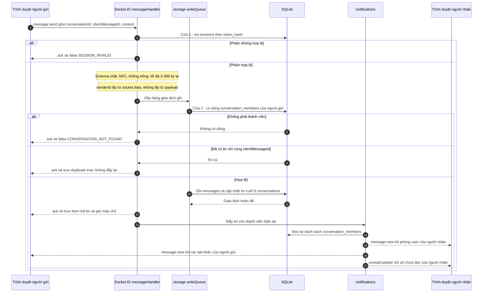
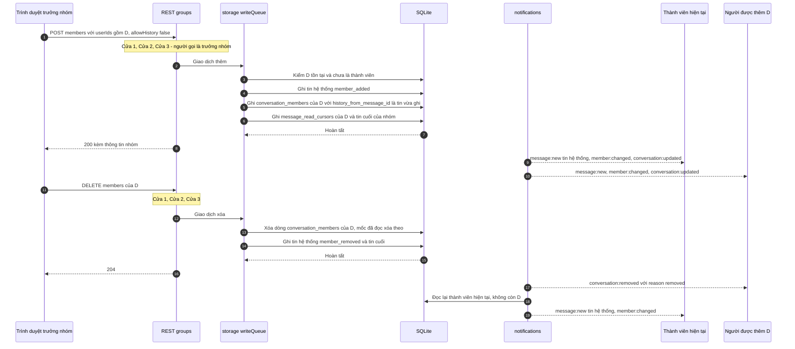
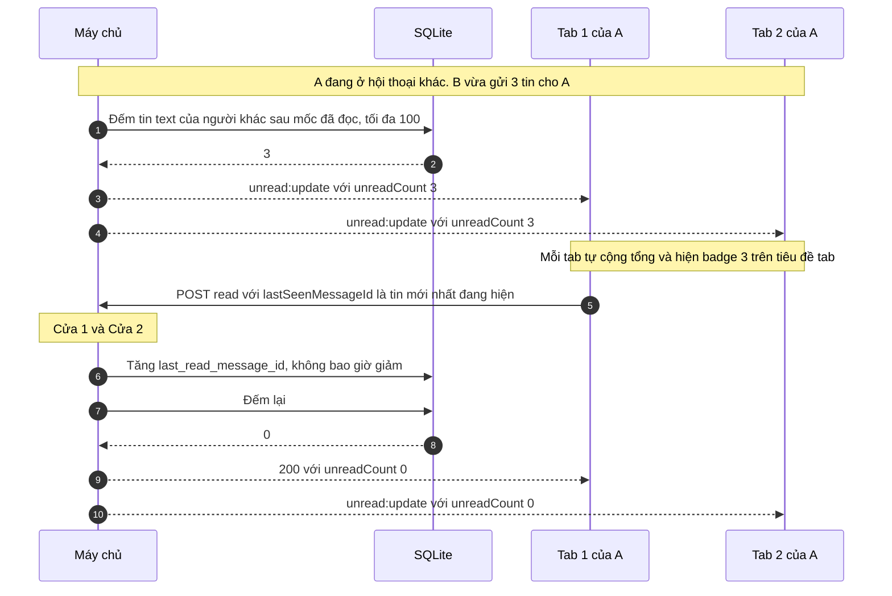
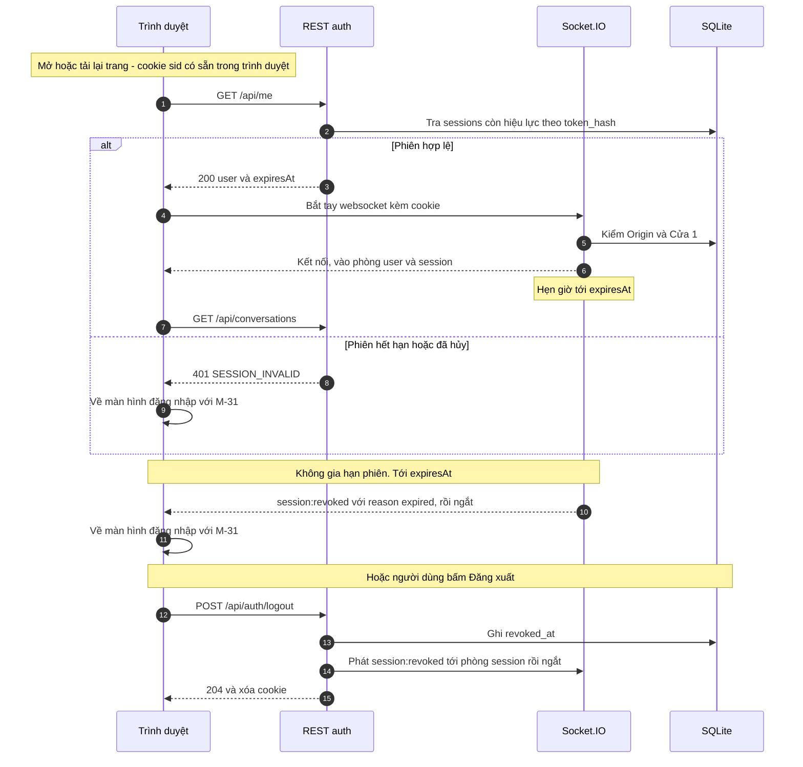

# 09 - Thiết kế chi tiết (Detailed Design)

| Mục | Nội dung |
|---|---|
| Dự án | Ứng dụng chat nội bộ (MVP) – Nhóm: *[chưa xác định]* |
| Tệp | `docs/09-detailed-design.md` |
| Phiên bản | 1.0 – Draft |
| Ngày | 2026-11-14 |
| Người soạn | Nhóm Architect / BA / QA (bản nháp có trợ lý AI hỗ trợ soạn thảo) |
| Trạng thái | Draft – dựa trên các ADR **đang ở trạng thái Đề xuất** của `08` (SQLite, token phiên + cookie, argon2id, Socket.IO phòng theo người dùng). Nếu ADR nào bị đổi, phải sửa các mục liên quan ở đây |
| Căn cứ | (1) PDF "Xây dựng ứng dụng chat nội bộ (MVP)", ngày 13~14/11/2026 – **nguồn duy nhất của yêu cầu nghiệp vụ**; (2) `docs/01-brd.md` v1.1, `02-srs.md` v1.1, `03-frs.md` v1.0, `04-use-cases.md` v1.1, `05-user-stories.md` v1.0, `06-erd.md` v1.0, `07-data-flow.md` v1.0, `08-high-level-design.md` v1.0 – **tất cả đang ở trạng thái Draft** |

**Quy ước ký hiệu**

| Ký hiệu | Ý nghĩa |
|---|---|
| `[PDF]` | Do đề bài quy định. Không được tự thay đổi. |
| `[QĐ-xx]` | Quyết định của Product Owner. |
| `[GĐ]` `[GS]` `[GF]` `[GU]` `[GE]` `[GL]` `[GH]` | Giả định đã ghi ở BRD / SRS / FRS / Use case / ERD / Data flow / HLD. |
| `[GT-xx]` | Giả định mới của tài liệu này (mục 17). |
| `[ADR-xx]` | Quyết định kiến trúc ở `08` mục 15. |
| `[ĐX]` | Lựa chọn kỹ thuật do nhóm đề xuất, không phải yêu cầu đề bài. |
| `[OQ-xx]` | Câu hỏi mở. OQ-01…OQ-38 đã có; OQ-39 trở đi phát sinh ở tài liệu này (mục 18). |
| `E-xx` | Một endpoint REST (mục 7). |
| `S-xx` | Một sự kiện Socket.IO (mục 8). |
| `T-xx` | Tuyến theo `07-data-flow.md` mục 5.3. |
| `M-xx` | Thông báo hiển thị theo `03-frs.md` mục 5. |
| `UT-`, `IT-`, `WS-`, `E2E-` | Mã kiểm thử tự động (mục 16). Đây là **mã định danh dự kiến**, chưa có kết quả nào. |

> Tài liệu này **không chứa kết quả chạy thử, kết quả kiểm thử hay số đo hiệu năng nào**. Các ví dụ JSON dùng dữ liệu mẫu lấy từ tiêu chí chấp nhận trong `02-srs.md`.

---

## 1. Giải thích nhanh cho người không làm IT

| Thuật ngữ | Giải thích dễ hiểu |
|---|---|
| Endpoint (REST API) | Một "ô cửa" trên máy chủ mà ứng dụng web gõ vào để làm một việc, ví dụ `POST /api/auth/login` để đăng nhập. |
| Phương thức HTTP | Loại việc: `GET` = xem, `POST` = tạo hoặc thực hiện, `PUT`/`PATCH` = sửa, `DELETE` = xóa. |
| Mã trạng thái | Con số máy chủ trả về: `200` thành công, `201` đã tạo mới, `204` thành công không có nội dung, `400` dữ liệu sai, `401` chưa đăng nhập hoặc phiên hết hạn, `403` không đủ quyền, `404` không tìm thấy, `409` xung đột (ví dụ trùng tên). |
| Sự kiện Socket.IO | Một "bức điện" gửi qua đường dây WebSocket luôn mở, ví dụ `message:new` = có tin mới. |
| Ack (xác nhận) | Lời đáp của máy chủ cho một bức điện, ví dụ "đã lưu tin, mã tin là 125". |
| Cursor (con trỏ trang) | Mốc "tin cũ nhất đang xem" để lấy tiếp 50 tin cũ hơn, thay vì đếm "trang số mấy". |
| Idempotency | Gửi lại cùng một yêu cầu nhiều lần vẫn chỉ cho ra **một** kết quả, ví dụ bấm "Gửi lại" không tạo hai tin giống nhau. |
| Giao dịch (transaction) | Nhóm thao tác ghi cùng thành công hoặc cùng thất bại. |
| Coding agent | Trợ lý AI viết mã. Tài liệu này đủ chi tiết để người hoặc trợ lý AI viết mã theo, kèm kiểm thử. |

## 2. Nguồn của từng loại quyết định

| Loại | Ví dụ trong tài liệu này | Nguồn |
|---|---|---|
| Bắt buộc theo PDF | Tối đa 5.000 ký tự/tin; 50 tin mỗi lần tải; tên đăng nhập duy nhất; mật khẩu ≥ 8 ký tự có chữ và số; băm argon2/bcrypt; phiên có hạn, đăng xuất hủy; realtime qua WebSocket; người ngoài không đọc được | `[PDF §3, §4]` |
| Quyết định Product Owner | Mã đăng ký tổ chức; quy tắc tên đăng nhập; phiên 8 giờ; tùy chọn cho xem tin cũ; tin hệ thống không tính chưa đọc; trưởng nhóm rời phải chuyển quyền | `[QĐ-03…QĐ-10]` |
| Kiến trúc đã đề xuất ở `08` | SQLite + Prisma; token phiên + cookie HttpOnly; argon2id; Socket.IO phòng theo người dùng; một tiến trình | `[ADR-01…ADR-05]` |
| Lựa chọn kỹ thuật mới ở đây | Đường dẫn API, tên sự kiện, mã lỗi, định dạng JSON, ID dạng chuỗi, cursor, idempotency bằng `clientMessageId`, cây thư mục | `[ĐX]`, `[GT-xx]` |

## 3. Cấu trúc mã nguồn

### 3.1 Cây thư mục

```text
chat-mvp-nhom-3/
├─ package.json                  # npm workspaces: shared, server, web
├─ .env.example                  # mẫu biến môi trường (mục 15), KHÔNG chứa giá trị bí mật
├─ shared/                       # mã dùng chung cho web và server
│  └─ src/
│     ├─ text.ts                 # normalizeText, countChars, toSearchKey (mục 6.1)
│     ├─ rules.ts                # hằng số: MAX_MESSAGE_CHARS = 5000, PAGE_SIZE = 50, ...
│     ├─ schemas.ts              # schema kiểm tra body API và payload sự kiện (thư viện zod)
│     ├─ dto.ts                  # kiểu dữ liệu trả về (mục 9)
│     ├─ errors.ts               # mã lỗi ↔ thông báo M-xx tiếng Việt (mục 5)
│     └─ events.ts               # tên sự kiện Socket.IO (mục 8)
├─ server/
│  ├─ prisma.config.ts           # cấu hình Prisma 7: đường dẫn schema, migration, DATABASE_URL
│  ├─ prisma/
│  │  ├─ schema.prisma           # mục 11.2
│  │  └─ migrations/             # SQL do Prisma sinh + SQL bổ sung CHECK, index có điều kiện (mục 11.3)
│  ├─ src/
│  │  ├─ main.ts                 # khởi động: đọc env, tạo HTTP server, gắn Socket.IO, lắng nghe PORT
│  │  ├─ app.ts                  # tạo Express app (tách riêng để kiểm thử)
│  │  ├─ config/env.ts           # đọc và kiểm tra biến môi trường; thiếu biến bắt buộc thì dừng
│  │  ├─ http/
│  │  │  ├─ router.ts            # gắn route của các module dưới /api
│  │  │  └─ middlewares/
│  │  │     ├─ checkOrigin.ts    # BM-09
│  │  │     ├─ requireSession.ts # Cửa 1
│  │  │     ├─ loadMembership.ts # Cửa 2: gắn req.membership hoặc trả 404
│  │  │     ├─ requireOwner.ts   # Cửa 3
│  │  │     ├─ validate.ts       # kiểm tra body/query theo schema
│  │  │     └─ errorHandler.ts   # đổi lỗi thành JSON chuẩn (mục 4.4)
│  │  ├─ realtime/
│  │  │  ├─ io.ts                # tạo Socket.IO server, kiểm tra bắt tay, gắn phòng user: và session:
│  │  │  └─ messageHandler.ts    # xử lý S-02 message:send
│  │  ├─ modules/
│  │  │  ├─ auth/        auth.routes.ts, auth.service.ts, password.ts, sessionToken.ts
│  │  │  ├─ users/       users.routes.ts, users.service.ts
│  │  │  ├─ chat/        conversations.routes.ts, conversations.service.ts,
│  │  │  │               messages.routes.ts, messages.service.ts, read.service.ts
│  │  │  ├─ groups/      groups.routes.ts, groups.service.ts, systemMessages.ts
│  │  │  └─ notifications/ notifier.ts, unread.service.ts, presenters.ts
│  │  ├─ storage/
│  │  │  ├─ prisma.ts            # PrismaClient + driver adapter (mục 11.1)
│  │  │  ├─ writeQueue.ts        # một giao dịch ghi tại một thời điểm (GH-04)
│  │  │  ├─ sql/                 # truy vấn thô: đếm chưa đọc, trang tin có phạm vi xem
│  │  │  └─ repositories/        # users, sessions, conversations, members, messages, readCursors
│  │  └─ generated/prisma/       # mã do Prisma sinh – không sửa tay, không commit nếu nhóm thống nhất
│  └─ test/
│     ├─ unit/                   # UT-xx
│     ├─ integration/            # IT-xx (Supertest)
│     ├─ socket/                 # WS-xx (socket.io-client)
│     └─ helpers/                # tạo app với CSDL thử, tạo người dùng/phiên mẫu
└─ web/
   ├─ vite.config.ts             # proxy /api và /socket.io (ws: true) sang máy chủ khi phát triển
   ├─ src/
   │  ├─ main.tsx, App.tsx, routes.tsx
   │  ├─ api/                    # http.ts (fetch kèm cookie, đổi lỗi), auth.ts, users.ts, conversations.ts
   │  ├─ realtime/socket.ts      # kết nối, ack 10 giây, tự nối lại, tải tin bị lỡ
   │  ├─ state/                  # session, conversations, messages, outbox (tin chờ gửi/gửi lỗi)
   │  ├─ pages/                  # Register (SCR-01), Login (SCR-02), Home (SCR-03), Conversation (SCR-04),
   │  │                          # CreateGroup (SCR-05), GroupInfo (SCR-06/06a/06b), Profile (SCR-07),
   │  │                          # ChangePassword (SCR-08)
   │  ├─ components/             # ConversationList, MessageList, Composer, Avatar, UnreadBadge, ...
   │  └─ i18n/vi.ts              # mọi chuỗi giao diện tiếng Việt (NFR-10)
   └─ e2e/acceptance.spec.ts     # E2E-AT-01…E2E-AT-06 (Playwright)
```

### 3.2 Quy tắc bắt buộc khi viết mã

Áp dụng nguyên văn các quy tắc bất biến QB-01…QB-10 của `08` mục 11. Bổ sung:

| # | Quy tắc |
|---|---|
| QB-11 | Route và handler **không bao giờ** đọc `senderId`, `userId` của người thực hiện, `role` hay `ownerId` từ body/query/payload. Danh tính người thực hiện **chỉ** lấy từ phiên (`req.auth.userId`, `socket.data.userId`). Schema kiểm tra ở chế độ **chặt**: trường lạ bị từ chối với `VALIDATION_ERROR` `[ĐX]`. |
| QB-12 | Mọi giới hạn (5.000, 50, 3–30, 8–64, 1–50, 1–100, 20) lấy từ `shared/src/rules.ts`; không gõ số trực tiếp ở nơi khác. |
| QB-13 | Mọi chuỗi hiển thị cho người dùng lấy từ `shared/src/errors.ts` hoặc `web/src/i18n/vi.ts`. |
| QB-14 | Mã trong `server/src/generated/` không sửa tay. |

## 4. Quy ước chung của API

### 4.1 Định dạng

| Mục | Quy ước | Nguồn |
|---|---|---|
| Đường dẫn gốc | `/api` | `[ĐX]` |
| Dữ liệu | JSON, mã hóa UTF-8 | `[PDF §4]` Unicode |
| Tên trường | **camelCase** ở API và sự kiện; **snake_case** ở CSDL; Prisma ánh xạ bằng `@map` | `08` mục 7.1 |
| ID | Trả về dạng **chuỗi số** (`"id": "42"`). Trình duyệt coi là chuỗi không đoán được ý nghĩa; không cộng trừ, không so sánh | `[GT-01]` |
| Thời gian | Chuỗi ISO 8601 theo giờ UTC, ví dụ `"2026-11-14T07:05:00.000Z"`; trình duyệt tự đổi sang giờ máy người dùng `[GS-26]` | `[ĐX]` |
| Kích thước body | Tối đa 64 KB; vượt thì trả `413` | `[ĐX]`, BM-05 |

### 4.2 Phiên và cookie

| Mục | Giá trị | Nguồn |
|---|---|---|
| Tên cookie | Theo `SESSION_COOKIE_NAME`, mặc định `sid` | `[ĐX]` |
| Giá trị | Token ngẫu nhiên 32 byte, mã hóa base64url. CSDL chỉ lưu `token_hash` = SHA-256 dạng hex (64 ký tự) | `[GE-03]`, `[ADR-02]` |
| Thuộc tính | `HttpOnly`; `SameSite=Strict`; `Path=/`; `Secure` theo `COOKIE_SECURE`; `Max-Age` = số giây còn lại tới `expires_at` | `[ADR-02]`, `[GH-05]` |
| Thời hạn | `expires_at` = lúc đăng nhập + `SESSION_TTL_HOURS` (mặc định 8). **Không gia hạn**, kể cả khi người dùng đang hoạt động | `[QĐ-09]`, `[GT-03]` |

### 4.3 Kiểm tra nguồn gửi (Origin)

Mọi yêu cầu `POST`, `PUT`, `PATCH`, `DELETE` và mọi lần bắt tay Socket.IO phải có header `Origin` **đúng bằng** `APP_ORIGIN`. Sai hoặc thiếu thì trả `403 ORIGIN_FORBIDDEN` (HTTP) hoặc từ chối bắt tay (Socket.IO) `[BM-09]`, `[GT-10]`.

### 4.4 Định dạng lỗi

```json
{
  "error": {
    "code": "CONVERSATION_NOT_FOUND",
    "message": "Không tìm thấy hội thoại hoặc bạn không có quyền truy cập.",
    "fields": null
  }
}
```

- `code`: mã máy đọc (mục 5). `message`: câu tiếng Việt theo M-xx của `03-frs.md`.
- `fields`: với `VALIDATION_ERROR`, là đối tượng `{ "tênTrường": "mã M-xx" }` để giao diện hiện lỗi dưới đúng ô nhập; các lỗi khác là `null`.
- Không bao giờ trả chi tiết lỗi nội bộ (ngăn xếp lời gọi, câu SQL) cho trình duyệt.

### 4.5 Chính sách mã trạng thái cho quyền truy cập

| Tình huống | Mã | Lý do |
|---|---|---|
| Không có cookie, phiên hết hạn hoặc đã hủy | `401 SESSION_INVALID` (M-31) | `[PDF TK-03]`, NFR-03 |
| Hội thoại **không tồn tại** hoặc người yêu cầu **không phải thành viên hiện tại** | `404 CONVERSATION_NOT_FOUND` (M-30) – **giống hệt nhau** | `[FRS 6.1 mục 3]`, NFR-04: không để lộ hội thoại có tồn tại hay không. Đây là lý do **không** dùng `403` cho người ngoài `[GT-02]`, `[OQ-39]` |
| Thành viên nhưng không phải trưởng nhóm làm việc của trưởng nhóm | `403 NOT_GROUP_OWNER` (M-29) | Thành viên đã biết nhóm tồn tại, không lộ gì thêm |
| Thao tác chỉ dành cho nhóm nhưng hội thoại là 1-1 | `404 CONVERSATION_NOT_FOUND` | Coi như "không tìm thấy nhóm" `[GT-19]` |

## 5. Danh mục mã lỗi

| Mã lỗi | HTTP | Thông báo | Dùng ở |
|---|---|---|---|
| `VALIDATION_ERROR` | 400 | Theo `fields`: M-02, M-03, M-04, M-06, M-07, M-08, M-17, M-25, M-26, M-35 | Mọi endpoint có body/query; S-02 |
| `ORG_CODE_INVALID` | 400 | M-05 | E-01 |
| `USERNAME_TAKEN` | 409 | M-01 | E-01 |
| `INVALID_CREDENTIALS` | 401 | M-09 | E-02 |
| `SESSION_INVALID` | 401 | M-31 | Mọi endpoint cần phiên; bắt tay Socket.IO; S-02 |
| `ORIGIN_FORBIDDEN` | 403 | M-34 | Mọi yêu cầu thay đổi dữ liệu; bắt tay Socket.IO |
| `CURRENT_PASSWORD_WRONG` | 400 | M-10 | E-06 |
| `PASSWORD_SAME_AS_OLD` | 400 | M-11 | E-06 |
| `SELF_CONVERSATION` | 400 | M-15 | E-08 |
| `USER_NOT_FOUND` | 404 | M-16 | E-08 |
| `CONVERSATION_NOT_FOUND` | 404 | M-30 | E-10…E-12, E-14…E-17; S-02 |
| `NOT_GROUP_OWNER` | 403 | M-29 | E-14, E-15, E-16 |
| `GROUP_MEMBER_NOT_FOUND` | 400 | M-27 | E-13 (có tài khoản được chọn không tồn tại) |
| `MEMBER_ADD_INVALID` | 409 | M-36 | E-15 (đã là thành viên hoặc không tồn tại) |
| `MEMBER_NOT_IN_GROUP` | 404 | **M-39 – đề xuất mới** "Người này không còn trong nhóm." | E-16 `[GT-11]` |
| `CANNOT_REMOVE_SELF` | 400 | **M-38 – đề xuất mới** "Trưởng nhóm muốn ra khỏi nhóm hãy dùng chức năng Rời nhóm." | E-16 `[GT-11]` |
| `NEW_OWNER_REQUIRED` | 400 | M-37 | E-17 (trưởng nhóm không chọn hoặc chọn người không phải thành viên) |
| `LAST_MEMBER_CANNOT_LEAVE` | 409 | M-28 | E-17 |
| `MESSAGE_TOO_LONG` | 400 | M-17 | S-02 |
| `CLIENT_MESSAGE_ID_CONFLICT` | 409 | M-20 | S-02 (mục 14) |
| `PAYLOAD_TOO_LARGE` | 413 | M-34 | Mọi endpoint; S-02 |
| `INTERNAL_ERROR` | 500 | M-34 | Lỗi không lường trước |

M-38 và M-39 **chưa có** trong `03-frs.md`; cần Product Owner duyệt câu chữ và bổ sung vào `03` (OQ-41).

## 6. Quy tắc kiểm tra dữ liệu (validation)

Máy chủ luôn kiểm tra lại toàn bộ; trình duyệt dùng **cùng** hàm ở `shared/` để báo lỗi sớm `[FRS NT-01]`.

### 6.1 Hàm xử lý văn bản dùng chung (`shared/src/text.ts`)

| Hàm | Làm gì | Nguồn |
|---|---|---|
| `normalizeText(s)` | Đổi `\r\n` và `\r` thành `\n`, rồi chuẩn hóa Unicode **NFC** | `[GS-18]`, `[FRS NT-02]` |
| `countChars(s)` | Đếm **ký tự người đọc nhìn thấy** (cụm ký tự – grapheme) bằng `Intl.Segmenter`. Mỗi `\n` tính 1 | `[GS-18]` |
| `countCodePoints(s)` | Đếm điểm mã Unicode (`Array.from(s).length`) – khớp cách đếm `length()` của SQLite | `[GE-12]` |
| `toSearchKey(s)` | `normalizeText` → bỏ khoảng trắng đầu/cuối → `toLocaleLowerCase('vi-VN')`. Giữ dấu (tìm có phân biệt dấu) | `[PDF §4]`, `[GĐ-10]` |
| `escapeLike(s)` | Thêm ký tự thoát trước `%`, `_`, `\` để từ khóa không bị hiểu là ký tự đại diện | `[ĐX]` |

### 6.2 Bảng quy tắc

| Mã | Trường | Xử lý trước | Quy tắc | Lỗi | Nguồn |
|---|---|---|---|---|---|
| V-01 | `username` (đăng ký, đăng nhập) | Bỏ khoảng trắng đầu/cuối, đổi chữ thường | Khớp `^[a-z0-9._]{3,30}$` | M-02 | `[QĐ-07]`, `[GF-01]` |
| V-02 | `username` duy nhất | Như V-01 | Ràng buộc duy nhất ở CSDL; vi phạm thì `409 USERNAME_TAKEN` (bắt lỗi trùng của Prisma, mã `P2002`) | M-01 | `[PDF TK-01]` |
| V-03 | `password`, `newPassword` | `normalizeText`; **không** bỏ khoảng trắng | `countChars` từ 8 đến 64; có ít nhất một chữ cái (`/\p{L}/u`) và một chữ số `0–9` | M-06, M-07, M-08 | `[PDF TK-02]`, `[GS-04]`, `[GS-05]`, `[GT-04]` |
| V-04 | `confirmPassword` | – | Giống hệt `newPassword` | M-04 | `[ĐX]` |
| V-05 | `displayName` | `normalizeText` + bỏ khoảng trắng đầu/cuối | `countChars` từ 1 đến 50 | M-03 | `[GS-02]` |
| V-06 | `orgCode` | Bỏ khoảng trắng đầu/cuối | So khớp chính xác với `ORG_REGISTRATION_CODE`; kiểm **trước mọi kiểm tra khác** của E-01 | M-05 | `[QĐ-06]`, `[GU-02]` |
| V-07 | `name` (tên nhóm) | `normalizeText` + bỏ khoảng trắng đầu/cuối | `countChars` từ 1 đến 100 | M-25 | `[GS-28]` |
| V-08 | `memberIds` (tạo nhóm) | Bỏ trùng | Ít nhất 2 phần tử; không chứa chính người tạo; mọi ID đều tồn tại | M-26, M-27 | `[PDF NH-01]`, `[GĐ-05]` |
| V-09 | `content` (tin) | `normalizeText`; **không** bỏ khoảng trắng | (a) có ít nhất một ký tự không phải khoảng trắng (`/\S/u`); (b) `countChars` ≤ 5.000; (c) `countCodePoints` ≤ 5.000 (khớp CHECK của CSDL) | Trống: không gửi; quá dài: M-17 | `[PDF CH-02]`, `[GS-18]`, `[GS-19]`, `[GT-05]` |
| V-10 | `q` (tìm người) | `toSearchKey` | Sau xử lý có ít nhất 1 ký tự | M-35 không dùng; giao diện không gửi khi trống (E-TK06-1) | `[GS-14]` |
| V-11 | ID trong đường dẫn, body | – | Chuỗi chỉ gồm chữ số, không bắt đầu bằng `0`, tối đa 15 chữ số | `VALIDATION_ERROR`; với `:id` hội thoại sai định dạng thì trả `404 CONVERSATION_NOT_FOUND` để không lộ thông tin | `[GT-01]` |
| V-12 | `clientMessageId` | – | Chuỗi UUID phiên bản 4 | `VALIDATION_ERROR` | Mục 14 |
| V-13 | `before`, `after` (trang tin) | – | Theo V-11; **không** được gửi cả hai cùng lúc | `VALIDATION_ERROR` | Mục 7, E-11 |
| V-14 | `limit` (trang tin) | – | Số nguyên 1–50, mặc định 50. Giao diện luôn dùng 50 | `VALIDATION_ERROR` | `[PDF CH-03]`, `[GT-06]` |

**Ví dụ phải đúng** (lấy từ tiêu chí chấp nhận SRS, dùng làm kiểm thử UT): `abc12345` hợp lệ; `abcdefgh`, `12345678`, `abc1234` không hợp lệ (TK-02-AC2); `NhanVien01` trùng `nhanvien01` (TK-01-AC2); tin đúng 5.000 ký tự gửi được, 5.001 bị từ chối (CH-02-AC3); `Đặng Thị Ẩn` lưu đúng từng ký tự (TK-01-AC4).

## 7. REST API

### 7.1 Bảng tổng hợp

"Cửa" theo `07` mục 5.2: C1 = phiên hợp lệ; C2 = thành viên hiện tại; C3 = trưởng nhóm.

| # | Method | Path | Mô tả | Cửa | Tuyến (07) | Mã yêu cầu |
|---|---|---|---|---|---|---|
| E-01 | POST | `/api/auth/register` | Đăng ký | Không | T-01 | TK-01, TK-02 |
| E-02 | POST | `/api/auth/login` | Đăng nhập, đặt cookie phiên | Không | T-02 | TK-03 |
| E-03 | POST | `/api/auth/logout` | Đăng xuất, hủy phiên | C1 | T-03 | TK-03 |
| E-04 | GET | `/api/me` | Hồ sơ của tôi + hạn phiên; dùng để khôi phục phiên khi tải lại trang | C1 | T-05 | TK-05, TK-03 |
| E-05 | PUT | `/api/me` | Sửa tên hiển thị | C1 | T-05 | TK-05 |
| E-06 | PUT | `/api/me/password` | Đổi mật khẩu, hủy các phiên khác | C1 | T-04 | TK-04, TK-02 |
| E-07 | GET | `/api/users?q=` | Tìm người dùng (tối đa 20) | C1 | T-06 | TK-06 |
| E-08 | POST | `/api/conversations/direct` | Mở hoặc tạo hội thoại 1-1 | C1 | T-07 | CH-01 |
| E-09 | GET | `/api/conversations` | Danh sách hội thoại + trích tin cuối + số chưa đọc | C1 | T-08 | CH-06, TB-01 |
| E-10 | GET | `/api/conversations/:id` | Thông tin một hội thoại (tên, thành viên, vai trò) | C1 + C2 | T-20 *(đề xuất bổ sung vào 07)* | NH-02, NH-03, CH-01 |
| E-11 | GET | `/api/conversations/:id/messages` | Trang 50 tin theo cursor `before` hoặc `after` | C1 + C2 + phạm vi xem | T-09, T-10 | CH-03, NH-02 |
| E-12 | POST | `/api/conversations/:id/read` | Đánh dấu đã đọc | C1 + C2 | T-11 | TB-01 |
| E-13 | POST | `/api/conversations/group` | Tạo nhóm | C1 | T-15 | NH-01, NH-04 |
| E-14 | PATCH | `/api/conversations/:id` | Đổi tên nhóm | C1 + C2 + C3 | T-18 | NH-03, NH-04 |
| E-15 | POST | `/api/conversations/:id/members` | Thêm thành viên (kèm lựa chọn cho xem tin cũ) | C1 + C2 + C3 | T-16 | NH-03, NH-04 |
| E-16 | DELETE | `/api/conversations/:id/members/:userId` | Xóa thành viên | C1 + C2 + C3 | T-17 | NH-03, NH-04 |
| E-17 | POST | `/api/conversations/:id/leave` | Rời nhóm (trưởng nhóm phải chọn người nhận quyền) | C1 + C2 | T-19 | NH-03, NH-04 |

**Không có endpoint gửi tin qua HTTP**: gửi tin chỉ qua S-02 (`message:send`) `[ADR-03]`.

### 7.2 Chi tiết từng endpoint

Mọi endpoint có C2: **Kiểm tra: người dùng là thành viên hiện tại của hội thoại (có dòng `conversation_members`); nếu không, trả `404 CONVERSATION_NOT_FOUND`, không đọc `messages`, không ghi gì** (mục 4.5).

#### E-01 – `POST /api/auth/register`

| Mục | Nội dung |
|---|---|
| Body | `{ "orgCode": "<mã tổ chức>", "username": "nhanvien01", "password": "Matkhau123", "displayName": "Nguyễn Văn An" }` |
| Thứ tự kiểm tra | V-06 (`orgCode`) → V-01 → V-03 → V-05 → V-02 |
| Thành công | `201` `{ "user": UserPublic }`. **Không** tự đăng nhập; giao diện chuyển tới đăng nhập với M-40 `[GS-03]` |
| Lỗi | `400 ORG_CODE_INVALID`; `400 VALIDATION_ERROR`; `409 USERNAME_TAKEN`; `403 ORIGIN_FORBIDDEN` |
| Ghi | `users`: `username` (chữ thường), `password_hash` (argon2id), `display_name`, `display_name_search` (= `toSearchKey(displayName)` – xem OQ-36) |

#### E-02 – `POST /api/auth/login`

| Mục | Nội dung |
|---|---|
| Body | `{ "username": "NhanVien01", "password": "Matkhau123" }` (tên đăng nhập không phân biệt hoa thường) |
| Thành công | `200` `{ "user": UserPublic, "session": { "expiresAt": "2026-11-14T15:05:00.000Z" } }` + header `Set-Cookie` (mục 4.2) |
| Lỗi | `400 VALIDATION_ERROR` (thiếu trường – M-35); `401 INVALID_CREDENTIALS` – **cùng một** câu cho sai tên và sai mật khẩu (TK-03-AC1) |
| Ghi | `sessions`: `token_hash`, `expires_at` |
| Ghi chú | Khi tên đăng nhập không tồn tại, vẫn chạy một lần kiểm tra băm giả để thời gian trả lời tương đương `[ĐX]` |

#### E-03 – `POST /api/auth/logout`

| Mục | Nội dung |
|---|---|
| Body | Không có |
| Thành công | `204`; header xóa cookie |
| Tác dụng | Ghi `sessions.revoked_at` cho phiên hiện tại; đẩy S-08 `session:revoked` (`reason: "logout"`) tới phòng `session:{sessionId}` rồi ngắt mọi đường dây của phiên đó `[PDF TK-03]` |
| Lỗi | `401 SESSION_INVALID` |

#### E-04 – `GET /api/me`

| Mục | Nội dung |
|---|---|
| Thành công | `200` `{ "user": UserPublic, "session": { "expiresAt": "..." } }` |
| Dùng khi | Ứng dụng web mở hoặc tải lại trang: có `200` thì vào trang chính và mở đường dây Socket.IO; `401` thì về màn hình đăng nhập (mục 13.4) |
| Lỗi | `401 SESSION_INVALID` |

#### E-05 – `PUT /api/me`

| Mục | Nội dung |
|---|---|
| Body | `{ "displayName": "Trần Thị Bình" }` |
| Thành công | `200` `{ "user": UserPublic }` |
| Tác dụng | Cập nhật `display_name`, `display_name_search`. Tin cũ hiển thị tên mới vì tên được lấy theo người gửi lúc đọc `[GS-12]`; tin hệ thống giữ tên tại thời điểm sự kiện `[GS-32]` |
| Lỗi | `400 VALIDATION_ERROR` (M-03); `401` |

#### E-06 – `PUT /api/me/password`

| Mục | Nội dung |
|---|---|
| Body | `{ "currentPassword": "Matkhau123", "newPassword": "Matkhau456", "confirmPassword": "Matkhau456" }` |
| Thành công | `204`; giao diện hiện M-41 |
| Thứ tự kiểm tra | `currentPassword` đúng (M-10) → V-03 cho `newPassword` → V-04 → mật khẩu mới khác mật khẩu cũ (kiểm bằng cách đối chiếu `newPassword` với băm cũ – M-11) |
| Tác dụng | Ghi băm mới; ghi `revoked_at` cho **mọi phiên khác** của tài khoản; đẩy S-08 (`reason: "password_changed"`) tới các phiên đó và ngắt đường dây. Phiên hiện tại giữ nguyên `[QĐ-09]` |
| Lỗi | `400 CURRENT_PASSWORD_WRONG`, `400 VALIDATION_ERROR`, `400 PASSWORD_SAME_AS_OLD`, `401` |

#### E-07 – `GET /api/users?q=Đặng`

| Mục | Nội dung |
|---|---|
| Thành công | `200` `{ "items": [UserPublic] }`, tối đa 20, không có chính người tìm, sắp theo tên hiển thị |
| Truy vấn | `q' = escapeLike(toSearchKey(q))`; điều kiện `username LIKE '%q'%' ESCAPE '\'` **hoặc** `display_name_search LIKE '%q'%' ESCAPE '\'`; loại `id = người tìm` |
| Ghi chú | Không dùng `lower()` của SQLite vì chỉ xử lý chữ không dấu (`08` mục 16.1) |
| Lỗi | `400 VALIDATION_ERROR` (q trống); `401` |

#### E-08 – `POST /api/conversations/direct`

| Mục | Nội dung |
|---|---|
| Body | `{ "userId": "2" }` |
| Thành công | `200` nếu đã có hội thoại; `201` nếu vừa tạo. Body `{ "conversation": ConversationSummary }` |
| Logic | Mục 12.1 |
| Lỗi | `400 SELF_CONVERSATION`; `404 USER_NOT_FOUND`; `400 VALIDATION_ERROR`; `401` |

#### E-09 – `GET /api/conversations`

| Mục | Nội dung |
|---|---|
| Thành công | `200` `{ "items": [ConversationSummary], "totalUnread": 7 }`. Chỉ hội thoại có dòng `conversation_members` của người yêu cầu **và** `last_message_id` khác rỗng (1-1 chưa có tin bị ẩn – `[GS-16]`, `[GF-09]`). Sắp theo `last_message_at` giảm dần. **Không phân trang** trong MVP `[GT-08]` |
| `unreadCount` | Mỗi hội thoại tối đa 100 (mục 12.5); giao diện hiện "99+" khi ≥ 100 |
| `totalUnread` | Tổng các `unreadCount` |
| Lỗi | `401` |

#### E-10 – `GET /api/conversations/:id`

| Mục | Nội dung |
|---|---|
| Thành công | `200` `{ "conversation": ConversationDetail }` – gồm danh sách **thành viên hiện tại** (`id`, `username`, `displayName`, `role`) |
| Kiểm tra | C1 + C2 |
| Lỗi | `404 CONVERSATION_NOT_FOUND`; `401` |

#### E-11 – `GET /api/conversations/:id/messages?before=&after=&limit=50`

| Mục | Nội dung |
|---|---|
| Tham số | Không có `before`, `after`: 50 tin **mới nhất**. `before=<messageId>`: 50 tin cũ hơn tin đó (cuộn ngược). `after=<messageId>`: tối đa 50 tin mới hơn tin đó (tải tin bị lỡ sau khi nối lại, `[GL-05]`) |
| Thành công | `200` `{ "items": [Message], "hasMore": true }`. `items` luôn sắp **từ cũ đến mới**. `hasMore = true` nghĩa là còn tin theo hướng đang tải |
| Kiểm tra | C1 + C2; mọi tin trả về có `id ≥ history_from_message_id` (nếu có) `[QĐ-08]` |
| Logic | Mục 12.3 |
| Lỗi | `404 CONVERSATION_NOT_FOUND`; `400 VALIDATION_ERROR`; `401` |

#### E-12 – `POST /api/conversations/:id/read`

| Mục | Nội dung |
|---|---|
| Body | `{ "lastSeenMessageId": "125" }` – mã tin mới nhất đang hiện trên màn hình |
| Thành công | `200` `{ "conversationId": "7", "unreadCount": 0 }` |
| Tác dụng | Mục 12.6: mốc đã đọc chỉ tăng; đẩy S-05 `unread:update` tới phòng `user:{tôi}` để các tab khác cập nhật `[GS-34]` |
| Gọi khi | Mở hội thoại; có `message:new` của hội thoại đang mở **và** tab đang được xem; tab chuyển lại trạng thái đang xem `[GS-33]` |
| Lỗi | `404 CONVERSATION_NOT_FOUND`; `400 VALIDATION_ERROR`; `401` |

#### E-13 – `POST /api/conversations/group`

| Mục | Nội dung |
|---|---|
| Body | `{ "name": "Phòng Kế hoạch", "memberIds": ["2", "3"] }` |
| Thành công | `201` `{ "conversation": ConversationSummary }` |
| Logic | Mục 12.7 |
| Lỗi | `400 VALIDATION_ERROR` (M-25, M-26); `400 GROUP_MEMBER_NOT_FOUND` (M-27); `401` |

#### E-14 – `PATCH /api/conversations/:id`

| Mục | Nội dung |
|---|---|
| Body | `{ "name": "Phòng Kế hoạch 2" }` |
| Thành công | `200` `{ "conversation": ConversationSummary }`. Tên mới giống tên cũ thì `200`, không sinh tin hệ thống `[GF-19]` |
| Kiểm tra | C1 + C2 + C3; hội thoại phải là nhóm |
| Lỗi | `404`; `403 NOT_GROUP_OWNER`; `400 VALIDATION_ERROR` (M-25); `401` |

#### E-15 – `POST /api/conversations/:id/members`

| Mục | Nội dung |
|---|---|
| Body | `{ "userIds": ["4"], "allowHistory": false }` – `allowHistory` là ô "Cho xem tin nhắn trước đó", mặc định `false` `[QĐ-08]`, `[GS-35]`; áp dụng cho cả lần thêm `[GF-17]` |
| Thành công | `200` `{ "conversation": ConversationDetail }` |
| Logic | Mục 12.8. Một người không hợp lệ thì **không thêm ai** trong lần đó `[GU-13]` |
| Lỗi | `404`; `403 NOT_GROUP_OWNER`; `409 MEMBER_ADD_INVALID` (M-36); `400 VALIDATION_ERROR`; `401` |

#### E-16 – `DELETE /api/conversations/:id/members/:userId`

| Mục | Nội dung |
|---|---|
| Thành công | `204` |
| Logic | Mục 12.9 |
| Lỗi | `404 CONVERSATION_NOT_FOUND`; `403 NOT_GROUP_OWNER`; `400 CANNOT_REMOVE_SELF`; `404 MEMBER_NOT_IN_GROUP`; `401` |

#### E-17 – `POST /api/conversations/:id/leave`

| Mục | Nội dung |
|---|---|
| Body | Thành viên thường: `{}`. Trưởng nhóm: `{ "newOwnerId": "3" }` `[QĐ-03]` |
| Thành công | `204` |
| Logic | Mục 12.10 |
| Lỗi | `404`; `400 NEW_OWNER_REQUIRED` (M-37); `409 LAST_MEMBER_CANNOT_LEAVE` (M-28); `401` |

## 8. Hợp đồng sự kiện Socket.IO

### 8.1 Kết nối (S-01, tuyến T-12)

| Mục | Nội dung | Nguồn |
|---|---|---|
| Đường dẫn | `/socket.io`, cùng địa chỉ gốc với web | `08` mục 5 |
| Kiểu truyền | Chỉ `websocket` ở cả máy chủ và trình duyệt | `[PDF §2]`, `[GH-07]` |
| Xác thực lúc bắt tay | Middleware `io.use`: (1) kiểm `Origin` = `APP_ORIGIN`; (2) đọc cookie phiên từ header; (3) Cửa 1 | `[ADR-02]` |
| Bắt tay thất bại | Lỗi kết nối với `message = "SESSION_INVALID"` hoặc `"ORIGIN_FORBIDDEN"`. Trình duyệt **không** tự thử lại khi gặp `SESSION_INVALID`; chuyển về đăng nhập (M-31) | `[GL-10]` |
| Sau khi bắt tay | `socket.data = { userId, sessionId, expiresAt }`; vào phòng `user:{userId}` và `session:{sessionId}`. **Không bao giờ** vào phòng theo hội thoại | `[ADR-03]`, QB-04 |
| Hết hạn | Đặt hẹn giờ tới `expiresAt`: tới hạn thì phát S-08 (`reason: "expired"`) rồi ngắt | `[GL-10]` |
| Giới hạn gói tin | `maxHttpBufferSize` = 64 KB | BM-05 |

**Thiết lập phía trình duyệt** `[ĐX]`: `io({ path: '/socket.io', transports: ['websocket'], withCredentials: true, reconnection: true, reconnectionDelay: 1000, reconnectionDelayMax: 30000 })` – khớp nhịp 1, 2, 4, 8… tối đa 30 giây `[GF-23]`.

### 8.2 Bảng sự kiện

| # | Tên | Chiều | Payload | Ack | Mô tả | Mã yêu cầu |
|---|---|---|---|---|---|---|
| S-02 | `message:send` | Trình duyệt → máy chủ | `{ conversationId, clientMessageId, content }` | **Có** (mục 8.3) | Gửi tin văn bản. **Không có** trường người gửi | CH-02, NH-02 |
| S-03 | `message:new` | Máy chủ → phòng `user:{id}` của mọi thành viên hiện tại | `{ message: Message }` | Không | Tin mới (văn bản hoặc hệ thống). Tab người gửi nhận lại chính tin của mình và ghép theo `clientMessageId` | CH-02, NH-02, NH-04 |
| S-04 | `conversation:updated` | Máy chủ → `user:{id}` | `{ conversation: ConversationSummary }` | Không | Hội thoại mới xuất hiện (nhóm mới; 1-1 vừa có tin đầu tiên; được thêm vào nhóm), đổi tên nhóm, đổi số thành viên. Trình duyệt **thay** dòng cũ bằng dòng mới | CH-06, NH-01, NH-03 |
| S-05 | `unread:update` | Máy chủ → `user:{id}` | `{ conversationId, unreadCount }` | Không | Số chưa đọc mới của **một** hội thoại cho **người nhận này**. Trình duyệt tự tính tổng `[GT-09]` | TB-01 |
| S-06 | `member:changed` | Máy chủ → `user:{id}` của thành viên hiện tại | `{ conversationId, members: [MemberInfo], ownerId }` | Không | Danh sách thành viên sau khi thêm, xóa, rời, chuyển quyền | NH-03 |
| S-07 | `conversation:removed` | Máy chủ → `user:{id}` của người bị xóa hoặc vừa rời | `{ conversationId, reason: "removed" \| "left" }` | Không | Gỡ hội thoại khỏi danh sách; nếu đang mở và `reason = "removed"` thì hiện M-32 `[GF-18]` | NH-03, `[QĐ-04]` |
| S-08 | `session:revoked` | Máy chủ → `session:{id}` | `{ reason: "logout" \| "password_changed" \| "expired" }` | Không | Phiên hết hiệu lực; máy chủ ngắt đường dây ngay sau đó | TK-03, TK-04 |

### 8.3 Ack của `message:send`

```json
{ "ok": true, "duplicate": false, "message": { "id": "125", "clientMessageId": "3f1c…", "createdAt": "…" } }
```

```json
{ "ok": false, "error": { "code": "MESSAGE_TOO_LONG", "message": "Tin nhắn vượt quá 5.000 ký tự (hiện có 5001 ký tự)." } }
```

| Tình huống | Ack | Trình duyệt làm gì |
|---|---|---|
| Lưu thành công | `ok: true, duplicate: false` | Đổi tin tạm thành tin chính thức (mã, giờ máy chủ) |
| Đã lưu trước đó với cùng `clientMessageId` | `ok: true, duplicate: true`, kèm tin cũ | Như trên; **không** tạo tin thứ hai (mục 14) |
| `VALIDATION_ERROR`, `MESSAGE_TOO_LONG` | `ok: false` | Giữ nội dung trong ô soạn, hiện lỗi; **không** gửi lại tự động |
| `CONVERSATION_NOT_FOUND` | `ok: false` | Hiện M-30; gỡ tin tạm |
| `SESSION_INVALID` | `ok: false` | Về màn hình đăng nhập (M-31) |
| `CLIENT_MESSAGE_ID_CONFLICT` | `ok: false` | Hiện M-20; tạo `clientMessageId` mới nếu người dùng gửi lại |
| **Không có ack sau 10 giây** hoặc mất kết nối | – | Tin chuyển "gửi lỗi" (M-20) với nút "Gửi lại"; gửi lại **cùng** `clientMessageId` `[GF-13]`, `[GF-12]` |

## 9. Kiểu dữ liệu trả về (DTO)

```ts
// shared/src/dto.ts – ID luôn là chuỗi (GT-01); thời gian là chuỗi ISO 8601 UTC
interface UserPublic { id: string; username: string; displayName: string }

interface MemberInfo extends UserPublic { role: 'owner' | 'member' }

interface Message {
  id: string;
  conversationId: string;
  type: 'text' | 'system';
  sender: UserPublic | null;          // null với tin hệ thống
  content: string;                    // chữ thuần, giữ xuống dòng
  systemEvent: 'group_created' | 'member_added' | 'member_removed'
             | 'member_left' | 'group_renamed' | 'owner_transferred' | null;
  clientMessageId: string | null;     // chỉ có giá trị với tin của chính người nhận dữ liệu
  createdAt: string;
}

interface ConversationSummary {
  id: string;
  type: 'direct' | 'group';
  name: string | null;                // tên nhóm; null với 1-1
  peer: UserPublic | null;            // người kia trong 1-1; null với nhóm
  memberCount: number;
  myRole: 'owner' | 'member';
  lastMessage: Message | null;
  lastMessageAt: string | null;
  unreadCount: number;                // 0…100 (mục 12.5)
}

interface ConversationDetail extends ConversationSummary { members: MemberInfo[] }
```

Avatar **không** có trong DTO: giao diện tự tạo chữ cái đầu từ `displayName` `[PDF TK-05]`, `[GS-11]`. Mật khẩu, băm mật khẩu, token, `display_name_search`, `history_from_message_id` **không bao giờ** có trong DTO.

**Ví dụ `Message` văn bản:**

```json
{
  "id": "125", "conversationId": "7", "type": "text",
  "sender": { "id": "1", "username": "nhanvien01", "displayName": "Nguyễn Văn An" },
  "content": "Chào bạn, hôm nay họp lúc 14h nhé!\nỪ, được.",
  "systemEvent": null, "clientMessageId": null,
  "createdAt": "2026-11-14T07:05:00.000Z"
}
```

## 10. Phân quyền

### 10.1 Chuỗi middleware cho REST

| Nhóm endpoint | Chuỗi kiểm tra theo thứ tự |
|---|---|
| E-01, E-02 | `checkOrigin` → `validate` → xử lý |
| E-03…E-09, E-13 | `checkOrigin` (nếu thay đổi dữ liệu) → `requireSession` → `validate` → xử lý |
| E-10, E-11, E-12, E-17 | `checkOrigin` (nếu thay đổi dữ liệu) → `requireSession` → `loadMembership` → `validate` → xử lý |
| E-14, E-15, E-16 | `checkOrigin` → `requireSession` → `loadMembership` → `requireOwner` → `validate` → xử lý |

- `requireSession`: đọc cookie → băm SHA-256 → tìm `sessions` còn hiệu lực → gắn `req.auth = { userId, sessionId, expiresAt }`. Không có → `401`.
- `loadMembership`: kiểm V-11 cho `:id` → tìm dòng `conversation_members (conversation_id = :id, user_id = req.auth.userId)` kèm `conversations.type` → gắn `req.membership`. Không có → `404 CONVERSATION_NOT_FOUND`.
- `requireOwner`: `req.membership.conversationType = 'group'` **và** `role = 'owner'`; nhóm nhưng không phải trưởng nhóm → `403`; không phải nhóm → `404`.

### 10.2 Phân quyền trên Socket.IO

| Điểm kiểm tra | Cách làm |
|---|---|
| Bắt tay | Origin + Cửa 1 (mục 8.1) |
| Mỗi `message:send` | Kiểm lại Cửa 1 (tra `sessions`) **và** Cửa 2 bên trong giao dịch ghi (mục 12.2) `[GL-02]` |
| Người gửi | Luôn là `socket.data.userId`. Payload có trường `senderId`, `userId` hay bất kỳ trường lạ nào → `VALIDATION_ERROR` (QB-11) |
| Phòng | Chỉ `user:{userId}` và `session:{sessionId}`. Danh sách người nhận được đọc lại từ `conversation_members` **sau khi** giao dịch ghi xong, nên người vừa bị xóa không nhận được gì `[ADR-03]`, `[GL-09]` |

## 11. Lớp dữ liệu

### 11.1 Prisma 7 và driver adapter

Prisma bản 7 tách địa chỉ CSDL khỏi tệp schema và bắt buộc dùng driver adapter `[GT-12]`:

| Thành phần | SQLite (mặc định – ADR-01) | PostgreSQL (khi chuyển – `08` mục 16) |
|---|---|---|
| `datasource.provider` trong `schema.prisma` | `sqlite` | `postgresql` |
| Địa chỉ CSDL | `prisma.config.ts` đọc `DATABASE_URL`, ví dụ `file:./data/chat.db` | `postgresql://…` |
| Gói adapter | `@prisma/adapter-better-sqlite3` + `better-sqlite3` | `@prisma/adapter-pg` + `pg` |
| Tạo client | `new PrismaClient({ adapter: new PrismaBetterSqlite3({ url }) })` | `new PrismaClient({ adapter: new PrismaPg({ connectionString }) })` |
| Generator | `provider = "prisma-client"`, `output` trỏ tới `src/generated/prisma` | Như trên |
| Nạp `.env` | Tự nạp bằng `dotenv` trong `prisma.config.ts` và `config/env.ts` | Như trên |

Khi khởi động với SQLite, `storage/prisma.ts` chạy `PRAGMA journal_mode = WAL`, `PRAGMA busy_timeout = <SQLITE_BUSY_TIMEOUT_MS>`, `PRAGMA foreign_keys = ON` `[GH-03]`.

### 11.2 Tệp `schema.prisma` (khung cho SQLite)

Tên bảng/cột ở CSDL trùng `06-erd.md` (qua `@map`), **trừ** một cột mới `display_name_search` chờ duyệt (OQ-36). Kiểu ID dùng `Int` của Prisma (SQLite lưu số nguyên 64 bit; Prisma kiểm trong phạm vi 32 bit) – đủ cho MVP; khi chuyển PostgreSQL đổi sang `BigInt`. API không bị ảnh hưởng vì ID trả về dạng chuỗi `[GT-01]`.

```prisma
generator client {
  provider = "prisma-client"
  output   = "../src/generated/prisma"
}

datasource db {
  provider = "sqlite"            // địa chỉ CSDL đặt trong prisma.config.ts
}

model User {
  id                Int      @id @default(autoincrement())
  username          String   @unique                          // chữ thường (V-01)
  passwordHash      String   @map("password_hash")
  displayName       String   @map("display_name")
  displayNameSearch String   @map("display_name_search")      // ĐỀ XUẤT MỚI – OQ-36
  createdAt         DateTime @default(now()) @map("created_at")
  updatedAt         DateTime @updatedAt @map("updated_at")
  sessions          Session[]
  memberships       ConversationMember[] @relation("MemberUser")
  addedMembers      ConversationMember[] @relation("MemberAddedBy")
  sentMessages      Message[]
  createdConvs      Conversation[]       @relation("ConvCreatedBy")
  directLow         Conversation[]       @relation("DirectLow")
  directHigh        Conversation[]       @relation("DirectHigh")
  @@map("users")
}

model Session {
  id        String    @id @default(uuid())
  userId    Int       @map("user_id")
  tokenHash String    @unique @map("token_hash")
  createdAt DateTime  @default(now()) @map("created_at")
  expiresAt DateTime  @map("expires_at")
  revokedAt DateTime? @map("revoked_at")
  user      User      @relation(fields: [userId], references: [id], onDelete: Restrict)
  @@index([userId])
  @@map("sessions")
}

model Conversation {
  id               Int       @id @default(autoincrement())
  type             String                                     // 'direct' | 'group' (CHECK ở 11.3)
  name             String?
  directUserLowId  Int?      @map("direct_user_low_id")
  directUserHighId Int?      @map("direct_user_high_id")
  createdById      Int       @map("created_by")
  lastMessageId    Int?      @unique @map("last_message_id")
  lastMessageAt    DateTime? @map("last_message_at")
  createdAt        DateTime  @default(now()) @map("created_at")
  updatedAt        DateTime  @updatedAt @map("updated_at")
  createdBy   User     @relation("ConvCreatedBy", fields: [createdById], references: [id], onDelete: Restrict)
  directLow   User?    @relation("DirectLow", fields: [directUserLowId], references: [id], onDelete: Restrict)
  directHigh  User?    @relation("DirectHigh", fields: [directUserHighId], references: [id], onDelete: Restrict)
  lastMessage Message? @relation("LastMessage", fields: [lastMessageId], references: [id], onDelete: Restrict)
  members     ConversationMember[]
  messages    Message[] @relation("ConvMessages")
  @@unique([directUserLowId, directUserHighId])               // CH-01: chống trùng 1-1
  @@map("conversations")
}

model ConversationMember {
  conversationId       Int      @map("conversation_id")
  userId               Int      @map("user_id")
  role                 String                                 // 'owner' | 'member'
  addedWithHistory     Boolean  @default(false) @map("added_with_history")
  historyFromMessageId Int?     @map("history_from_message_id")
  addedById            Int?     @map("added_by")
  joinedAt             DateTime @default(now()) @map("joined_at")
  conversation Conversation @relation(fields: [conversationId], references: [id], onDelete: Restrict)
  user         User         @relation("MemberUser", fields: [userId], references: [id], onDelete: Restrict)
  addedBy      User?        @relation("MemberAddedBy", fields: [addedById], references: [id], onDelete: Restrict)
  historyFrom  Message?     @relation("HistoryFrom", fields: [historyFromMessageId], references: [id], onDelete: Restrict)
  readCursor   MessageReadCursor?
  @@id([conversationId, userId])
  @@index([userId, conversationId])
  @@map("conversation_members")
}

model Message {
  id              Int      @id @default(autoincrement())
  conversationId  Int      @map("conversation_id")
  senderId        Int?     @map("sender_id")
  type            String                                      // 'text' | 'system'
  content         String
  systemEvent     String?  @map("system_event")
  systemPayload   String?  @map("system_payload")             // chuỗi JSON (SQLite không có jsonb)
  clientMessageId String?  @map("client_message_id")
  createdAt       DateTime @default(now()) @map("created_at")
  conversation   Conversation         @relation("ConvMessages", fields: [conversationId], references: [id], onDelete: Restrict)
  sender         User?                @relation(fields: [senderId], references: [id], onDelete: Restrict)
  lastOf         Conversation?        @relation("LastMessage")
  historyFromFor ConversationMember[] @relation("HistoryFrom")
  readCursorFor  MessageReadCursor[]
  @@unique([senderId, clientMessageId])                      // idempotency (mục 14)
  @@index([conversationId, id])                              // I-09: trang 50 tin, đếm chưa đọc
  @@map("messages")
}

model MessageReadCursor {
  conversationId    Int      @map("conversation_id")
  userId            Int      @map("user_id")
  lastReadMessageId Int?     @map("last_read_message_id")
  updatedAt         DateTime @updatedAt @map("updated_at")
  member   ConversationMember @relation(fields: [conversationId, userId], references: [conversationId, userId], onDelete: Cascade)
  lastRead Message?           @relation(fields: [lastReadMessageId], references: [id], onDelete: Restrict)
  @@id([conversationId, userId])
  @@map("message_read_cursors")
}
```

### 11.3 SQL bổ sung trong migration đầu tiên

Tạo migration bằng `prisma migrate dev --create-only`, rồi **sửa câu `CREATE TABLE`** do Prisma sinh để thêm các CHECK sau (SQLite không thêm CHECK vào bảng đã có), và thêm index có điều kiện:

| Bảng | Bổ sung | Nguồn |
|---|---|---|
| `conversations` | `CHECK ((type = 'direct' AND name IS NULL AND direct_user_low_id IS NOT NULL AND direct_user_high_id IS NOT NULL AND direct_user_low_id < direct_user_high_id) OR (type = 'group' AND name IS NOT NULL AND direct_user_low_id IS NULL AND direct_user_high_id IS NULL))` | `06` mục 5.3, 6.1 |
| `conversation_members` | `CHECK (role IN ('owner','member'))`; `CREATE UNIQUE INDEX conversation_members_one_owner ON conversation_members(conversation_id) WHERE role = 'owner'` | `06` I-08 |
| `messages` | `CHECK ((type = 'text' AND sender_id IS NOT NULL AND system_event IS NULL AND length(content) BETWEEN 1 AND 5000) OR (type = 'system' AND sender_id IS NULL AND system_event IS NOT NULL))` | `06` mục 5.5, GE-12 |
| `sessions` | `CHECK (expires_at > created_at)` | `06` mục 5.2 |

Kiểm tra định dạng tên đăng nhập, độ dài tên hiển thị/tên nhóm và NFC được làm ở máy chủ (V-01, V-05, V-07, QB-10), không đặt CHECK ở SQLite (`08` mục 16.1).

### 11.4 Kho truy cập (`storage/repositories`)

| Kho | Hàm chính (chữ ký rút gọn) | Ghi chú |
|---|---|---|
| `users` | `create`, `findByUsername`, `findById`, `findManyByIds`, `updateDisplayName`, `updatePasswordHash`, `search(meId, key, 20)` | `search` dùng `display_name_search` |
| `sessions` | `create`, `findValidByTokenHash(hash, now)`, `revoke(id, now)`, `revokeOthers(userId, keepId, now)` → trả danh sách ID đã hủy | |
| `conversations` | `findDirectByPair(low, high)`, `createDirect`, `createGroup`, `rename`, `setLastMessage`, `lockForWrite(id)` | `lockForWrite` dùng cho PostgreSQL (`SELECT … FOR UPDATE`); với SQLite là không làm gì vì đã có `writeQueue` |
| `members` | `find(convId, userId)`, `listCurrent(convId)`, `add`, `remove`, `setRole`, `listConversationIdsOf(userId)` | |
| `messages` | `insertText`, `insertSystem`, `findByClientId(senderId, clientMessageId)`, `pageVisible({ userId, convId, before?, after?, limit })` | `pageVisible` là **cửa duy nhất** đọc tin (`08` mục 9.3) |
| `readCursors` | `create`, `advance(convId, userId, targetId)`, `unreadForUser(userId, convIds?)` | `advance` chỉ tăng |

`writeQueue.run(fn)`: xếp hàng các hàm ghi, mỗi lúc chạy **một** `prisma.$transaction(fn)` `[GH-04]`. Mọi thao tác ghi của module nghiệp vụ đi qua đây.

## 12. Logic chi tiết (mã giả)

### 12.1 Mở hoặc tạo hội thoại 1-1 không trùng (E-08, CH-01)

```text
openDirect(meId, otherIdStr):
  otherId = parseId(otherIdStr)                       // V-11
  if otherId == meId: throw 400 SELF_CONVERSATION     // GĐ-14
  if not users.findById(otherId): throw 404 USER_NOT_FOUND
  low, high = min(meId, otherId), max(meId, otherId)  // chuẩn hóa cặp
  existing = conversations.findDirectByPair(low, high)
  if existing: return (200, summaryFor(meId, existing))
  try:
    conv = writeQueue.run(tx =>
      c = tx.conversation.create({ type:'direct', directUserLowId: low,
                                   directUserHighId: high, createdById: meId })
      for u in [low, high]:
        tx.conversationMember.create({ conversationId: c.id, userId: u, role:'member',
                                       addedWithHistory: true, historyFromMessageId: null })
        tx.messageReadCursor.create({ conversationId: c.id, userId: u, lastReadMessageId: null })
      return c)
    return (201, summaryFor(meId, conv))
  catch UniqueViolation(P2002 trên direct_user_low_id, direct_user_high_id):
    // hai yêu cầu cùng lúc: bên đến sau đọc lại hội thoại bên kia vừa tạo (GS-17)
    return (200, summaryFor(meId, conversations.findDirectByPair(low, high)))
  // Không đẩy sự kiện: 1-1 chưa có tin thì chưa hiện trong danh sách (GF-09)
```

### 12.2 Gửi tin – xác thực → lưu → đẩy (S-02, CH-02)

```text
onMessageSend(socket, payload, ack):
  session = sessions.findValidByTokenHash(socket.data.sessionTokenHash, now)
  if not session: return ack(err SESSION_INVALID)             // Cửa 1 kiểm lại (GL-02)
  p = schemas.messageSend.strict().parse(payload)             // trường lạ → VALIDATION_ERROR (QB-11)
  content = normalizeText(p.content)
  if not /\S/u.test(content): return ack(err VALIDATION_ERROR)
  n = countChars(content)
  if n > 5000 or countCodePoints(content) > 5000:
      return ack(err MESSAGE_TOO_LONG, n)                     // M-17
  senderId = socket.data.userId                               // KHÔNG lấy từ payload
  convId = parseIdOrNotFound(p.conversationId)

  result = writeQueue.run(tx =>
    conversations.lockForWrite(tx, convId)                    // PostgreSQL; SQLite: hàng đợi
    if not members.find(tx, convId, senderId): throw CONVERSATION_NOT_FOUND   // Cửa 2
    dup = messages.findByClientId(tx, senderId, p.clientMessageId)
    if dup:
      if dup.conversationId != convId or dup.content != content:
          throw CLIENT_MESSAGE_ID_CONFLICT
      return { message: dup, duplicate: true }
    wasEmpty = conversations.get(tx, convId).lastMessageId == null
    m = messages.insertText(tx, convId, senderId, content, p.clientMessageId)
    conversations.setLastMessage(tx, convId, m.id, m.createdAt)
    return { message: m, duplicate: false, wasEmpty })
  // giao dịch đã xong → mới xác nhận (PDF §4)
  ack({ ok: true, duplicate: result.duplicate, message: present(result.message, senderId) })
  if result.duplicate: return                                  // không đẩy lần hai
  recipients = members.listCurrent(convId)                    // đọc lại SAU khi lưu (ADR-03)
  notifier.toUsers(recipients, 'message:new', m => present(result.message, m))
  if result.wasEmpty: notifier.toUsers(recipients, 'conversation:updated', u => summaryFor(u, convId))
  for u in recipients where u != senderId:
      notifier.toUser(u, 'unread:update', { conversationId, unreadCount: unread.countOne(u, convId) })
```

### 12.3 Trang tin theo cursor (E-11, CH-03)

```text
pageVisible(userId, convId, before?, after?, limit = 50):
  mem = members.find(convId, userId)                          // đã có ở loadMembership
  floor = mem.historyFromMessageId ?? 0                       // phạm vi xem (QĐ-08)
  if after == null:
    rows = SELECT … FROM messages
           WHERE conversation_id = :convId AND id >= :floor
             [AND id < :before]
           ORDER BY id DESC LIMIT :limit + 1                  // dùng index (conversation_id, id)
    hasMore = len(rows) > limit;  items = reverse(rows[0:limit])
  else:
    rows = SELECT … WHERE conversation_id = :convId AND id >= :floor AND id > :after
           ORDER BY id ASC LIMIT :limit + 1
    hasMore = len(rows) > limit;  items = rows[0:limit]
  return { items: items.map(present), hasMore }
```

Vì cursor là mã tin và mã tin tăng đúng theo thứ tự lưu (mục 12.2), tin mới đến trong lúc người dùng cuộn ngược không làm trùng hay sót tin giữa các trang `[GS-22]`, CH-03-AC1.

### 12.4 Kiểm tra quyền dùng chung

```text
requireSession(req):
  token = req.cookies[SESSION_COOKIE_NAME]
  if not token: throw 401 SESSION_INVALID
  s = sessions.findValidByTokenHash(sha256hex(token), now)   // revoked_at IS NULL AND expires_at > now
  if not s: clearCookie(); throw 401 SESSION_INVALID
  req.auth = { userId: s.userId, sessionId: s.id, expiresAt: s.expiresAt }

loadMembership(req):
  convId = parseIdOrNull(req.params.id)
  m = convId and members.findWithConversationType(convId, req.auth.userId)
  if not m: throw 404 CONVERSATION_NOT_FOUND                  // giống hệt khi không tồn tại
  req.membership = m

requireOwner(req):
  if req.membership.conversationType != 'group': throw 404 CONVERSATION_NOT_FOUND
  if req.membership.role != 'owner': throw 403 NOT_GROUP_OWNER
```

### 12.5 Tính số chưa đọc (TB-01, CH-06)

Truy vấn cho SQLite (thay `LATERAL` của `06` mục 8 bằng truy vấn con, **cùng ý nghĩa**):

```sql
SELECT c.conversation_id AS conversationId,
       (SELECT COUNT(*) FROM (
          SELECT 1 FROM messages m
          WHERE m.conversation_id = c.conversation_id
            AND m.id > COALESCE(c.last_read_message_id, 0)
            AND m.type = 'text'
            AND m.sender_id <> c.user_id
          LIMIT 100)) AS unreadCount
FROM message_read_cursors c
WHERE c.user_id = :userId;
```

- `countOne(userId, convId)` là cùng câu, thêm điều kiện `c.conversation_id = :convId`.
- Không cần điều kiện phạm vi xem: mốc đã đọc ban đầu của người được thêm đã là tin mới nhất lúc thêm (`06` mục 5.6), nên tin cũ hơn không bao giờ được đếm `[GF-22]`.
- Tin hệ thống và tin của chính mình bị loại bởi `m.type = 'text'` và `m.sender_id <> c.user_id` `[QĐ-10]`.

### 12.6 Đánh dấu đã đọc (E-12)

```text
markRead(userId, convId, lastSeenIdStr):
  seen = parseId(lastSeenIdStr)
  latest = conversations.get(convId).lastMessageId ?? 0
  target = min(seen, latest)                                  // không đánh dấu tin chưa tồn tại
  writeQueue.run(tx => readCursors.advance(tx, convId, userId, target))
      // UPDATE … SET last_read_message_id = MAX(COALESCE(last_read_message_id,0), :target)
  count = unread.countOne(userId, convId)
  notifier.toUser(userId, 'unread:update', { conversationId: convId, unreadCount: count })  // mọi tab
  return { conversationId: convId, unreadCount: count }
```

### 12.7 Tạo nhóm (E-13, NH-01, NH-04)

```text
createGroup(meId, name, memberIds):
  name = trim(normalizeText(name)); ids = unique(memberIds.map(parseId))
  validate V-07, V-08 (ids.length >= 2, meId not in ids)
  if users.findManyByIds(ids).length != ids.length: throw 400 GROUP_MEMBER_NOT_FOUND
  conv = writeQueue.run(tx =>
    c = tx.conversation.create({ type:'group', name, createdById: meId })
    sys = systemMessages.insert(tx, c.id, 'group_created', actor = me, extra = { name })   // HT-01
    for u in [meId] + ids:
      members.add(tx, c.id, u, role = (u == meId ? 'owner' : 'member'),
                  addedWithHistory = true, historyFrom = null, addedBy = (u == meId ? null : meId))
      readCursors.create(tx, c.id, u, lastRead = sys.id)
    conversations.setLastMessage(tx, c.id, sys.id, sys.createdAt)
    return c)
  notifier.toUsers([meId] + ids, 'conversation:updated', u => summaryFor(u, conv.id))
  return summaryFor(meId, conv.id)
```

### 12.8 Thêm thành viên (E-15)

```text
addMembers(ownerId, convId, userIds, allowHistory = false):
  ids = unique(userIds.map(parseId))
  result = writeQueue.run(tx =>
    conversations.lockForWrite(tx, convId)
    for u in ids:                                              // tất cả hoặc không ai (GU-13)
      if not users.findById(tx, u) or members.find(tx, convId, u): throw 409 MEMBER_ADD_INVALID
    added = []
    for u in ids:
      sys = systemMessages.insert(tx, convId, 'member_added', actor = owner, target = u)  // HT-02, mỗi người một tin
      members.add(tx, convId, u, role = 'member', addedWithHistory = allowHistory,
                  historyFrom = (allowHistory ? null : sys.id), addedBy = ownerId)       // GE-07
      added.push({ u, sys })
    lastSys = added.last.sys
    for a in added: readCursors.create(tx, convId, a.u, lastRead = lastSys.id)           // GF-22
    conversations.setLastMessage(tx, convId, lastSys.id, lastSys.createdAt)
    return added)
  current = members.listCurrent(convId)                       // gồm cả người mới
  for a in result: notifier.toUsers(current, 'message:new', present(a.sys))
  notifier.toUsers(current, 'member:changed', memberChangedPayload(convId))
  notifier.toUsers(current, 'conversation:updated', u => summaryFor(u, convId))
```

### 12.9 Xóa thành viên (E-16)

```text
removeMember(ownerId, convId, targetIdStr):
  target = parseId(targetIdStr)
  if target == ownerId: throw 400 CANNOT_REMOVE_SELF          // GU-14
  sys = writeQueue.run(tx =>
    conversations.lockForWrite(tx, convId)
    if not members.find(tx, convId, target): throw 404 MEMBER_NOT_IN_GROUP
    members.remove(tx, convId, target)                        // xóa dòng; read cursor xóa theo (GE-05)
    s = systemMessages.insert(tx, convId, 'member_removed', actor = owner, target)       // HT-03
    conversations.setLastMessage(tx, convId, s.id, s.createdAt)
    return s)
  notifier.toUser(target, 'conversation:removed', { conversationId: convId, reason: 'removed' })
  current = members.listCurrent(convId)                       // đã không còn target (GL-09)
  notifier.toUsers(current, 'message:new', present(sys))
  notifier.toUsers(current, 'member:changed', memberChangedPayload(convId))
```

### 12.10 Rời nhóm, trưởng nhóm phải chuyển quyền (E-17)

```text
leave(meId, convId, newOwnerIdStr?):
  result = writeQueue.run(tx =>
    conversations.lockForWrite(tx, convId)
    me = members.find(tx, convId, meId)                       // đã có từ loadMembership
    msgs = []
    if me.role == 'owner':
      others = members.listCurrent(tx, convId) minus meId
      if others is empty: throw 409 LAST_MEMBER_CANNOT_LEAVE   // GĐ-18, M-28
      newOwner = parseIdOrNull(newOwnerIdStr)
      if newOwner == null or newOwner not in others: throw 400 NEW_OWNER_REQUIRED   // M-37
      members.setRole(tx, convId, meId, 'member')             // trưởng nhóm cũ hạ quyền trước
      members.setRole(tx, convId, newOwner, 'owner')          // để không vi phạm "một trưởng nhóm"
      msgs.push(systemMessages.insert(tx, convId, 'owner_transferred', actor = me, target = newOwner))  // HT-06
    members.remove(tx, convId, meId)
    msgs.push(systemMessages.insert(tx, convId, 'member_left', actor = me))                         // HT-04
    conversations.setLastMessage(tx, convId, msgs.last.id, msgs.last.createdAt)
    return msgs)
  notifier.toUser(meId, 'conversation:removed', { conversationId: convId, reason: 'left' })
  current = members.listCurrent(convId)
  for m in result: notifier.toUsers(current, 'message:new', present(m))
  notifier.toUsers(current, 'member:changed', memberChangedPayload(convId))
```

### 12.11 Sinh tin hệ thống (`groups/systemMessages.ts`, NH-04)

```text
insert(tx, convId, event, actor, target?, extra?):
  // Tên hiển thị TẠI THỜI ĐIỂM sự kiện (GS-32) được ghi cứng vào content và payload
  payload = { actor: { id, displayName }, target: target && { id, displayName }, ...extra }
  content = render(event, payload)       // câu theo FRS-14:
     // group_created     → '{A} đã tạo nhóm "{tên nhóm}"'
     // member_added      → '{A} đã thêm {D} vào nhóm'
     // member_removed    → '{A} đã xóa {D} khỏi nhóm'
     // member_left       → '{D} đã rời nhóm'
     // group_renamed     → '{A} đã đổi tên nhóm thành "{tên mới}"'
     // owner_transferred → '{A} đã chuyển quyền trưởng nhóm cho {B}'
  return messages.insertSystem(tx, convId, event, JSON.stringify(payload), content)   // sender_id = NULL
```

Đổi tên nhóm (E-14): trong một giao dịch, `rename` + `insert(…, 'group_renamed', …, extra = { newName })` + `setLastMessage`; sau đó đẩy `message:new` và `conversation:updated` tới thành viên hiện tại. Tên mới giống tên cũ thì không làm gì `[GF-19]`.

## 13. Sơ đồ trình tự

### 13.1 Gửi tin: xác thực → lưu → đẩy



### 13.2 Nhóm: thêm thành viên rồi xóa thành viên



### 13.3 Số chưa đọc: tin đến khi chưa mở, rồi mở hội thoại



### 13.4 Phiên: khôi phục khi tải lại trang, hết hạn, đăng xuất



## 14. Idempotency với `clientMessageId` – lựa chọn kỹ thuật

| Mục | Nội dung |
|---|---|
| Có phải yêu cầu của PDF? | **Không.** PDF §4 chỉ **khuyến khích** "tin gửi lỗi cho phép gửi lại". Nếu gửi lại mà máy chủ thực ra đã lưu lần trước (mất ack do mạng), không có cơ chế này thì sẽ thành **hai tin giống nhau**. FRS đã ghi giả định GF-12 |
| Quyết định | **Đưa vào MVP** `[ĐX]`, `[GT-07]`: chi phí thấp (một cột + một ràng buộc duy nhất), giảm rủi ro tin trùng khi demo mất mạng |
| Cách làm | Trình duyệt tạo `clientMessageId` (UUID v4) **một lần** cho mỗi tin, giữ nguyên qua mọi lần gửi lại. CSDL có ràng buộc duy nhất (`sender_id`, `client_message_id`) |
| Gửi lại trùng | Cùng người gửi, cùng `clientMessageId`, cùng hội thoại, cùng nội dung → ack `ok: true, duplicate: true` kèm tin cũ; **không** ghi thêm, **không** đẩy lại |
| Xung đột | Cùng `clientMessageId` nhưng khác hội thoại hoặc khác nội dung → `CLIENT_MESSAGE_ID_CONFLICT` |
| Phạm vi | Chỉ cho S-02. Các endpoint REST thay đổi dữ liệu không có idempotency riêng; trùng thao tác được chặn bằng quy tắc nghiệp vụ (đã là thành viên → `409`…) |
| Không phải | **Không** phải trạng thái tin "đã gửi / đã nhận / đã xem" của CH-04 (NOT MVP) |

## 15. Biến môi trường

| Biến | Bắt buộc | Ví dụ – máy cá nhân | Ví dụ – demo trực tuyến | Ghi chú |
|---|---|---|---|---|
| `NODE_ENV` | Có | `development` | `production` | |
| `PORT` | Có | `3000` | `3000` | Cổng máy chủ ứng dụng |
| `APP_ORIGIN` | Có | `http://localhost:5173` (Vite) | `https://<tên-codespace>-3000.app.github.dev` | Dùng cho kiểm tra Origin (mục 4.3) |
| `DATABASE_URL` | Có | `file:./data/chat.db` | `file:./data/chat.db` (Codespaces) hoặc `postgresql://…` (phương án B) | |
| `SESSION_TTL_HOURS` | Có | `8` | `8` | `[QĐ-09]` |
| `SESSION_COOKIE_NAME` | Không | `sid` | `sid` | |
| `COOKIE_SECURE` | Có | `false` | `true` | `false` chỉ dùng với `http://localhost` `[GH-05]` |
| `TRUST_PROXY` | Không | `0` | `1` | Bật khi chạy sau lớp chuyển tiếp có TLS |
| `ORG_REGISTRATION_CODE` | Có | *(tự đặt, không commit)* | *(đặt qua cơ chế bí mật của nơi chạy)* | Thiếu thì máy chủ **không khởi động** `[QĐ-06]`, BM-07 |
| `SQLITE_BUSY_TIMEOUT_MS` | Không | `5000` | `5000` | `[GH-03]` |
| `LOG_LEVEL` | Không | `debug` | `info` | Không ghi log mật khẩu, token, nội dung tin `[GH-10]` |

**Không có** `JWT_SECRET`, `JWT_EXPIRES_IN`: hệ thống không dùng JWT (ADR-02). Tệp `.env` nằm trong `.gitignore`; chỉ commit `.env.example` không có giá trị bí mật.

## 16. Kiểm thử tự động

### 16.1 Kiểm thử đơn vị (`server/test/unit`, `web/src/**/*.test.ts`)

| Mã | Đối tượng | Nội dung chính | Nguồn |
|---|---|---|---|
| UT-01 | `normalizeText`, `countChars` | Chữ tiếng Việt có dấu đếm 1; `\r\n` thành `\n` và đếm 1; 5.000 hợp lệ, 5.001 không | V-09, CH-02-AC3 |
| UT-02 | Quy tắc tên đăng nhập | `nhanvien01` hợp lệ; `ab`, `an nguyen` không; `NhanVien01` thành `nhanvien01` | V-01, US-01 |
| UT-03 | Quy tắc mật khẩu | `abc12345` hợp lệ; `abcdefgh`, `12345678`, `abc1234` không; 65 ký tự không | V-03, TK-02-AC1, AC2 |
| UT-04 | Tên hiển thị, tên nhóm | Chỉ khoảng trắng bị từ chối; 50/51 và 100/101 ký tự | V-05, V-07 |
| UT-05 | `toSearchKey`, `escapeLike` | `ĐẶNG` → `đặng`; `an_` được thoát | V-10 |
| UT-06 | Chuẩn hóa cặp 1-1 | (5, 2) và (2, 5) ra cùng (2, 5); (3, 3) bị từ chối | 12.1 |
| UT-07 | `systemMessages.render` | 6 mẫu câu HT-01…HT-06 với tên tiếng Việt | 12.11 |
| UT-08 | Phân tích ID, cursor | `"042"`, `"abc"`, cả `before` và `after` bị từ chối | V-11, V-13 |
| UT-09 | Chữ cái avatar (web) | "Nguyễn Văn Ẩn" → "Ẩ" | `[GS-11]` |
| UT-10 | Schema payload chặt | Payload `message:send` có `senderId` bị từ chối | QB-11 |

### 16.2 Ma trận endpoint/sự kiện → mã kiểm thử

Quy ước hậu tố: `-OK` thành công; `-VAL` dữ liệu sai; `-401` không có phiên; `-REV` phiên đã đăng xuất; `-NM` người ngoài hội thoại (phải nhận **404**); `-NE` hội thoại không tồn tại (phải giống hệt `-NM`); `-403` thành viên thường làm việc của trưởng nhóm; các hậu tố khác mô tả trong cột cuối.

| Endpoint / sự kiện | Mã kiểm thử | Trường hợp đặc thù | Mã yêu cầu / AC |
|---|---|---|---|
| E-01 register | IT-E01-OK, IT-E01-VAL, IT-E01-DUP, IT-E01-ORG, IT-E01-HASH | DUP: `NhanVien01` trùng → 409; ORG: mã sai → 400 và không kiểm tiếp; HASH: CSDL không chứa mật khẩu gốc | TK-01-AC1…AC4, TK-02-AC3 |
| E-02 login | IT-E02-OK, IT-E02-VAL, IT-E02-SAME | SAME: sai mật khẩu và sai tên trả cùng câu; cookie có `HttpOnly`, `SameSite=Strict` | TK-03-AC1 |
| E-03 logout | IT-E03-OK, IT-E03-401, IT-E03-REUSE | REUSE: dùng lại cookie cũ sau đăng xuất → 401 | TK-03-AC2 |
| E-04 me | IT-E04-OK, IT-E04-401, IT-E04-EXP | EXP: đặt `SESSION_TTL_HOURS` rất ngắn trong môi trường thử → 401 | TK-03-AC3 |
| E-05 update me | IT-E05-OK, IT-E05-VAL, IT-E05-401 | Tên mới hiện ở E-09 của người khác | TK-05-AC1, AC3 |
| E-06 password | IT-E06-OK, IT-E06-WRONG, IT-E06-SAME, IT-E06-OTHERS, IT-E06-401 | OTHERS: phiên ở "trình duyệt B" bị 401 sau khi đổi ở "A" | TK-04-AC1…AC3 |
| E-07 users | IT-E07-OK, IT-E07-VI, IT-E07-SELF, IT-E07-401 | VI: `đặng` ra "Đặng Thị Ẩn"; SELF: không ra chính mình | TK-06-AC1…AC3 |
| E-08 direct | IT-E08-NEW, IT-E08-AGAIN, IT-E08-REV, IT-E08-RACE, IT-E08-SELF, IT-E08-401 | AGAIN/REV: A mở hai lần, B mở với A → cùng mã; RACE: hai yêu cầu đồng thời → một hội thoại | CH-01-AC1…AC3 |
| E-09 list | IT-E09-ORDER, IT-E09-UNREAD, IT-E09-HIDE, IT-E09-NM, IT-E09-401 | HIDE: 1-1 chưa có tin bị ẩn; NM: hội thoại người khác không xuất hiện | CH-06-AC1…AC3, TB-01-AC1 |
| E-10 detail | IT-E10-OK, IT-E10-NM, IT-E10-NE, IT-E10-401 | | NFR-04 |
| E-11 messages | IT-E11-PAGES, IT-E11-AFTER, IT-E11-SCOPE-NO, IT-E11-SCOPE-YES, IT-E11-LEFT, IT-E11-NM, IT-E11-NE, IT-E11-VAL, IT-E11-401 | PAGES: 120 tin → 50/50/20, không trùng, không sót; SCOPE-NO/YES: thêm không/có cho xem tin cũ; LEFT: người đã rời → 404 | CH-03-AC1, NH-03-AC1, AC1b, AC2, **AT-06** |
| E-12 read | IT-E12-OK, IT-E12-MONO, IT-E12-SYS, IT-E12-NM, IT-E12-401 | MONO: mốc không lùi; SYS: tin hệ thống không làm tăng số | TB-01-AC2, AC4 |
| E-13 group | IT-E13-OK, IT-E13-ONE, IT-E13-MISSING, IT-E13-VAL, IT-E13-401 | ONE: chỉ chọn 1 người → 400; OK: có tin "đã tạo nhóm" | NH-01-AC1…AC3 |
| E-14 rename | IT-E14-OK, IT-E14-SAME, IT-E14-403, IT-E14-NM, IT-E14-DIRECT | SAME: không sinh tin hệ thống; DIRECT: hội thoại 1-1 → 404 | NH-03-AC3, NH-04-AC2 |
| E-15 add | IT-E15-OK, IT-E15-HIST, IT-E15-DUP, IT-E15-ATOMIC, IT-E15-403, IT-E15-NM | ATOMIC: một người không hợp lệ thì không ai được thêm | NH-03-AC1, AC1b, NH-04-AC1 |
| E-16 remove | IT-E16-OK, IT-E16-SELF, IT-E16-GONE, IT-E16-403, IT-E16-NM | OK: người bị xóa gọi E-11 → 404 | NH-03-AC2, NH-04-AC1 |
| E-17 leave | IT-E17-MEMBER, IT-E17-OWNER, IT-E17-NOOWNER, IT-E17-LAST, IT-E17-NM | OWNER: 2 tin hệ thống theo thứ tự chuyển quyền rồi rời | NH-03-AC4, NH-04-AC2 |
| Mọi endpoint có C1 | IT-AUTHN-ALL | Lặp qua toàn bộ E-03…E-17: không cookie → 401; cookie đã hủy → 401 | NFR-03 |
| Mọi endpoint có C2 | IT-AUTHZ-ALL | Lặp qua E-10…E-12, E-14…E-17 bằng tài khoản thứ ba → 404, phản hồi giống hệt hội thoại không tồn tại | **AT-06**, NFR-04 |
| Mọi endpoint thay đổi dữ liệu | IT-ORIGIN-ALL | Origin sai → 403 | BM-09 |
| S-01 connect | WS-01-OK, WS-01-NOCOOKIE, WS-01-REV, WS-01-ORIGIN | Bắt tay bị từ chối khi không có/đã hủy phiên hoặc Origin sai | TK-03-AC2 |
| S-02 message:send | WS-02-OK, WS-02-VI, WS-02-LIMIT, WS-02-EMPTY, WS-02-NM, WS-02-SENDER, WS-02-DUP, WS-02-CONFLICT, WS-02-REVOKED | VI: tiếng Việt và xuống dòng nguyên vẹn; LIMIT: 5.000/5.001; SENDER: payload có `senderId` bị từ chối; DUP: gửi lại không sinh tin thứ hai | CH-02-AC1…AC4, NH-02-AC2 |
| S-03 message:new | WS-03-1TO1, WS-03-GROUP, WS-03-OUTSIDER, WS-03-REMOVED | OUTSIDER/REMOVED: tài khoản ngoài và người vừa bị xóa **không** nhận | AT-06, NH-02-AC1, AC2 |
| S-04 conversation:updated | WS-04-FIRSTMSG, WS-04-GROUPNEW, WS-04-RENAME | FIRSTMSG: 1-1 xuất hiện ở người nhận khi có tin đầu | CH-06-AC1 |
| S-05 unread:update | WS-05-INC, WS-05-SYNC, WS-05-SELF | SYNC: đọc ở tab 1 thì tab 2 về 0; SELF: tin của mình không làm tăng | TB-01-AC1…AC3 |
| S-06 member:changed | WS-06-ADD, WS-06-REMOVE, WS-06-TRANSFER | | NH-03 |
| S-07 conversation:removed | WS-07-REMOVED, WS-07-LEFT | | NH-03-AC2, CH-06-AC3 |
| S-08 session:revoked | WS-08-LOGOUT, WS-08-PWD, WS-08-EXP | Đường dây bị ngắt sau sự kiện | TK-03-AC2, TK-04-AC3 |
| Kịch bản nghiệm thu | E2E-AT-01 … E2E-AT-06 | Playwright, hai/ba ngữ cảnh trình duyệt độc lập theo đúng 6 bước PDF §5 | AT-01…AT-06 |

Kiểm thử tích hợp chạy trên **tệp SQLite riêng** cho mỗi lần chạy (tạo mới bằng migration), không dùng chung CSDL với môi trường demo `[ĐX]`. Mã kiểm thử ở đây sẽ được `11-test-cases.md` ánh xạ sang test case chính thức; kết quả chỉ ghi ở `12-test-reports.md`.

## 17. ASSUMPTIONS – Giả định của tài liệu này

Các QĐ, GĐ, GS, GF, GU, GE, GL, GH ở tài liệu trước vẫn giữ hiệu lực. **Không giả định nào dưới đây là yêu cầu của PDF.**

| Mã | Giả định | Áp dụng | Câu hỏi |
|---|---|---|---|
| GT-01 | ID trả về dạng chuỗi số; trên SQLite, Prisma dùng kiểu `Int` (khác `bigint` ghi ở `06`); khi chuyển PostgreSQL dùng `BigInt` | Mục 4.1, 11.2 | OQ-36 |
| GT-02 | Người ngoài hội thoại và hội thoại không tồn tại cùng nhận `404 CONVERSATION_NOT_FOUND` | Mục 4.5 | OQ-39 |
| GT-03 | Không có cơ chế gia hạn hay "làm mới" phiên: phiên kết thúc đúng 8 giờ sau đăng nhập kể cả khi đang dùng | Mục 4.2, 13.4 | OQ-40 |
| GT-04 | Mật khẩu được chuẩn hóa NFC trước khi băm và đếm độ dài; không bỏ khoảng trắng | V-03 | – |
| GT-05 | Tin hợp lệ khi **cả** số ký tự hiển thị ≤ 5.000 **và** số điểm mã ≤ 5.000 (để khớp CHECK của CSDL). Với chữ tiếng Việt hai cách đếm cho cùng kết quả; chỉ khác với một số biểu tượng cảm xúc ghép | V-09 | OQ-26 |
| GT-06 | Tham số `limit` nhận 1–50, mặc định 50; giao diện luôn dùng 50 | E-11 | – |
| GT-07 | Idempotency bằng `clientMessageId` được đưa vào MVP như lựa chọn kỹ thuật | Mục 14 | – |
| GT-08 | Danh sách hội thoại (E-09) trả toàn bộ, không phân trang | E-09 | – |
| GT-09 | `unread:update` chỉ mang số của một hội thoại; trình duyệt tự tính tổng | S-05 | – |
| GT-10 | Kiểm tra `Origin` cho mọi yêu cầu thay đổi dữ liệu và lúc bắt tay | Mục 4.3 | – |
| GT-11 | Thêm hai thông báo mới M-38 (`CANNOT_REMOVE_SELF`), M-39 (`MEMBER_NOT_IN_GROUP`) | Mục 5 | OQ-41 |
| GT-12 | Dùng Prisma bản 7 với driver adapter (`@prisma/adapter-better-sqlite3` cho SQLite); phiên bản cụ thể được ghim khi cài đặt | Mục 11.1 | OQ-42 |
| GT-13 | Cột `users.display_name_search` được bổ sung để tìm kiếm tiếng Việt trên SQLite | E-01, E-05, E-07 | OQ-36 |
| GT-14 | Kết quả tìm người sắp theo `display_name_search`, rồi `username` | E-07 | – |
| GT-15 | E-10 trả danh sách thành viên hiện tại cho mọi thành viên (cả 1-1 và nhóm) | E-10 | – |
| GT-16 | Mốc đã đọc mà trình duyệt gửi lên được giới hạn không vượt tin cuối hiện có của hội thoại | 12.6 | – |
| GT-17 | Trình duyệt gọi E-12 khi: mở hội thoại; có `message:new` của hội thoại đang mở và tab đang được xem; tab trở lại trạng thái đang xem | E-12 | – |
| GT-18 | Tuyến T-20 (xem thông tin hội thoại) được bổ sung so với `07` | E-10 | – |
| GT-19 | Thao tác nhóm gọi trên hội thoại 1-1 trả `404` | Mục 4.5 | – |

## 18. OPEN QUESTIONS – Câu hỏi mở

### 18.1 Câu hỏi mới

| Mã | Câu hỏi | Giả định tạm | Ảnh hưởng | Người quyết định đề xuất |
|---|---|---|---|---|
| OQ-39 | Người ngoài hội thoại nhận `404` (giống hội thoại không tồn tại, theo FRS 6.1) hay `403`? | `404` (GT-02) | Mục 4.5, IT-AUTHZ-ALL | Architect, QA |
| OQ-40 | Có chấp nhận việc người đang dùng bị đăng xuất đúng 8 giờ sau đăng nhập, không gia hạn? | Có (GT-03), đúng nguyên văn QĐ-09 | Mục 4.2, 13.4 | Product Owner |
| OQ-41 | Duyệt câu chữ M-38, M-39 để bổ sung vào `03-frs.md`? | Dùng câu đề xuất ở mục 5 | `03`, giao diện | Product Owner |
| OQ-42 | Dùng Prisma 7 (bản hiện hành, bắt buộc driver adapter, cấu hình kiểu mới) hay ghim Prisma 6 (cấu hình cũ, nhiều ví dụ hơn)? | Prisma 7 (GT-12) | Mục 11.1, README | Architect |

### 18.2 Câu hỏi kế thừa còn ảnh hưởng tới tài liệu này

| Mã | Nội dung | Ảnh hưởng ở đây |
|---|---|---|
| OQ-33 | SQLite hay PostgreSQL | Toàn bộ mục 11, câu SQL 12.5 |
| OQ-35 | Cookie HttpOnly + argon2id | Mục 4.2, E-01, E-02, E-06 |
| OQ-36 | Cập nhật `06` (cột tìm kiếm, kiểu ID, ghi chú SQLite) | GT-01, GT-13; module `users` **không nên** viết trước khi chốt |
| OQ-26 | Cách đếm 5.000 ký tự | V-09, GT-05 |
| OQ-08, OQ-11, OQ-15, OQ-16, OQ-17, OQ-24, OQ-27, OQ-28, OQ-31, OQ-34, OQ-37, OQ-38 | Như các tài liệu trước | Không đổi thiết kế ở đây nếu giả định tạm được giữ |

## 19. Truy vết mã yêu cầu → endpoint / sự kiện / kiểm thử

| Mã | Endpoint / sự kiện | Logic | Kiểm thử chính |
|---|---|---|---|
| TK-01 | E-01 | V-01, V-02, V-05, V-06 | IT-E01-*, UT-02, UT-04 |
| TK-02 | E-01, E-06 | V-03, V-04 | IT-E01-HASH, UT-03 |
| TK-03 | E-02, E-03, E-04, S-01, S-08 | 12.4, 13.4 | IT-E02-*, IT-E03-*, IT-E04-*, WS-01-*, WS-08-*, IT-AUTHN-ALL |
| TK-04 | E-06, S-08 | E-06 | IT-E06-*, WS-08-PWD |
| TK-05 | E-04, E-05 | V-05 | IT-E05-*, UT-09 |
| TK-06 | E-07 | V-10, GT-13 | IT-E07-*, UT-05 |
| CH-01 | E-08, E-10 | 12.1 | IT-E08-*, UT-06 |
| CH-02 | S-02, S-03 | 12.2, mục 14 | WS-02-*, WS-03-*, UT-01 |
| CH-03 | E-11 | 12.3 | IT-E11-* |
| CH-06 | E-09, S-04, S-05 | 12.5 | IT-E09-*, WS-04-* |
| NH-01 | E-13, S-04 | 12.7 | IT-E13-* |
| NH-02 | S-02, S-03, E-11 | 12.2 | WS-03-GROUP, WS-02-NM |
| NH-03 | E-10, E-14…E-17, S-06, S-07 | 12.8–12.10 | IT-E14-* … IT-E17-*, WS-06-*, WS-07-* |
| NH-04 | E-13…E-17, S-03 | 12.11 | IT-E13-OK, IT-E15-OK, IT-E16-OK, IT-E17-OWNER, UT-07 |
| TB-01 | E-09, E-12, S-05 | 12.5, 12.6 | IT-E12-*, WS-05-* |
| NFR-04 / AT-06 | Mọi endpoint có C2; S-02, S-03 | 12.4, mục 10 | IT-AUTHZ-ALL, WS-02-NM, WS-03-OUTSIDER, E2E-AT-06 |

**Kiểm tra độ phủ:** 15/15 mã MVP có endpoint hoặc sự kiện; 17/17 endpoint và 8/8 sự kiện trỏ về ít nhất một mã yêu cầu (không có API "mồ côi"); mọi endpoint và sự kiện có mã kiểm thử dự kiến.

## 20. Ngoài phạm vi – NOT MVP

Không có endpoint, sự kiện, bảng hay cột cho các mã PDF §6 `[QĐ-01]`:

| Không có | Thuộc mã |
|---|---|
| Sự kiện "đã nhận / đã xem", trạng thái từng tin | CH-04 |
| Sự kiện online/offline, "đang hoạt động" | CH-05 |
| "Ai đã xem" trong nhóm | NH-05 |
| Web Notification | TB-03 |
| Endpoint quản trị, thống kê | QT-01, QT-02 |
| Tải tệp/ảnh, reaction, trả lời trích dẫn, sự kiện "đang nhập" | TN-01…TN-07 |
| Email, quên mật khẩu | TK-07…11 |
| Sửa / thu hồi / gỡ tin | TN-10…TN-14 |

## 21. Nguồn tham khảo kỹ thuật

- Prisma – hướng dẫn nâng cấp lên Prisma ORM 7 (driver adapter, `prisma.config.ts`, adapter cho SQLite và PostgreSQL): https://www.prisma.io/docs/guides/upgrade-guides
- SQLite Forum – `upper`/`lower` chỉ xử lý chữ ASCII (lý do của cột `display_name_search`): https://sqlite.org/forum/info/e9de8f5631f762ab83bccce892abf8e224fd3d4e0b84bbef17440d2e9635faa3
