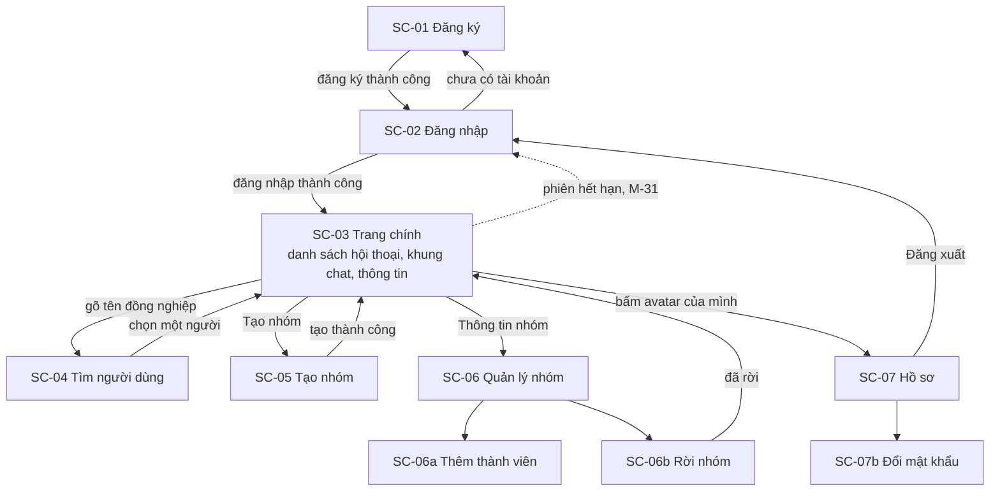
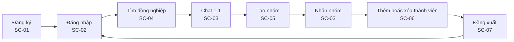

# 10 - Thiết kế trải nghiệm và giao diện (UI/UX)

| Mục | Nội dung |
|---|---|
| Dự án | Ứng dụng chat nội bộ (MVP) – Nhóm: *[chưa xác định]* |
| Tệp | `docs/10-ui-ux.md` |
| Phiên bản | 1.0 – Draft |
| Ngày | 2026-11-14 |
| Người soạn | Nhóm Designer / BA / QA (bản nháp có trợ lý AI hỗ trợ soạn thảo) |
| Trạng thái | Draft – **wireframe đang chờ duyệt** (mục 14). `docs/ui-design/ui-design.html` **chỉ được tạo sau khi wireframe được duyệt** |
| Căn cứ | (1) PDF "Xây dựng ứng dụng chat nội bộ (MVP)", ngày 13~14/11/2026 – **nguồn duy nhất của yêu cầu nghiệp vụ**; (2) `docs/01-brd.md` … `docs/09-detailed-design.md` trên repository – **tất cả đang ở trạng thái Draft**. Danh sách màn hình SCR-xx và câu chữ M-xx lấy từ `03-frs.md` mục 2, 4, 5 |
| Tệp đi kèm | `docs/wireframes/wireframe.html` (wireframe, đã có); `docs/ui-design/ui-design.html` (giao diện chi tiết, **chưa tạo** – chờ duyệt wireframe) |

**Quy ước ký hiệu**

| Ký hiệu | Ý nghĩa |
|---|---|
| `[PDF]` | Do đề bài quy định. |
| `[QĐ-xx]` | Quyết định của Product Owner. |
| `[GĐ]` `[GS]` `[GF]` `[GU]` `[GT]` … | Giả định đã ghi ở tài liệu trước. |
| `[GX-xx]` | Giả định mới của tài liệu này (mục 15). |
| `[ĐX]` | Lựa chọn thiết kế của nhóm, không phải yêu cầu đề bài. |
| `[OQ-xx]` | Câu hỏi mở. OQ-43 trở đi phát sinh ở tài liệu này (mục 16). |
| `SC-xx` | Màn hình trong tài liệu này. Đối chiếu với `SCR-xx` của `03-frs.md` ở mục 5. |
| `ST-xx` | Một **trạng thái** của màn hình (rỗng, đang tải, lỗi, có tin chưa đọc…). |
| `M-xx` | Thông báo theo `03-frs.md` mục 5 (dùng nguyên văn). |
| `E-xx`, `S-xx` | Endpoint, sự kiện theo `09-detailed-design.md`. |

> **Wireframe và giao diện mẫu là bản vẽ thiết kế, không phải ảnh chụp sản phẩm đang chạy.** Không được dùng chúng – kể cả khi xuất ra ảnh PNG – làm bằng chứng nghiệm thu hay đưa vào `12-test-reports.md`. Bằng chứng nghiệm thu chỉ lấy từ sản phẩm thật chạy trên môi trường demo (mục 13).

---

## 1. Giải thích nhanh cho người không làm IT

| Thuật ngữ | Giải thích dễ hiểu |
|---|---|
| UI / UX | UI là **giao diện** (màn hình trông thế nào). UX là **trải nghiệm** (người dùng làm việc có dễ, nhanh, ít nhầm không). |
| Sitemap | Bản đồ các màn hình và cách đi từ màn này sang màn khác. |
| Wireframe | Bản phác **đen trắng**, chỉ có khung và nhãn, để duyệt **bố cục** – chưa bàn màu sắc. |
| UI design (high-fidelity) | Bản vẽ giao diện **có màu, chữ, khoảng cách thật**, dựng theo design token. |
| Design token | Bộ "thông số chuẩn" dùng chung: mã màu, cỡ chữ, khoảng cách, bo góc. Ai làm giao diện cũng dùng đúng bộ này. |
| Responsive | Giao diện tự co giãn: máy tính thấy nhiều cột, điện thoại thấy một cột. |
| Trạng thái màn hình | Cùng một màn hình nhưng ở tình huống khác: chưa có dữ liệu, đang tải, bị lỗi, mất mạng… |
| Khả năng tiếp cận (accessibility) | Thiết kế sao cho người dùng bàn phím, người nhìn kém, người dùng phần mềm đọc màn hình vẫn dùng được. |
| Tương phản | Mức chênh lệch sáng tối giữa chữ và nền. Chuẩn WCAG AA yêu cầu chữ thường đạt ít nhất 4,5 : 1. |

## 2. Nguyên tắc trải nghiệm

| # | Nguyên tắc | Gắn với |
|---|---|---|
| NT-UX-01 | **Bắt đầu chat nhanh:** từ trang chính, gõ tên đồng nghiệp → chọn → gõ tin là xong; không có bước trung gian. | TK-06, CH-01 `[ĐX]` |
| NT-UX-02 | **Luôn thấy số chưa đọc:** trên từng hội thoại và trên tiêu đề tab trình duyệt, kể cả khi đang ở hội thoại khác. | TB-01 `[PDF]` |
| NT-UX-03 | **Không làm mất chữ của người dùng:** báo lỗi không xóa nội dung đã nhập; tin gửi lỗi nằm nguyên tại chỗ kèm nút "Gửi lại". | CH-02, NFR-13 |
| NT-UX-04 | **Phân biệt rõ ba loại tin:** tin của mình (bên phải), tin của người khác (bên trái, nhóm có tên + avatar), tin hệ thống (căn giữa, chữ nhỏ, màu xám). | NH-02, NH-04 |
| NT-UX-05 | **Tiếng Việt đúng và không hiển thị thứ MVP không có:** mọi nhãn bằng tiếng Việt có dấu; **không** vẽ trạng thái online, "đã xem", "đang nhập…" (thuộc phần mở rộng). | `[PDF §4]`, `[QĐ-01]` |

## 3. Persona (minh họa)

Hai persona dưới đây là **mô tả giả định để định hướng thiết kế** `[GX-01]`, không dựa trên khảo sát hay người thật (PDF không cung cấp thông tin người dùng – `[GĐ-03]`).

| | Persona A – Nhân viên văn phòng | Persona B – Nhân viên thường di chuyển |
|---|---|---|
| Thiết bị chính | Máy tính, màn hình rộng, dùng bàn phím nhiều | Điện thoại, trình duyệt di động |
| Việc thường làm | Trao đổi 1-1 với đồng nghiệp; theo dõi vài nhóm phòng ban; mở nhiều tab | Đọc nhanh tin chưa đọc; trả lời ngắn; tham gia nhóm |
| Mong muốn | Gõ Enter để gửi, Shift+Enter xuống dòng; không bỏ sót tin | Bấm trúng nút dễ dàng; chữ đủ to; mất sóng không mất tin |
| Thiết kế đáp ứng | Bố cục 3 cột; phím tắt Enter; tổng chưa đọc trên tab (TB-01) | Bố cục 1 cột, nút "Quay lại"; vùng bấm ≥ 44 px; thanh báo mất kết nối, nút "Gửi lại" |

## 4. Sitemap và hành trình người dùng

### 4.1 Bảng sitemap

| Từ màn hình | Thao tác | Tới | Mã yêu cầu |
|---|---|---|---|
| SC-01 Đăng ký | Đăng ký thành công (M-40) / "Đã có tài khoản? Đăng nhập" | SC-02 | TK-01, TK-02 |
| SC-02 Đăng nhập | Đăng nhập thành công | SC-03 | TK-03 |
| SC-02 Đăng nhập | "Chưa có tài khoản? Đăng ký" | SC-01 | TK-01 |
| SC-03 Trang chính | Gõ vào ô "Tìm đồng nghiệp…" | SC-04 (kết quả hiện ngay trong cột trái) | TK-06 |
| SC-04 Tìm người | Bấm một kết quả | SC-03, mở hội thoại 1-1 | CH-01 |
| SC-03 Trang chính | Bấm "Tạo nhóm" | SC-05 | NH-01 |
| SC-05 Tạo nhóm | Tạo thành công | SC-03, mở nhóm mới | NH-01, NH-04 |
| SC-03 (nhóm đang mở) | "Thông tin nhóm" | SC-06 (cột phải trên máy tính; màn riêng trên điện thoại) | NH-03 |
| SC-06 Quản lý nhóm | "Thêm thành viên" / "Rời nhóm" / "Xóa" | SC-06a / SC-06b / hộp xác nhận M-43 | NH-03, NH-04 |
| SC-03 Trang chính | Bấm avatar của mình | SC-07 | TK-05 |
| SC-07 Hồ sơ | "Đổi mật khẩu" | SC-07b | TK-04 |
| SC-07 Hồ sơ | "Đăng xuất" | SC-02 | TK-03 |
| Mọi màn hình cần đăng nhập | Phiên hết hạn hoặc bị hủy | SC-02 kèm M-31 | TK-03 |

### 4.2 Hành trình chính: đăng ký → đăng nhập → chat → nhóm → đăng xuất

| Bước | Màn hình | Người dùng làm | Hệ thống phản hồi | Mã yêu cầu | Bước nghiệm thu |
|---|---|---|---|---|---|
| 1 | SC-01 | Nhập mã tổ chức, tên đăng nhập, tên hiển thị, mật khẩu hai lần; bấm "Đăng ký" | Chuyển SC-02, hiện M-40, điền sẵn tên đăng nhập | TK-01, TK-02 | AT-01 |
| 2 | SC-02 | Nhập tên đăng nhập, mật khẩu; Enter | Vào SC-03; danh sách hội thoại (hoặc M-23 nếu chưa có) | TK-03 | AT-01 |
| 3 | SC-04 | Gõ "Bình" vào ô tìm; bấm "Trần Thị Bình" | Mở hội thoại 1-1 (cũ hoặc mới, không trùng) | TK-06, CH-01 | AT-02 |
| 4 | SC-03 | Gõ tin tiếng Việt có xuống dòng; Enter | Tin hiện ngay; người nhận thấy realtime | CH-02 | AT-02 |
| 5 | SC-03 | Ở hội thoại khác thì thấy số chưa đọc; mở hội thoại thì số về 0 | Badge từng dòng và tổng trên tab cập nhật | CH-06, TB-01 | AT-04 |
| 6 | SC-05 | Đặt tên nhóm, chọn 2 người; bấm "Tạo nhóm" | Mở nhóm, có tin hệ thống "đã tạo nhóm" | NH-01, NH-04 | AT-03 |
| 7 | SC-03 | Nhắn trong nhóm | Mỗi tin có tên + avatar người gửi | NH-02 | AT-03 |
| 8 | SC-06, SC-06a | Trưởng nhóm thêm D, rồi xóa D | Hai tin hệ thống tương ứng | NH-03, NH-04 | AT-03 |
| 9 | SC-07 | Bấm "Đăng xuất" | Về SC-02; đăng nhập lại thấy lịch sử còn nguyên | TK-03, CH-03 | AT-05 |

## 5. Danh sách màn hình và truy vết

| Mã | Tên | Tương ứng FRS | Mục đích | Thành phần chính | Mã SRS | Use case | User story | API / sự kiện |
|---|---|---|---|---|---|---|---|---|
| SC-01 | Đăng ký | SCR-01 | Tạo tài khoản bằng mã tổ chức | 5 ô nhập, nút "Đăng ký", liên kết sang đăng nhập | TK-01, TK-02 | UC-01 | US-01, US-02 | E-01 |
| SC-02 | Đăng nhập | SCR-02 | Vào ứng dụng | 2 ô nhập, nút "Đăng nhập", liên kết sang đăng ký, thanh báo M-31 | TK-03 | UC-02, UC-03 | US-03, US-04 | E-02, E-04 |
| SC-03 | Trang chính (3 cột) | SCR-03 + SCR-04 (+ SCR-06 ở cột phải) | Xem danh sách hội thoại, đọc và gửi tin | Cột trái: avatar mình, ô tìm, "Tạo nhóm", danh sách có badge. Cột giữa: đầu hội thoại, khung tin, ô soạn. Cột phải: thông tin hội thoại | CH-01, CH-02, CH-03, CH-06, NH-02, NH-04, TB-01 | UC-07…UC-11, UC-17 | US-08…US-15, US-17, US-22, US-27 | E-09…E-12, S-02…S-05, S-07 |
| SC-04 | Tìm người dùng | Một phần SCR-03 | Tìm đồng nghiệp để bắt đầu chat | Ô tìm, tối đa 20 kết quả, trạng thái M-14 | TK-06, CH-01 | UC-06, UC-07 | US-07, US-08 | E-07, E-08 |
| SC-05 | Tạo nhóm | SCR-05 | Tạo nhóm ≥ 3 người | Ô tên nhóm, ô tìm thành viên, thẻ người đã chọn, "Đã chọn: n người", nút "Tạo nhóm" / "Hủy" | NH-01, NH-04 | UC-12 | US-16 | E-13 |
| SC-06 | Quản lý nhóm | SCR-06 | Xem, thêm, xóa thành viên; đổi tên; rời nhóm | Tên nhóm + nút sửa, danh sách thành viên + nhãn "Trưởng nhóm", nút "Xóa", "Thêm thành viên", "Rời nhóm" | NH-03, NH-04 | UC-13…UC-16 | US-18…US-21 | E-10, E-14…E-17, S-06 |
| SC-06a | Thêm thành viên | SCR-06a | Thêm người, chọn cho xem tin cũ | Ô tìm, thẻ đã chọn, ô đánh dấu "Cho xem tin nhắn trước đó" (mặc định không) | NH-03, NH-04 | UC-13 | US-18 | E-15 |
| SC-06b | Rời nhóm | SCR-06b | Rời nhóm; trưởng nhóm chọn người nhận quyền | Câu M-44, danh sách chọn "Trưởng nhóm mới" | NH-03, NH-04 | UC-16 | US-21 | E-17 |
| SC-07 | Hồ sơ | SCR-07 | Xem/sửa tên hiển thị, đăng xuất | Avatar chữ cái, tên đăng nhập (chỉ xem), ô tên hiển thị, "Lưu", "Đổi mật khẩu", "Đăng xuất" | TK-05, TK-03 | UC-03, UC-05 | US-04, US-06 | E-03, E-04, E-05 |
| SC-07b | Đổi mật khẩu | SCR-08 | Đổi mật khẩu | 3 ô mật khẩu, danh sách kiểm tra quy tắc, "Đổi mật khẩu" / "Hủy" | TK-04, TK-02 | UC-04 | US-05 | E-06 |

**Kiểm tra độ phủ:** 15/15 mã MVP xuất hiện trên ít nhất một màn hình: TK-01 (SC-01), TK-02 (SC-01, SC-07b), TK-03 (SC-02, SC-07), TK-04 (SC-07b), TK-05 (SC-07), TK-06 (SC-04), CH-01 (SC-04, SC-03), CH-02 (SC-03), CH-03 (SC-03), CH-06 (SC-03), NH-01 (SC-05), NH-02 (SC-03), NH-03 (SC-06, SC-06a, SC-06b), NH-04 (SC-03, SC-06), TB-01 (SC-03). UC-17 (người ngoài bị từ chối) thể hiện bằng trạng thái ST-16.

## 6. Trạng thái giao diện

Mỗi trạng thái có một khung trong `wireframe.html` (cột cuối).

| Mã | Màn hình | Trạng thái | Hiển thị | Mã yêu cầu / nguồn | Khung wireframe |
|---|---|---|---|---|---|
| ST-01 | SC-01 | Lỗi nhập liệu | Viền ô đỏ + chữ lỗi ngay dưới ô (M-02, M-06, M-07, M-04, M-05); nội dung đã nhập **giữ nguyên** | TK-01, TK-02 | W-01b |
| ST-02 | SC-01, SC-02, mọi hộp thoại | Đang gửi | Nút bị khóa, có biểu tượng chờ (chống bấm hai lần) | `[FRS NT-05]` | W-01 |
| ST-03 | SC-02 | Đăng nhập sai | M-09 phía trên nút, một câu chung cho sai tên và sai mật khẩu | TK-03 | W-02b |
| ST-04 | SC-02 | Phiên hết hạn | Thanh báo M-31 ở đầu khung đăng nhập | TK-03 | W-02b |
| ST-05 | SC-03 | Có tin chưa đọc | Badge số trên dòng hội thoại (tối đa "99+"), tên in đậm; tổng trên biểu tượng ứng dụng và tiêu đề tab "(5) Chat nội bộ" | TB-01, CH-06 | W-03 |
| ST-06 | SC-03 | Danh sách trống | M-23, gợi ý dùng ô tìm phía trên | CH-06 | W-04 |
| ST-07 | SC-03 | Đang tải danh sách | Khung xương (skeleton) xám thay cho các dòng | `[ĐX]` | W-04 |
| ST-08 | SC-03 | Lỗi tải danh sách | M-24 + nút "Thử lại" | CH-06 | W-04 |
| ST-09 | SC-03 | Chat 1-1 | Tin mình bên phải, tin người kia bên trái, giờ dưới mỗi tin, giữ xuống dòng | CH-02, CH-03 | W-03 |
| ST-10 | SC-03 | Chat nhóm | Tên + avatar cạnh **mỗi** tin người khác `[GF-16]`; tin hệ thống căn giữa, chữ nhỏ xám, không avatar | NH-02, NH-04 | W-05 |
| ST-11 | SC-03 | Lịch sử | Đang tải 50 tin cũ (biểu tượng chờ ở đầu khung); M-21 khi hết; M-22 + "Thử lại" khi lỗi | CH-03 | W-06 |
| ST-12 | SC-03 | Có tin mới khi đang đọc tin cũ | Nút nổi "Có tin nhắn mới ↓", khung không tự cuộn | `[GF-15]` | W-06 |
| ST-13 | SC-03 | Tin dài | Bộ đếm "n / 5.000" khi > 4.500; > 5.000 thì bộ đếm đỏ, M-17, nút "Gửi" khóa | CH-02 `[PDF]`, `[GF-11]` | W-07 |
| ST-14 | SC-03 | Mất kết nối | Thanh báo M-33 ở đầu màn hình; tự nối lại | NFR-13 | W-07 |
| ST-15 | SC-03 | Tin gửi lỗi | Tin mờ + biểu tượng cảnh báo + M-20 + nút "Gửi lại"; nội dung giữ nguyên | NFR-13, `[GF-12]` | W-07 |
| ST-16 | SC-03 | Không có quyền / không tồn tại | Khung giữa hiện M-30, không hiện nội dung nào | NFR-04, UC-17, AT-06 | W-08 |
| ST-17 | SC-03 | Vừa bị xóa khỏi nhóm | M-32, quay về danh sách; nhóm biến mất | NH-03 `[QĐ-04]` | W-08 |
| ST-18 | SC-04 | Kết quả tìm / không có kết quả | Danh sách tối đa 20 người; M-14 khi không có | TK-06 | W-09 |
| ST-19 | SC-05 | Chưa đủ thành viên | "Đã chọn: 1 người", M-26, nút "Tạo nhóm" khóa | NH-01 | W-10 |
| ST-20 | SC-06 | Trưởng nhóm / thành viên | Trưởng nhóm thấy nút sửa tên, "Xóa", "Thêm thành viên"; thành viên thường **không thấy** các nút đó | NH-03 | W-11 |
| ST-21 | SC-06a | Thêm thành viên | Ô đánh dấu "Cho xem tin nhắn trước đó" mặc định **không** đánh dấu | NH-03 `[QĐ-08]` | W-12 |
| ST-22 | SC-06b | Rời nhóm | Trưởng nhóm: bắt buộc chọn người nhận quyền, nút khóa tới khi chọn (M-37); là người cuối: M-28 | NH-03 `[QĐ-03]` | W-12 |
| ST-23 | SC-06 | Xác nhận xóa | Hộp thoại M-43 | NH-03 | W-11 |
| ST-24 | SC-07, SC-07b | Lưu / đổi mật khẩu | M-42 khi lưu tên; M-41 khi đổi mật khẩu; lỗi M-10, M-11 | TK-04, TK-05 | W-13 |
| ST-25 | SC-03, SC-06 | Điện thoại | Một cột: danh sách → hội thoại → thông tin nhóm, có nút "Quay lại" | `[PDF §2]` responsive | W-14 |

## 7. Responsive (web trên máy tính và điện thoại – không phải ứng dụng cài đặt)

| Khoảng rộng màn hình | Bố cục SC-03 | Cột thông tin (SC-06) | Ghi chú |
|---|---|---|---|
| ≥ 1024 px (máy tính) | **3 cột**: danh sách 320 px – khung chat co giãn – thông tin 296 px | Hiện ở cột phải; nút "Thông tin" ẩn/hiện cột | `[ĐX]`, `[GX-03]` |
| 768–1023 px (máy tính bảng, cửa sổ hẹp) | 2 cột: danh sách + khung chat | Mở thành bảng trượt đè lên khung chat | `[ĐX]` |
| < 768 px (điện thoại) | **1 cột**: danh sách → chạm vào hội thoại → khung chat (nút "← Quay lại") | Màn hình riêng | `[ĐX]` |

Quy tắc chung: không có thanh cuộn ngang ở 360 px, 768 px, 1280 px (NFR-12); vùng bấm tối thiểu 44 × 44 px trên điện thoại; ô nhập có cỡ chữ 16 px để trình duyệt điện thoại không tự phóng to; hộp thoại trên điện thoại hiện toàn màn hình.

## 8. Tiếng Việt và Unicode

| Quy tắc | Cách làm | Nguồn |
|---|---|---|
| Ngôn ngữ trang | `<html lang="vi">` để trình đọc màn hình đọc đúng tiếng Việt | NFR-10 |
| Phông chữ | Bộ phông hệ thống có đủ chữ tiếng Việt: `-apple-system, "Segoe UI", Roboto, "Noto Sans", "Helvetica Neue", Arial, sans-serif`. **Không** tải phông từ máy chủ bên ngoài | `[GX-04]` |
| Xuống dòng trong tin | Hiển thị giữ nguyên xuống dòng và dòng trống (`white-space: pre-wrap`) | CH-02 R2 `[PDF]` |
| Từ quá dài, đường dẫn dài | Tự ngắt để không tràn khung (`overflow-wrap: anywhere`) | NFR-12 |
| Trích tin cuối | Một dòng, cắt bớt kèm "…" bằng CSS; không cắt chuỗi bằng mã để tránh tách dấu khỏi chữ | `[GS-25]` |
| Đếm ký tự | Bộ đếm "n / 5.000" dùng cùng hàm đếm với máy chủ (`countChars` ở `09` mục 6.1) | `[GS-18]` |
| Nội dung tin | Hiện dạng chữ thuần: `<b>` hay `<script>` hiện nguyên văn | CH-02 R6 |
| Dữ liệu mẫu | Wireframe và UI design dùng tên, câu tiếng Việt có dấu đủ loại: "Đặng Thị Ẩn", "Nguyễn Văn An", "Phòng Kế hoạch" | TK-01-AC4 |

## 9. Khả năng tiếp cận

| # | Yêu cầu | Cách làm |
|---|---|---|
| A11Y-01 | Dùng được hoàn toàn bằng bàn phím | Thứ tự Tab: cột trái → khung chat → ô soạn → cột phải; mọi nút là phần tử `button` thật |
| A11Y-02 | Phím trong ô soạn | Máy tính: Enter gửi, Shift + Enter xuống dòng `[GF-10]` |
| A11Y-03 | Hộp thoại | Mở thì đưa con trỏ vào ô đầu tiên; Tab không thoát ra ngoài hộp thoại; Esc để đóng; đóng xong trả con trỏ về nút đã mở hộp thoại |
| A11Y-04 | Viền tiêu điểm rõ | Viền 2 px màu `color.focus` cách phần tử 2 px, **không bao giờ** tắt viền tiêu điểm |
| A11Y-05 | Tương phản | Mọi cặp chữ/nền đạt WCAG AA ≥ 4,5 : 1; viền ô nhập và viền tiêu điểm ≥ 3 : 1 (mục 10.1) |
| A11Y-06 | Không chỉ dựa vào màu | Chưa đọc: số + chữ đậm (không chỉ màu đỏ); lỗi: biểu tượng + câu chữ (không chỉ viền đỏ) |
| A11Y-07 | Nhãn cho phần tử không có chữ | Badge có nhãn đọc "3 tin chưa đọc"; nút biểu tượng (sửa, đóng, gửi) có `aria-label` |
| A11Y-08 | Lỗi nhập liệu | Lỗi gắn với ô qua `aria-describedby`; ô lỗi có `aria-invalid="true"` |
| A11Y-09 | Tin mới, thông báo | Khung tin là vùng `role="log"`; thanh mất kết nối dùng `role="status"` để trình đọc màn hình đọc lên mà không giành tiêu điểm |
| A11Y-10 | Phóng to | Dùng được ở mức phóng to 200 %; giảm chuyển động khi người dùng bật `prefers-reduced-motion` |

## 10. Design token (đặc tả giao diện chi tiết)

Mọi giá trị dưới đây là lựa chọn thiết kế `[ĐX]`; PDF không quy định màu hay phông. Màu chủ đạo trung tính, **không** dùng logo hay nhận diện thương hiệu nào `[GX-05]`.

### 10.1 Màu

| Token | Mã màu | Dùng cho | Tương phản đã tính |
|---|---|---|---|
| `color.primary` | `#1D4ED8` | Nút chính, tin của mình, liên kết | Chữ trắng trên nền này 6,70 : 1; chữ màu này trên nền trắng 6,70 : 1 |
| `color.primary.hover` | `#1E40AF` | Nút chính khi rê chuột | Chữ trắng 8,72 : 1 |
| `color.primary.active` | `#1E3A8A` | Nút chính khi đang nhấn | – |
| `color.primary.subtle` | `#DBEAFE` | Nền dòng hội thoại đang mở; giờ gửi trên tin của mình | Chữ `#111827` trên nền này 14,54 : 1; chữ này trên `color.primary` 5,49 : 1 |
| `color.text` | `#111827` | Chữ chính | Trên trắng 17,74 : 1 |
| `color.text.secondary` | `#4B5563` | Chữ phụ, giờ, tin hệ thống | Trên trắng 7,56 : 1; trên `color.bg.app` 7,23 : 1 |
| `color.text.placeholder` | `#6B7280` | Chữ gợi ý trong ô nhập | Trên trắng 4,83 : 1 |
| `color.bg.app` | `#F9FAFB` | Nền ứng dụng, nền khung tin | – |
| `color.bg.surface` | `#FFFFFF` | Thẻ, cột, hộp thoại, ô nhập | – |
| `color.bg.subtle` | `#F3F4F6` | Tin của người khác; dòng khi rê chuột | Chữ chính trên nền này 16,12 : 1 |
| `color.border` | `#E5E7EB` | Đường phân cách trang trí | (trang trí, không yêu cầu) |
| `color.border.input` | `#6B7280` | Viền ô nhập, ô đánh dấu | So với nền trắng 4,83 : 1 (≥ 3 : 1) |
| `color.focus` | `#1D4ED8` | Viền tiêu điểm 2 px, cách 2 px | So với nền trắng 6,70 : 1 |
| `color.danger` | `#B91C1C` | Badge chưa đọc, viền và chữ lỗi, nút "Xóa" | Chữ trắng 6,47 : 1; chữ màu này trên trắng 6,47 : 1 |
| `color.danger.subtle` / `color.danger.text` | `#FEE2E2` / `#991B1B` | Hộp lỗi (M-24, M-30, M-20) | 6,80 : 1 |
| `color.success.subtle` / `color.success.text` | `#DCFCE7` / `#166534` | Thông báo thành công (M-40, M-41, M-42) | 6,49 : 1 |
| `color.warning.subtle` / `color.warning.text` | `#FEF3C7` / `#92400E` | Thanh mất kết nối (M-33), cảnh báo bộ đếm | 6,37 : 1 |
| `color.disabled.bg` / `color.disabled.text` | `#E5E7EB` / `#6B7280` | Nút bị khóa | 3,90 : 1 (phần tử bị khóa không bắt buộc đạt mức chữ, vẫn giữ ≥ 3 : 1) |
| `color.avatar.1…8` | `#1D4ED8`, `#7E22CE`, `#B45309`, `#047857`, `#BE185D`, `#0E7490`, `#4D7C0F`, `#C2410C` | Nền avatar chữ cái (chữ trắng) | Thấp nhất 4,99 : 1 |

Màu avatar chọn theo mã người dùng (`id` chia lấy dư cho 8), nên mỗi người luôn cùng một màu `[GX-06]`.

### 10.2 Chữ

| Token | Cỡ / chiều cao dòng | Độ đậm | Dùng cho |
|---|---|---|---|
| `font.family` | `-apple-system, "Segoe UI", Roboto, "Noto Sans", "Helvetica Neue", Arial, sans-serif` | – | Toàn bộ |
| `text.xs` | 12 / 16 px | 400 | Giờ gửi, bộ đếm ký tự |
| `text.sm` | 14 / 20 px | 400 | Tin hệ thống, trích tin cuối, chữ lỗi dưới ô |
| `text.md` | 16 / 24 px | 400 | Nội dung tin, ô nhập, chữ chính |
| `text.md.strong` | 16 / 24 px | 600 | Tên hội thoại, tên người gửi, hội thoại có tin chưa đọc |
| `text.lg` | 20 / 28 px | 600 | Tiêu đề hội thoại, tiêu đề hộp thoại |
| `text.xl` | 24 / 32 px | 700 | Tiêu đề trang đăng ký/đăng nhập |

### 10.3 Khoảng cách, bo góc, bóng, kích thước

| Nhóm | Token | Giá trị |
|---|---|---|
| Khoảng cách (lưới 8 px) | `space.1` … `space.6` | 8, 16, 24, 32, 40, 48 px; `space.half` = 4 px chỉ dùng giữa chữ và biểu tượng |
| Bo góc | `radius.sm`, `radius.md`, `radius.lg`, `radius.full` | 4 px (ô đánh dấu), 8 px (nút, ô nhập, thẻ), 16 px (bong bóng tin, hộp thoại), 9999 px (avatar, badge) |
| Bóng | `shadow.dialog` | `0 8px 24px rgba(17, 24, 39, 0.16)` |
| Kích thước | `size.avatar.sm` / `.md` / `.lg` | 32 px (cạnh tin nhóm), 40 px (danh sách), 72 px (hồ sơ) |
| | `size.control` | Nút và ô nhập cao 40 px (máy tính), 48 px (điện thoại) |
| | `size.row.conversation` | Dòng hội thoại cao 72 px |
| | `size.header` | Thanh đầu 64 px |
| | `size.bubble.maxWidth` | 70 % khung chat (tối đa 560 px) |
| Điểm ngắt | `bp.md`, `bp.lg` | 768 px, 1024 px |

### 10.4 Thành phần và trạng thái

| Thành phần | Mặc định | Rê chuột (hover) | Tiêu điểm (focus) | Bị khóa (disabled) | Lỗi / đặc biệt |
|---|---|---|---|---|---|
| Nút chính | Nền `color.primary`, chữ trắng 600, `radius.md` | Nền `color.primary.hover` | Viền `color.focus` 2 px cách 2 px | Nền `color.disabled.bg`, chữ `color.disabled.text`, con trỏ "not-allowed" | Đang gửi: biểu tượng chờ + khóa |
| Nút phụ | Nền trắng, viền `color.border.input`, chữ `color.text` | Nền `color.bg.subtle` | Như trên | Như trên | – |
| Nút nguy hiểm ("Xóa", "Rời nhóm" trong hộp thoại) | Nền `color.danger`, chữ trắng | Nền `#991B1B` | Như trên | Như trên | Luôn kèm hộp xác nhận (M-43, M-44) |
| Ô nhập | Nền trắng, viền 1 px `color.border.input`, nhãn phía trên | Viền `color.text.secondary` | Viền 2 px `color.focus` | Nền `color.bg.subtle` | Viền 2 px `color.danger`, chữ lỗi `text.sm` màu `color.danger` + biểu tượng ⚠ dưới ô |
| Ô đánh dấu | Ô 20 px, viền `color.border.input` | – | Viền tiêu điểm | – | – |
| Dòng hội thoại | Avatar 40 px, tên, trích tin cuối, giờ, badge | Nền `color.bg.subtle` | Viền tiêu điểm bên trong | – | Đang mở: nền `color.primary.subtle`; có chưa đọc: tên và trích tin in đậm |
| Badge chưa đọc | Hình viên thuốc, nền `color.danger`, chữ trắng `text.xs` 600, tối thiểu 20 × 20 px | – | – | – | Ẩn khi 0; "99+" khi ≥ 100 |
| Bong bóng tin của mình | Nền `color.primary`, chữ trắng, căn phải, giờ màu `color.primary.subtle` | – | – | – | Gửi lỗi: nền trắng viền `color.danger`, ⚠ + M-20 + nút "Gửi lại" |
| Bong bóng tin người khác | Nền `color.bg.subtle`, căn trái; nhóm: avatar 32 px + tên `text.sm` 600 phía trên **mỗi** tin | – | – | – | – |
| Tin hệ thống | Căn giữa, `text.sm`, màu `color.text.secondary`, chữ nghiêng, không avatar, kèm giờ | – | – | – | – |
| Ô soạn tin | Nhiều dòng, tự cao tới khoảng 6 dòng | – | Viền tiêu điểm | Khi mất kết nối vẫn gõ được | Bộ đếm hiện khi > 4.500; > 5.000: bộ đếm `color.danger`, M-17, nút "Gửi" khóa |
| Thanh thông báo | Toàn chiều rộng, cao 40 px | – | – | – | Mất kết nối: `color.warning.*` + M-33; lỗi: `color.danger.*`; thành công: `color.success.*` |
| Hộp thoại | Nền trắng, `radius.lg`, `shadow.dialog`, rộng 480 px (máy tính) / toàn màn hình (điện thoại) | – | Giữ tiêu điểm bên trong | – | – |
| Avatar chữ cái | Hình tròn, nền `color.avatar.n`, chữ trắng 600 | – | – | – | Chữ cái theo `[GS-11]`: chữ đầu của **từ cuối** tên hiển thị, viết hoa, giữ dấu ("Đặng Thị Ẩn" → "Ẩ") |
| Khung xương đang tải | Khối `color.bg.subtle` | – | – | – | Không nhấp nháy khi bật `prefers-reduced-motion` |

## 11. Câu chữ giao diện (microcopy)

### 11.1 Nhãn, nút, chữ gợi ý `[ĐX]`

| Vị trí | Câu chữ |
|---|---|
| Tiêu đề tab trình duyệt | `Chat nội bộ`; có tin chưa đọc: `(5) Chat nội bộ` `[GĐ-15]` |
| SC-01 | Tiêu đề "Tạo tài khoản"; nhãn "Mã đăng ký tổ chức", "Tên đăng nhập", "Tên hiển thị", "Mật khẩu", "Nhập lại mật khẩu"; gợi ý dưới ô tên đăng nhập "3–30 ký tự: chữ không dấu, số, dấu chấm, gạch dưới"; nút "Đăng ký"; liên kết "Đã có tài khoản? Đăng nhập" |
| SC-02 | Tiêu đề "Đăng nhập"; nhãn "Tên đăng nhập", "Mật khẩu"; nút "Hiện"/"Ẩn" mật khẩu; nút "Đăng nhập"; liên kết "Chưa có tài khoản? Đăng ký" |
| SC-03 | Ô tìm "Tìm đồng nghiệp…"; nút "Tạo nhóm"; ô soạn "Nhập tin nhắn…"; nút "Gửi"; nút "Thông tin nhóm"; nút "Có tin nhắn mới ↓"; nút "← Quay lại" (điện thoại); nhãn "Bạn: " trước trích tin của mình; "Hôm qua" |
| SC-05 | Tiêu đề "Tạo nhóm"; nhãn "Tên nhóm", "Thêm thành viên"; dòng "Đã chọn: n người"; nút "Tạo nhóm", "Hủy" |
| SC-06 | Tiêu đề "Thông tin nhóm"; dòng "n thành viên"; nhãn "Trưởng nhóm"; nút "Thêm thành viên", "Xóa", "Rời nhóm", "Lưu" |
| SC-06a | Tiêu đề "Thêm thành viên"; ô đánh dấu "Cho xem tin nhắn trước đó"; nút "Thêm", "Hủy" |
| SC-06b | Tiêu đề "Rời nhóm"; nhãn "Chọn trưởng nhóm mới"; nút "Rời nhóm", "Hủy" |
| SC-07 | Tiêu đề "Hồ sơ"; nhãn "Tên đăng nhập", "Tên hiển thị"; nút "Lưu", "Đổi mật khẩu", "Đăng xuất" |
| SC-07b | Tiêu đề "Đổi mật khẩu"; nhãn "Mật khẩu hiện tại", "Mật khẩu mới", "Nhập lại mật khẩu mới"; danh sách kiểm tra "Ít nhất 8 ký tự", "Có chữ cái", "Có chữ số"; nút "Đổi mật khẩu", "Hủy" |

### 11.2 Thông báo (nguyên văn `03-frs.md` mục 5)

| Mã | Câu chữ | Màn hình |
|---|---|---|
| M-01 | Tên đăng nhập đã tồn tại. Vui lòng chọn tên khác. | SC-01 |
| M-02 | Tên đăng nhập dài 3–30 ký tự, chỉ gồm chữ không dấu (a–z), số (0–9), dấu chấm (.) hoặc gạch dưới (_). | SC-01 |
| M-03 | Tên hiển thị không được để trống và tối đa 50 ký tự. | SC-01, SC-07 |
| M-04 | Mật khẩu nhập lại không khớp. | SC-01, SC-07b |
| M-05 | Mã đăng ký tổ chức không đúng. Vui lòng liên hệ đầu mối của tổ chức để nhận mã. | SC-01 |
| M-06 | Mật khẩu phải có ít nhất 8 ký tự. | SC-01, SC-07b |
| M-07 | Mật khẩu phải có cả chữ cái và chữ số. | SC-01, SC-07b |
| M-08 | Mật khẩu tối đa 64 ký tự. | SC-01, SC-07b |
| M-09 | Tên đăng nhập hoặc mật khẩu không đúng. | SC-02 |
| M-10 | Mật khẩu hiện tại không đúng. | SC-07b |
| M-11 | Mật khẩu mới phải khác mật khẩu hiện tại. | SC-07b |
| M-14 | Không tìm thấy người dùng phù hợp. | SC-04 |
| M-15 | Bạn không thể tự nhắn tin cho chính mình. | SC-04 |
| M-16 | Người dùng này không tồn tại. | SC-04 |
| M-17 | Tin nhắn vượt quá 5.000 ký tự (hiện có {n} ký tự). | SC-03 |
| M-20 | Gửi không thành công. [Gửi lại] | SC-03 |
| M-21 | Đã hiển thị toàn bộ lịch sử. | SC-03 |
| M-22 | Không tải được tin nhắn cũ. [Thử lại] | SC-03 |
| M-23 | Bạn chưa có cuộc trò chuyện nào. Hãy tìm đồng nghiệp ở ô phía trên để bắt đầu. | SC-03 |
| M-24 | Không tải được danh sách hội thoại. [Thử lại] | SC-03 |
| M-25 | Tên nhóm không được để trống và tối đa 100 ký tự. | SC-05, SC-06 |
| M-26 | Hãy chọn ít nhất 2 thành viên. | SC-05 |
| M-27 | Có người dùng không còn tồn tại. Vui lòng chọn lại. | SC-05 |
| M-28 | Bạn là thành viên duy nhất của nhóm nên chưa thể rời nhóm. | SC-06b |
| M-29 | Chỉ trưởng nhóm mới thực hiện được thao tác này. | SC-06 |
| M-30 | Không tìm thấy hội thoại hoặc bạn không có quyền truy cập. | SC-03 |
| M-31 | Phiên đăng nhập đã hết hạn. Vui lòng đăng nhập lại. | SC-02 |
| M-32 | Bạn không còn là thành viên của nhóm này. | SC-03 |
| M-33 | Mất kết nối. Đang thử kết nối lại… | SC-03 |
| M-34 | Không kết nối được máy chủ. Vui lòng thử lại. | Mọi màn hình |
| M-35 | Vui lòng nhập đủ tên đăng nhập và mật khẩu. | SC-02 |
| M-36 | Người này đã ở trong nhóm hoặc không còn tồn tại. | SC-06a |
| M-37 | Hãy chọn người nhận quyền trưởng nhóm trước khi rời nhóm. | SC-06b |
| M-40 | Đăng ký thành công. Vui lòng đăng nhập. | SC-02 |
| M-41 | Đổi mật khẩu thành công. Các thiết bị khác đã được đăng xuất. | SC-07 |
| M-42 | Đã lưu tên hiển thị. | SC-07 |
| M-43 | Xóa {tên} khỏi nhóm? Người này sẽ không xem được lịch sử nhóm nữa. | SC-06 |
| M-44 | Rời nhóm "{tên nhóm}"? Bạn sẽ không xem được lịch sử nhóm nữa. | SC-06b |
| M-38 *(đề xuất ở `09`, chờ duyệt – OQ-41)* | Trưởng nhóm muốn ra khỏi nhóm hãy dùng chức năng Rời nhóm. | SC-06 |
| M-39 *(đề xuất ở `09`, chờ duyệt – OQ-41)* | Người này không còn trong nhóm. | SC-06 |

Tin hệ thống dùng đúng mẫu câu HT-01…HT-06 của `03-frs.md` FRS-14.

## 12. Những gì giao diện MVP **không** có

Theo `[QĐ-01]`, wireframe và UI design **không** vẽ: chấm xanh online / "hoạt động x phút trước" (CH-05); dấu "đã gửi / đã nhận / đã xem" (CH-04); "đã xem bởi n người" (NH-05); thông báo bật lên của trình duyệt (TB-03); màn hình quản trị (QT-01, QT-02); nút đính kèm tệp, ảnh, bộ chọn emoji, reaction, trả lời trích dẫn, "đang nhập…" (TN-01…TN-07); "quên mật khẩu" (TK-07…11); sửa / thu hồi tin (TN-10…TN-14). Trạng thái "gửi lỗi – Gửi lại" là NFR-13 (khuyến khích), **không** phải CH-04.

## 13. Tệp thiết kế và quy định dùng ảnh

| Tệp | Nội dung | Trạng thái |
|---|---|---|
| `docs/wireframes/wireframe.html` | Wireframe đen trắng, 14 khung W-01…W-14 có tiêu đề SC-xx, chú thích số ①②③ | Đã tạo – **chờ duyệt** |
| `docs/ui-design/ui-design.html` | Giao diện chi tiết theo design token mục 10, dữ liệu mẫu tiếng Việt, bản máy tính và bản điện thoại 390 px | **Chưa tạo** – chỉ tạo sau khi wireframe được duyệt |

Cách mở: tải tệp về máy hoặc mở từ bản sao kho mã, nhấp đúp để mở bằng trình duyệt. Tệp không cần mạng và không dùng thư viện ngoài.

**Quy định dùng ảnh** `[ĐX]`:
- Được chụp wireframe / UI design thành PNG để trình bày **thiết kế**, nhưng mỗi ảnh phải ghi rõ "Bản thiết kế – không phải ảnh chụp sản phẩm".
- **Không** dùng ảnh thiết kế làm bằng chứng nghiệm thu, không đưa vào `12-test-reports.md`, không ghép vào video demo như thể là sản phẩm.
- Ảnh hay video nghiệm thu chỉ được quay từ sản phẩm thật chạy trên môi trường demo.

## 14. Duyệt wireframe trước khi làm UI design và viết mã

Wireframe phải được Product Owner (người học) **xác nhận trước** khi: (1) tạo `docs/ui-design/ui-design.html`; (2) viết mã giao diện ở `web/`.

**Phiếu duyệt wireframe** (người duyệt điền):

| Khung | Màn hình | Đồng ý / Cần sửa | Ghi chú | Người duyệt | Ngày |
|---|---|---|---|---|---|
| W-01, W-01b | SC-01 Đăng ký | | | | |
| W-02, W-02b | SC-02 Đăng nhập | | | | |
| W-03 | SC-03 Trang chính – chat 1-1, có chưa đọc | | | | |
| W-04 | SC-03 Trống / đang tải / lỗi | | | | |
| W-05 | SC-03 Chat nhóm, tin hệ thống | | | | |
| W-06 | SC-03 Lịch sử, có tin mới | | | | |
| W-07 | SC-03 Mất kết nối, gửi lỗi, tin dài | | | | |
| W-08 | SC-03 Không có quyền, bị xóa khỏi nhóm | | | | |
| W-09 | SC-04 Tìm người dùng | | | | |
| W-10 | SC-05 Tạo nhóm | | | | |
| W-11 | SC-06 Quản lý nhóm, xác nhận xóa | | | | |
| W-12 | SC-06a Thêm thành viên, SC-06b Rời nhóm | | | | |
| W-13 | SC-07 Hồ sơ, SC-07b Đổi mật khẩu | | | | |
| W-14 | Điện thoại – 1 cột | | | | |

**Trạng thái hiện tại: chưa duyệt** (OQ-43).

## 15. ASSUMPTIONS – Giả định của tài liệu này

Các QĐ, GĐ, GS, GF, GU, GE, GL, GH, GT ở tài liệu trước vẫn giữ hiệu lực. **Không giả định nào dưới đây là yêu cầu của PDF.**

| Mã | Giả định | Áp dụng | Câu hỏi |
|---|---|---|---|
| GX-01 | Hai persona là mô tả minh họa, không phải người dùng thật | Mục 3 | – |
| GX-02 | Mã màn hình SC-xx của tài liệu này dùng song song với SCR-xx của FRS theo bảng đối chiếu ở mục 5; FRS không phải sửa | Mục 5 | OQ-46 |
| GX-03 | Máy tính ≥ 1024 px hiện 3 cột; cột phải luôn hiện, có nút ẩn/hiện; với 1-1, cột phải chỉ hiện avatar, tên hiển thị, tên đăng nhập của người kia | Mục 7 | OQ-44 |
| GX-04 | Dùng phông hệ thống, không tải phông ngoài | Mục 8 | – |
| GX-05 | Màu chủ đạo xanh dương trung tính; không có nhận diện thương hiệu tổ chức | Mục 10 | OQ-45 |
| GX-06 | Màu avatar cố định theo mã người dùng (8 màu) | Mục 10.1 | – |
| GX-07 | Avatar nhóm là chữ cái đầu của **từ đầu tiên** trong tên nhóm ("Phòng Kế hoạch" → "P"); avatar người dùng theo GS-11 (chữ đầu của từ cuối) | Mục 10.4 | OQ-47 |
| GX-08 | Không có giao diện tối (dark mode) trong MVP | Toàn bộ | – |
| GX-09 | Trên điện thoại, hộp thoại hiện toàn màn hình | Mục 7 | – |
| GX-10 | Giờ dưới mỗi tin dạng giờ:phút; trong danh sách theo GS-26 và FRS-10 ("14:05", "Hôm qua", "dd/mm/yyyy") | Mục 6 | – |
| GX-11 | Kích thước cột: danh sách 320 px, thông tin 296 px (bội số của 8) | Mục 7 | – |

## 16. OPEN QUESTIONS – Câu hỏi mở

| Mã | Câu hỏi | Giả định tạm | Ảnh hưởng | Người quyết định đề xuất |
|---|---|---|---|---|
| OQ-43 | Wireframe (14 khung) có được duyệt để làm UI design và viết mã chưa? | **Chưa duyệt** – chưa tạo `ui-design.html` | Mục 13, 14 | Product Owner |
| OQ-44 | Trên máy tính, cột thông tin luôn hiện hay chỉ mở khi bấm "Thông tin"? | Luôn hiện, có nút ẩn (GX-03) | SC-03, SC-06 | Product Owner |
| OQ-45 | Tổ chức có màu nhận diện riêng cần dùng không? | Không – dùng bảng màu mục 10.1 (GX-05) | Design token | Product Owner |
| OQ-46 | Giữ song song SC-xx (tài liệu này) và SCR-xx (FRS), hay sửa FRS dùng chung một bộ mã? | Giữ song song (GX-02) | `03`, `11` | BA |
| OQ-47 | Avatar nhóm lấy chữ cái nào? | Chữ đầu của từ đầu tiên (GX-07) | SC-03, SC-06 | Product Owner |

Các câu hỏi kế thừa còn ảnh hưởng tới giao diện: OQ-08 (tìm có bỏ dấu không – ảnh hưởng ví dụ ở SC-04), OQ-11 (trưởng nhóm là người cuối – M-28 ở SC-06b), OQ-17 (tùy chọn xem tin cũ – SC-06a), OQ-31 (tải tin bị lỡ), OQ-40 (đăng xuất đúng 8 giờ – M-31), OQ-41 (M-38, M-39).

## 17. Truy vết mã yêu cầu → màn hình → trạng thái

| Mã | Màn hình | Trạng thái | Khung wireframe |
|---|---|---|---|
| TK-01 | SC-01 | ST-01, ST-02 | W-01, W-01b |
| TK-02 | SC-01, SC-07b | ST-01, ST-24 | W-01b, W-13 |
| TK-03 | SC-02, SC-07 | ST-03, ST-04 | W-02, W-02b, W-13 |
| TK-04 | SC-07b | ST-24 | W-13 |
| TK-05 | SC-07, avatar mọi nơi | ST-24 | W-13 |
| TK-06 | SC-04 | ST-18 | W-09 |
| CH-01 | SC-04 → SC-03 | ST-09 | W-03, W-09 |
| CH-02 | SC-03 | ST-09, ST-13, ST-15 | W-03, W-07 |
| CH-03 | SC-03 | ST-11 | W-06 |
| CH-06 | SC-03 | ST-05, ST-06, ST-07, ST-08 | W-03, W-04 |
| NH-01 | SC-05 | ST-19 | W-10 |
| NH-02 | SC-03 | ST-10 | W-05 |
| NH-03 | SC-06, SC-06a, SC-06b | ST-17, ST-20…ST-23 | W-08, W-11, W-12 |
| NH-04 | SC-03, SC-06 | ST-10 | W-05 |
| TB-01 | SC-03 | ST-05 | W-03, W-14 |
| NFR-04 / AT-06 | SC-03 | ST-16 | W-08 |
| NFR-12 | Mọi màn hình | ST-25 | W-14 |
| NFR-13 | SC-03 | ST-14, ST-15 | W-07 |
